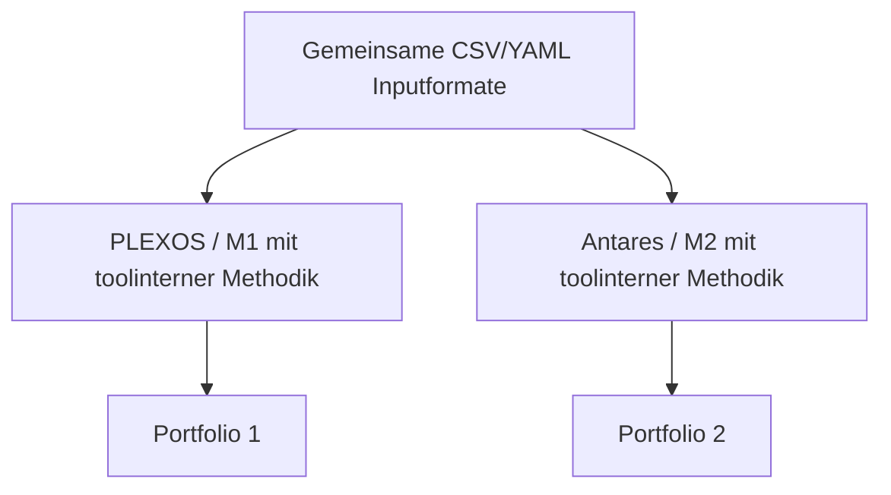
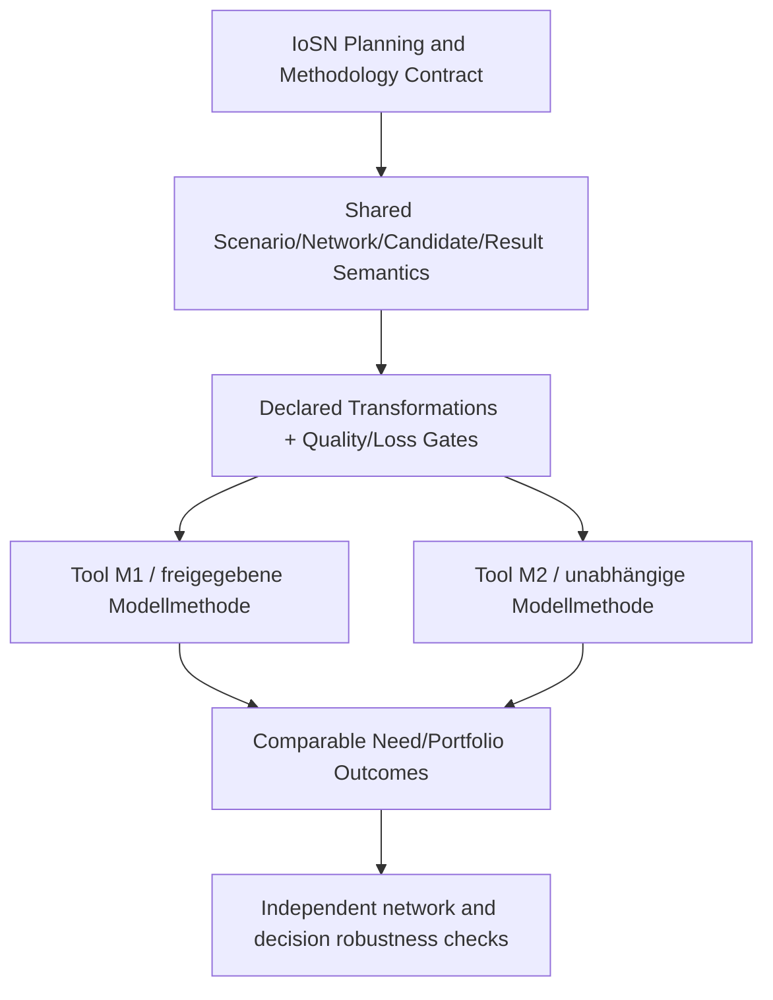
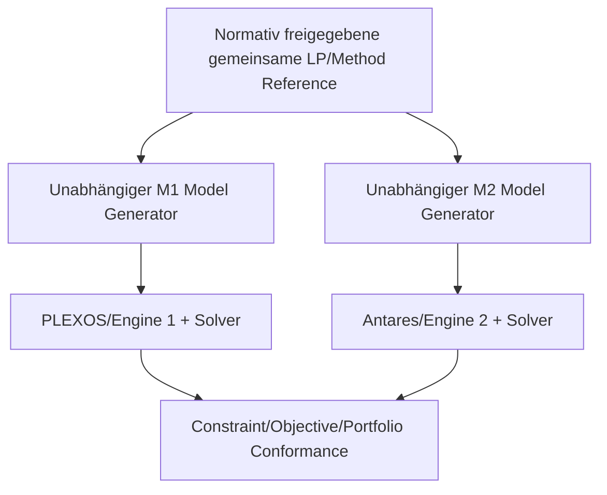
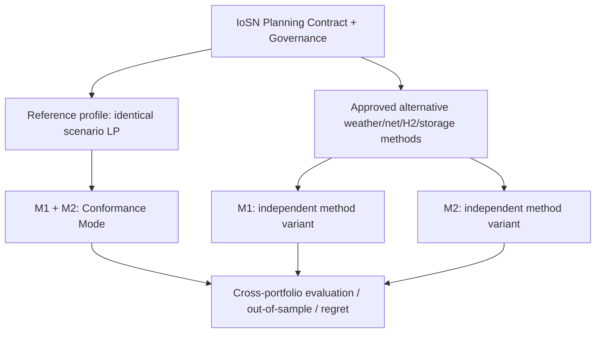

# Anwendung der Architekturen A/A+/B/B+ auf den IoSN-Prozess

**Stand 23.10.2026 · kritische fachliche Hypothesen, kein realer Antares-/PLEXOS-Benchmark.** IoSN ist ein **spezifischer Anwendungsprozess**, keine Modelling-Language-Produktentscheidung. Primäranker [S01 ``3.1/3.7–3.10/5.1](../sources/bibliography.md).

## 1. A — Gemeinsame Daten, implizit unabhängige Mathematik

**Pflichtgleichheit:** Formate, einige Identifikatoren. **Variiert:** Modellbedingungen, Clustering/Netzapproximation, Stufen, Szenariogewichte/Defaults, KPI. **Geprüft:** Parserfähigkeit und oberflächliche Endergebnisähnlichkeit. **Problem:** die zentrale gewichtete Nichtantizipativität kann sich unterscheiden, obwohl beide Tools „3 Weather Scenarios“ anzeigen.

**A-Gültigkeitsbereich:** ungeregelter, niedrigkritischer Datentransfer; **nicht** als alleinige IoSN-Kernarchitektur verantwortbar.

## 2. A+ — Gemeinsame Prozess-/Semantikverträge mit unabhängigen Toolmethoden

**Pflichtgleichheit:** Planungsfrage, Dataset-/Wetter-/Kandidatendefinition, Topologie/Busmap-Provenienz, zulässige Methodendifferenzen, Gewichte, Einheiten, Ergebnis- und Auditsemantik. **Variiert:** ausdrücklich registrierte Toolmethoden. **Geprüft:** nachvollziehbare Prozesskette, Fehlergrenzen und vergleichbare Bedarfsrangfolge bei zugelassenen Alternativen. **Problem:** Nichtantizipativität und Objective-Conformance sind damit **noch nicht** garantiert.

**A+-Rolle:** Querschnittsschicht über die heterogenen statistischen, Netz-/Physik-, Daten- und Optimierungsstufen. Nicht automatisch Sieger für den mathematischen Kern.

## 3. B — Vollständig explizite Referenzformulierung eines definierten Subproblems

**Pflichtgleichheit:** für **konkret abgegrenzte** Teilprobleme z. B. `x`, `pi_s`, Zielfunktion, Szenarionichtantizipativität, Kandidaten, Stufen, Netzgleichungen, Speicher/Sektorkopplung. **Variiert:** unabhängig implementierte Parser/Modellgeneratoren, numerische Solver. **Geprüft:** mathematische/Implementierungs-Konformität, nicht die Wahrheit des reduzierten Netzes oder Statistikauswahl.

**B-Rolle:** besonders wichtig für den **mehrszenariellen Ausbaukern**. „Vollständig explizit“ ist **Entwicklungsanforderung**; nicht als schon bestehender veröffentlichter ENTSO-E-Standard behauptet.

## 4. B+ — Referenz-Conformance PLUS freigegebene Methodendiversität

**Pflichtgleichheit:** B-Referenz **innerhalb Conformance Mode**; gemeinsame Planungs- und Bewertungsfrage über alle Varianten. **Variiert:** vorab genehmigte Wetterselektion, Zonierung/Reduktion, LF/OPF-Sensitivität, Wasserstoff-Betrieb u.a. **Geprüft:** getrennt implementierte Mathematik und Robustheit des **Systembedarfs**; nicht durch Ergebnisgleichheit allein.

**B+-Risiken:** Governance-/Adapter-Kosten, unklare Zulässigkeit alternativer Methoden in offiziellem Prozess, numerische Komplexität, falsche Robustheit bei gemeinsamen Daten-/Netzfehlern.

## 5. Bewertungsmatrix (qualitativ; keine willkürliche Punktearithmetik)

| IoSN-Kriterium | A | A+ | B | B+ |
|---|---|---|---|---|
| eindeutige Szenario-/Zeit-/Einheiten-/Candidate-Semantik | unzureichend | **nativ als Pflicht** | nur im vollständig expliziten Profil | **Pflicht** |
| offengelegte Zonen-/Netz-/Zeittransformation | optional | **erforderlich** | nicht durch LP-Referenz allein | **erforderlich** |
| strikte Nichtantizipativität `x` | versteckt | deklariert, ohne Algebra-Garantie | **prüfbar** | **prüfbar im Conformance Mode** |
| Zielfunktions-/Constraint-1:1 | selten | nur als optionales Profil | **Hauptstärke** | **Hauptstärke in Referenzmodus** |
| methodisch unabhängige Wetter-/Clustering-Alternativen | beliebig, oft nicht vergleichbar | **registriert** | nicht im Kernmodus | **registriert, explizit getrennt** |
| TYNDP-2026-Methodenstand/Governance | ad hoc | versionierter Process Contract | zusätzlich zur Mathematik nötig | Process-/Reference-/Variant Contracts |
| Fehlerrisiko durch gemeinsame falsche Reduktion | hoch | nur durch eigene physikalische Gegenchecks reduzierbar | **bleibt bestehen** | durch unabhängige Methoden potenziell reduzierbar |
| Migrationsaufwand bei existierenden Tools | niedrig | mittel | hoch, da exakte Mathematical Normal Form vorausgesetzt | sehr hoch |
| geeignet für technische **Entscheidungsrobustheit** | nein | möglich, wenn echter Methodenvergleich | **allein nein** | ja, unter realer Unabhängigkeit und freigegebenen Varianten |
| eignet sich für amtliche vollständige Reproduktion | nein | nur mit formalen Profilen und freigegebenem Verfahren | **wenn vollständig freigegeben und implementiert** | **wenn zusätzlich Varianten regulativ erlaubt** |

## 6. Wo welche Architektur im IoSN-Prozess?

| Prozessstufe | Benötigte Interaktion | Vorläufige Wahl | Wann B/B+ vorzuziehen? |
|---|---|---|---|
| PECD/PEMMDB/H₂ und Klima-/Profildaten | Tool-neutrale semantische Daten | **A+** | bei formal determinierter Wetterjahrauswahl zusätzlich B-Methodenprofil |
| Statistische Klimajahrselektion | nachvollziehbare 30→3-Selektion und Gewichte | **A+ + Algorithmusprofil** | B-Algorithmus zur exakten Reproduktion; **B+** für validierte alternative Selektoren |
| Dispatch→Netzclustering | unterschiedliche Repräsentationen, Engpassbehandlung | **A+ + Qualitätsvertrag** | B für eng definierte DC-/PTDF-/LODF-Kerne, B+ für Varianten |
| Ersatzimpedanzen/Kapazitäten | physikalisches Mapping und N-1 | **A+ + formale Teilmethoden** | B bei exakter Referenzkalibrierung; B+ zur Modellrisikoanalyse |
| Sektorale Last-/RES-/H₂-Aufteilung | identische Gesamtsummen und Portbezüge | **A+** | B bei festgelegten Elektrolyse-/Speicher-Gleichungen |
| Weighted multiweather Expansion LP | gemeinsame Bauentscheidung / Kandidatensequenz / Kosten | **B innerhalb A+-Contracts** | B+ wenn normierte Referenz und **zugelassene** Varianten koexistieren |
| LF/OPF- oder H₂-Freeze Sensitivität | unterschiedliche Modellfrage, gleiche Ausgangsdaten | **A+ Variantencontract** | **B+** für streng getrennte verifizierte Varianten |
| Ergebnis-/Bedarfsmeldung | gleicher Corridor/Bottleneck/Rang/Kostenbegriff | **A+**, B-Referenz wenn nötig | B+ für Cross-Regret/Out-of-sample |

## 7. Zwei Bewertungs-/Gewichtungsszenarien

**Gewichtung W1 – reproduzierbare offizielle IoSN-Kernrechnung:** höchster Stellenwert für gemeinsame Zielfunktion, Szenariogewichte, Nichtantizipativität, identische Kandidaten- und Stufenlogik, Feasibility. **B** kann im Ausbaukern besser sein als A+; B+ bietet hierfür allein keinen zusätzlichen Nachweis über B. Lücken in offizieller Vollformulierung sind ein **Stop-Gate**.

**Gewichtung W2 – methodisch belastbare langfristige Systembedarfe:** höherer Stellenwert für Klima-Holdout, Netz-/Zonierungsrobustheit, Sensitivität der Projektgruppen und Korridorrangfolge, Erhalt kritischer N-1-Engpässe, unabhängig bewertete Lösungen. **B+ oder A+ plus freigegebene B-Referenzprofile** sind aussichtsreicher als ein nur eindeutiges B. Mehrere zulässige Modelle können dennoch dieselben Fehler teilen.

**Sensitivität:** je stärker die Vorgabe **eine mathematisch identische** LP-Instanz verlangt, desto eher B. Je stärker die Kette **heterogene Vorverarbeitung** und **konkurrierende methodische Varianten** legitim integrieren muss, desto eher A+/B+. Keine erfundene aggregierte Scorezahl; regulatorische Muss-Kriterien sind nicht kompensierbar.

## 8. Zwei oft übersehene Fehlbewertungen

1. „PLEXOS und Antares liefern ähnliche Drei-Knoten-Ergebnisse, also ist 2026er Ausbau robust.“ **Unzulässige Generalisierung.** Die `5.1-Sanity Cases betreffen statischen Dispatch, nicht dieselbe zwei-stufige Optimierung mit drei Wetterjahren und Kandidatenfiltern.
2. „Ein fehlerfreies `A_z Gamma = P A_d` beweist gleiche Investitionsbedarfe.“ **Falsch.** Knotenbilanz ist eine schwächere Eigenschaft als PTDF-/N-1-/Kosten- und **Portfolio-Entscheidungsäquivalenz**.

**Entscheidung:** siehe [ADR](recommendation_adr.md); konkret umsetzbare falsifizierende Tests: [requirements_and_tests.md](requirements_and_tests.md) und [pilot_plan.md](pilot_plan.md).
