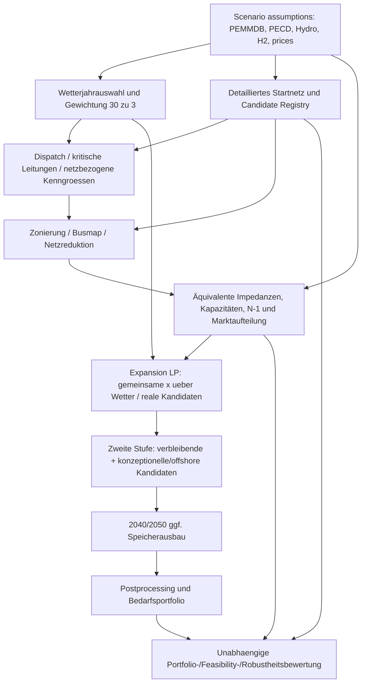

# IoSN Process-first Interoperation und Handoff-Verträge

**Scope:** ENTSO-E TYNDP 2026 IoSN gemäß der **Konsultationsfassung 25.02.2026**, [S01 ``3.1,3.6–3.10/5.1/Annex 6.1 und 6.3](../sources/bibliography.md). Dies ist eine **fachliche Rekonstruktion von Abhängigkeiten**, kein behaupteter originaler ENTSO-E-Workflowcode oder dessen exakte Laufreihenfolge. Die bereits vorliegende wissenschaftliche Repository-Forschung [R03–R08] dient nur zur Formulierung von **prüfbaren** Qualitätsmerkmalen.

## 1. Prozessgrenzen und Datenketten

**Warnung:** `Zonierung` und `Wetterauswahl` können in Forschung/Produktion iterativ oder mit vorberechneten Referenzen ablaufen. Das Diagramm legt funktionale **Datenabhängigkeiten** offen und beansprucht keine interne ENTSO-E-Orchestrierung. `H2` ist in der Konsultationsfassung als exogenes Infrastrukturgerüst mit operativer Kopplung modelliert, nicht als ohne Weiteres endogen neu aufzubauendes H₂-Netz.

## 2. Handoff-Matrix mit Test- und Verlustsemantik

| Übergabe | Quelle → Ziel | Darstellungswechsel / notwendige Identitäten | Erlaubter Verlust | Validierung / Criticality |
|---|---|---|---|---|
| H01 | Szenarioplanung → IoSN-Inputs | `study_year` 2035/40/50; PEMMDB-/PECD-/Hydro-/H₂-Version; Region, Technologie, Unit, Currency; Zeit und Profil | **kein** unmarkierter Daten-/Methodenverlust | Input-Hash, Id-Konsistenz, gemeinsamer Energie-/Kapazitätsmaßstab; P0 |
| H02 | 30 Klimajahre → 3 repräsentative | Source-climate ID, vollständiges synchrones Jahr, Variablen/Features, PCA/KMeans, Seed, Clusterrepräsentanz, Gewichte `pi_s` | nur **freigegebene statistische Reduktion**, nicht „exakt“ | Jahre/Stunden/Correlations/Weights/holdout; P0 |
| H03 | Detailnetz+Dispatch → kritische Leitungen | AC-Knoten, Leitungen, Transformatoren, PST/HVDC, MW/pu, Stunden, `overload_energy` | keine unbemerkte Auslassung kritischer Engpässe | Fehlersummen, Rang/CNEC-Abdeckung, asset IDs; P0 |
| H04 | detailliertes Netz → Zonenbusmap | `busmap`, Inzidenz `A_d`, Aggregation `P`, Cut-Operator `Gamma`, Netzreferenz | rein topologische Verdichtung **mit expliziter Güteprüfung** | `A_z Gamma = P A_d`, Zonenkonnektivität, Bilanz; P0 |
| H05 | Zonen + Flüsse → äquivalentes Netz | Ersatzreaktanzen, no-load/correction flows, saison-/richtungsabhängige Sicherheitslimits, Referenzeinspeisungen | **approximierte Flussabbildung**, kein 1:1 Netzmodell | Flow-RMSE plus Tail/critical constraint recall, LODF/N-1, islanding; P0 |
| H06 | detaillierte Anlagen/PECD → zonales Marktmodell | `original_bus_id`, `zonal_bus_id`, demand-type, RES capacity, PECD source region, asset dispatch, Elektrolyse | explizite, bounded Aggregation/Disaggregation | Kapazität und Energie, Profile, max/min, Zeitbilanz; P0 |
| H07 | zonales Marktmodell → Expansion M1/M2 | identisches Startnetz, real candidates/IDs, 3 Wetterjahre, `pi_s`, `x`, costs/limits, LF/OPF, stage ids | für **B Conformance: NONE**; für A+/B+ nur deklarierte Unterschiede | objective, constraints, nonanticipativity, MIP/LP status; P0 |
| H08 | LP Stufe 1 → Stufe 2 | vollständig, teilweise, nicht gebaute Kandidaten; Filter, maximale Potenziale; neue Konzept-/Offshorekandidaten | nur durch **freigegebene Stage-Regel** | kein verlorener/duplizierter Kandidat, gleiche Bounds/Costs; P0 |
| H09 | LP → Storage-Profile | Zieljahrabhängigkeit (Speicherausbau 2040/2050), Duration/Energy/Power, Speicher-Endbedingungen | methodisch genehmigte Vereinfachungen | SOC-Energiegleichung, Terminal-/Cyclicity, Investitionsgrenzen; P0 |
| H10 | fertiges Portfolio → LF-/OPF-/N-1-Bewertung | candidate IDs, gebaute x, nodal/zonal Mapping, constrained/internal limits, Wetter/Ausfallliste | zulässige physikalische Näherung **explizit** | feasibility, constraint violations, Energie, Sicherheitslimits; P0 |
| H11 | toolinterne Resultate → Systembedarfsbericht | Corridor-ID/Regionen, MW, CAPEX/OPEX, unmet demand, constraints, uncertainty/confidence, method/scenario ID | KPI-Umformung nur mit belegter Semantik | Rangfolge, Worst-Case, Regret, reproducibility; P0 |

**Kritischer Spezialfall:** `H04` ist in der **Bilanz** exakt möglich, während `H05` häufig physikalisch/ökonomisch **nähernd** ist. Wer das zu einem generischen `exact_network_translation` zusammenzieht, verdeckt die eigentliche Risikostelle.

## 3. Gemeinsame normative IoSN-Studiensprache: minimal, aber ausreichend

Jeder Handoff braucht mindestens ein maschinenlesbares Manifest mit:
- `study_contract_id` und **Quellenfassungsstatus** (Konsultation vs freigegeben), `study_year`, `dataset_hashes`, Szenario-/Klimajahr-ID mit `pi_s` und Verweis auf Auswahlalgorithmus/Seed;
- `physical_network_id`, `zone_model_id`, eindeutige nodale/zonale Port-/Asset-/Korridoridentitäten; `unit`, `sign`, `slack_reference`, Zeitauflösung, `duration_hours`;
- `method_id` **je** Clustering, Netzreduktion, PST/HVDC, LF/OPF, Speicher, H₂-Kopplung, Optimierungsstufe; plus jeweilige Konfiguration und Default-Liste;
- `candidate_registry_hash` mit Baugrenzen/Kosten/Szenarioabhängigkeit; Kennzeichnung, ob die Investitionsentscheidungen s-unabhängig sind;
- `transformation_id` mit Coverage, `loss_class`, Qualitätsmetrik, Referenzflächen, Fehlergrenzen, Approvals, Vorher-/Nachher-Hash;
- `engine_version`, Modellerzeuger, Solver/Gap/Seed, Run-Input/Output-Hashes und getrennte `validation_status`-Felder.

**Trennung:** Eine gemeinsam codierte `Line`-Komponente ist weder Beweis, dass die zonale Ersatzimpedanz stimmt, noch dass die N-1-Kapazität ausreichend streng ist. Diese beiden Verfahrensfunktionen sind eigene Method- und Validation-Contracts.

## 4. Drei unterschiedliche Zielformulierungen

**4.1 Identische Algebra (B-Conformance):** prüfbare Referenz in vereinfachter allgemeiner Form,

\[
\min_{x,\{y_s\}} c^\top x + \sum_{s\in S} \pi_s f_s(y_s)
\quad \text{s.t.}\quad A_s y_s + B_s x \ge b_s,\; 0\le x\le \bar x ,
\]

mit **einmaligem** `x` für alle `s` (Nichtantizipativität). Die Formel ist ein **abstrahierendes Review-Schema**, nicht die vollständige ENTSO-E-Implementierung. Positive `pi_s`, `sum(pi_s)=1` und Stufen-/Speicher-/Netzrestriktionen müssen detailliert vereinbart werden.

**4.2 Prozessinteroperation:** Quelldaten + freigegebene Transformation können verschiedene interne LPs erzeugen. Zulässig nur, wenn die Planning- und Result-Semantik trotz erlaubter Unterschiede explizit vergleichbar sind; „Loss = exact“ darf nicht vorgetäuscht werden.

**4.3 Methoden-/Entscheidungsrobustheit:** verschiedene freigegebene `clustering_id`/`weather_selector_id`/`network_profile_id` ergeben **verschiedene Optimierungsinstanzen**. Man testet die Stabilität der Systembedarfsentscheidung, **nicht** die 1:1-Übersetzung.

## 5. Welche Teile Sprachen/Tools allein nicht lösen

Eine Modellierungs-DSL kann die Formulierung von `x` und Knotenbilanzen vereinheitlichen. Sie legt nicht automatisch fest:
- den regulatorisch gültigen IoSN-Konsultations-/Freigabestand;
- welche Klimajahre nach welchem statistischen Verfahren repräsentativ ausgewählt werden;
- welche Busmap/Referenzdispatch die netzphysikalisch kritischen Engpässe bewahrt;
- welche Feasibility-/Security-/Residualschwellen akzeptabel sind;
- welche Infrastrukturbedarfe und Portfolios unter einem **gemeinsamen** Vergleichskontrakt kommuniziert werden dürfen.

**Entscheidungsschutz:** Für H02/H04/H05/H08 darf ein allgemeiner Adapter *nie* still in eine mathematisch andere Approximation wechseln. Status: `EXACT_VERIFIED`, `APPROVED_APPROXIMATION`, `NON_SEMANTIC_LOSS`, `UNSUPPORTED` oder `UNKNOWN`.
