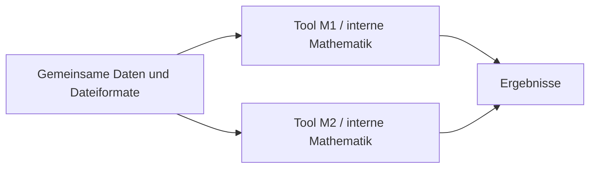
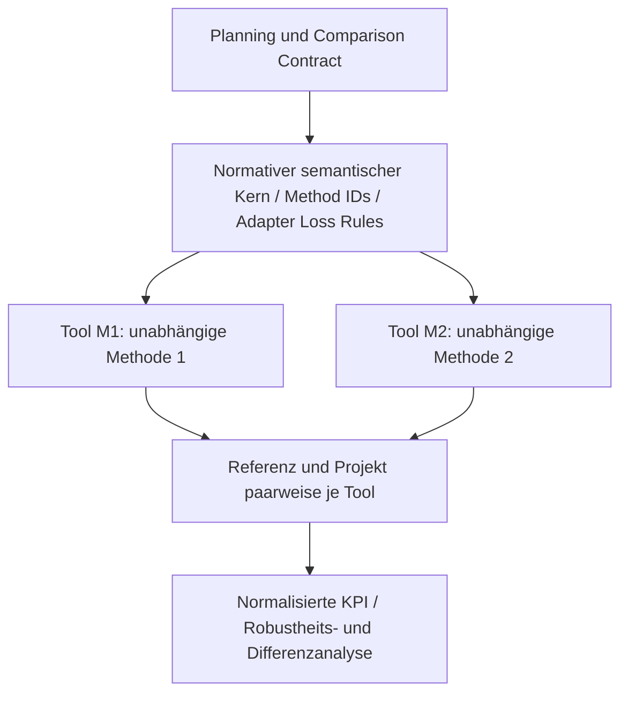
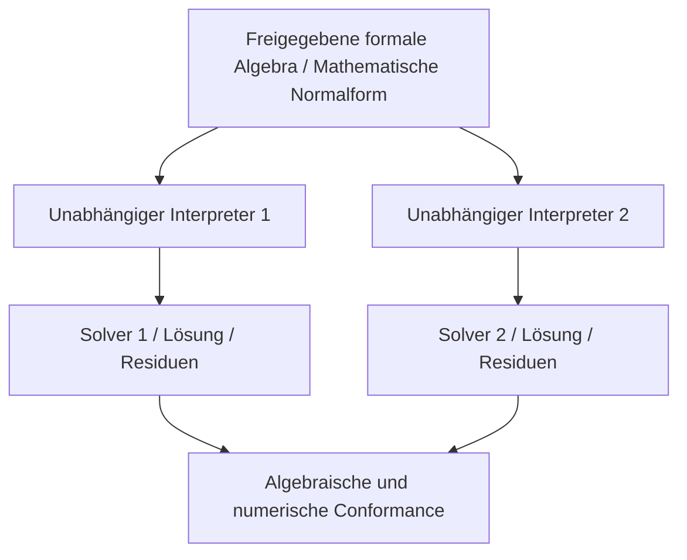
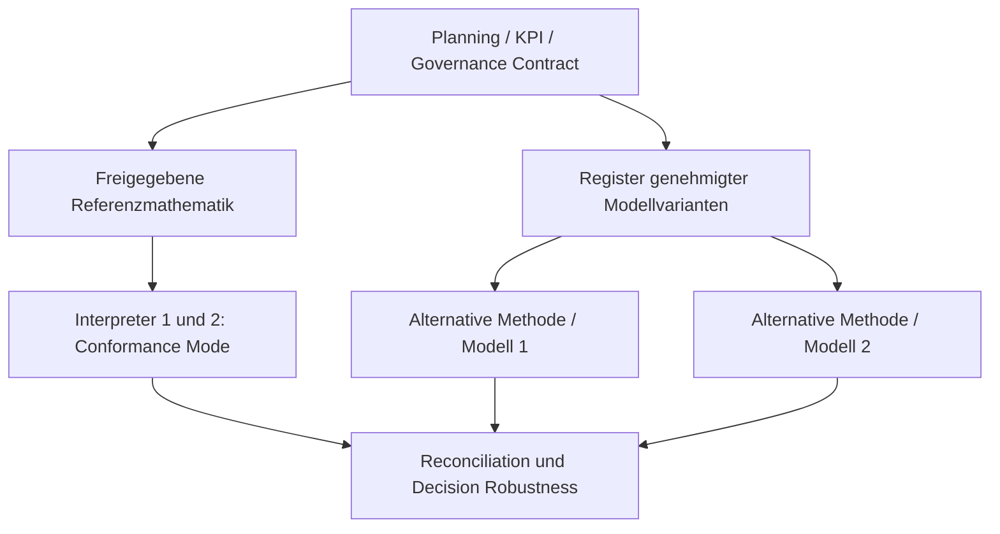

# Architekturvergleich A / A+ / B / B+ — Design-Review

**Status:** Arbeitsentwurf, keine nachgewiesene Multi-Tool-Zertifizierung. Für CBA ist zu unterscheiden zwischen einem *unabhängigen Gegenmodell* und einem *Interpreter derselben Referenzmathematik*.

## 1. Definitionen und High-Level-Diagramme

### A — Datenaustausch, toolinterne Mathematik

**Gleich:** Format und einige Benennungen. **Variabel:** Defaults, Methodik, Parametersemantik, KPI. **Geprüft:** höchstens technische Datenkompatibilität; **keine** mathematische Äquivalenz oder CBA-Vergleichbarkeit.

### A+ — semantischer Kern und freigegebener Comparison Contract

**Gleich:** Planungsfrage, Szenarioidentität, semantische Größen, Zeit-/Raum-Referenzen, Referenz-/Projektfall, KPI-Funktion, zulässige Methodendifferenzen, Provenienz. **Variabel:** ausdrücklich zugelassene Toolmathematik/Modellstruktur. **Geprüft:** Interoperation und (nur bei tatsächlich variierten Methoden) methodische Robustheit; *nicht* automatisch exakte Gleichheit der Algebra.

### B — verpflichtende Referenzmathematik

**Gleich:** Variablen, Indizes, Gleichungen, Zielfunktion, Daten-/Szenariowerte. **Variabel:** Parser/Modellgenerator/Solver (soweit unabhängig). **Geprüft:** Conformance, numerische Stabilität; **nicht** die Entscheidung gegen andere plausible Methoden und **nicht** der Wahrheitsgehalt der gemeinsamen Fachgleichungen.

### B+ — Referenzmathematik mit genehmigten Alternativmethoden

**Gleich:** freigegebene Ausgangsformulierung *innerhalb Conformance Mode*, gemeinsame CBA-Frage, Methodenidentitäten, Berichtspflichten. **Variabel:** in separatem Robustness Mode ausdrücklich zugelassene Formulierungen. **Geprüft:** getrennte Konformität und methodische Entscheidungsrobustheit. **Risiko:** hoher Zulassungs-, Change- und Prüfaufwand.

## 2. Diversitätsdimensionen

| Ebene | Beispiel | Prüft vor allem | Prüft nicht |
|---|---|---|---|
| Solverdiversität | gleiches LP, HiGHS vs kommerzieller Solver | numerische Stabilität, Implementierungsfehler | gemeinsame falsche Gleichungen |
| Implementierungsdiversität | gleicher formaler Code, zwei unabhängig geschriebene Modellgeneratoren | Parsing/Lowering/Abbildungen | methodische Unsicherheit |
| Methoden-/Strukturdiversität | Transport vs DC/PTDF; Speicher zyklisch vs freie Grenze | Sensitivität gegenüber Modellannahmen | automatisch gleiche Planungsfrage |
| Szenariodiversität | Varianten Nachfrage/Erzeugung/Wetter/Policy | Zukunftsunsicherheit | Methodenunsicherheit |

**Technisch entscheidend:** Wenn M2 ausschließlich ein von M1 generiertes LP übernimmt, ist der zweite Solver **keine unabhängige mathematische Modellimplementierung**.

## 3. Vergleich (qualitativ, ohne erfundene Score-Summen)

| Prüfkriterium | A | A+ | B | B+ |
|---|---|---|---|---|
| gemeinsame Datenstruktur | ja | ja | ja, in DSL integriert | ja |
| durchgesetzte einheiten-/rollenbezogene Semantik | selten | **notwendiger Kern** | durch DSL/Profil, zusätzlich nötig | durch DSL/Profil plus Vergleichsvertrag |
| zwingende gleiche Algebra | nein | nein | **ja** | im Conformance Mode ja |
| unabhängige Methoden möglich | ja, ungeordnet | ja, kontrolliert | nicht im Kernmodus | ja, als registrierte Profile |
| mathematische 1:1-Prüfung | schwach | optionales Profil | **stark bei bewiesener Konverter-/Interpreterabdeckung** | stark im Conformance Mode |
| Common-Mode-Risiko | toolseitig | Daten-/Contract-seitig | **gemeinsame Referenzalgebra** | gemeinsame Referenz plus Variantenrisiken |
| CBA/Decision Robustness | nicht gesichert | prüfbar bei genehmigten Variationen | durch B allein **nicht** | prüfbar, falls echte unabhängige Varianten |
| organisatorischer Aufwand | niedrig | mittel–hoch | hoch bei Heterogenität | sehr hoch |
| Wann passend? | nicht-kritischer Datentransfer | heterogener TYNDP-/NEP-Vergleich | definierte 1:1-Modellklasse | reguliertes Verfahren + zulässige Varianten |

## 4. Zwei Gewichtungsszenarien ohne Scheingenauigkeit

**Szenario W1 – CBA-Interoperation und Entscheidungsrobustheit:** Kritische Kriterien = gemeinsame B1/B6-KPI, Referenz-/Projektfall-Parität, unterschiedliche Toolmethoden unter selben Szenarioverträgen, sichere Transformation und überprüfbare Ergebnisse. Kosten/Governance ebenfalls relevant. **A+** wird dadurch plausibler, **B+** bei zwingender Referenzgleichung ebenso. *Kein numerischer Score*, bevor Stakeholder Präferenzen und Constraints freigegeben haben.

**Szenario W2 – mathematische 1:1-Konformität:** Kritische Kriterien = explizite Modellgleichungen, unveränderte Zielfunktion, prüfbare Indizes und Solver-Klasse, Round-Trip, abhängige Variablen und Stochastik. **B** oder **B+ im Conformance Mode** kann hier A+ klar dominieren. A+ ohne formales Profil erfüllt das Muss nicht.

**Sensitivität der Empfehlung:** Ändert sich die Leitfrage von „vergleichbare Planungsentscheidung unter methodischer Vielfalt“ zu „identische LP/MILP-Formulierung zwischen Engines“, kippt die Präferenz. Besteht eine strikt verordnete normative Referenzmathematik, darf unabhängige Methodik **nicht** deren verbindliche Konformität ersetzen.

## 5. Alternativen für einen Minimal-Semantikkern

| Merkmal | Metamodell X: sieben Fachtypen | Metamodell Y: generische Klassen |
|---|---|---|
| Kernklassen | Bus, Load, Generator, Storage, Line, Link, Converter | Balance/Node, Port, Commodity, Process/Unit, Connection, Storage, ProfileRef |
| Erweiterung auf Wasserstoff/Wärme | weitere komponentenspezifische Sonderfälle | generische Port- und Prozessbeziehungen; physikalische Spezialmethoden optional |
| Eindeutigkeit | intuitiv, aber vermischt Gerätetyp und Formulierung | weniger implizite Gerätetypannahmen; benötigt klare Port-/Bilanzregeln |
| Elektrische Leitungsphysik | Line als explizite Spezialklasse | Connection plus `electrical_network_profile` (CGMES/PTDF/AC) |
| Risiko | wachsender Katalog, unklare Defaults | zu abstrakt, konkrete Netzsemantik kann verloren gehen |
| Nachweis | Konverterprüfungen pro Komponente | Referenz-/Port-Konsistenz + Spezialprofilprüfungen |

**Vorläufige Empfehlung:** Modell Y als zu pilotierende Kernabstraktion, ohne die gesonderte elektrische Netzmodellierung in diesem Kern zu verflachen. Ob Y tatsächlich *minimal und semantisch ausreichend* ist, bleibt bis zu Strom-/H₂-/Wärme-Konvertierungsfällen offen. CESM [S06] bietet dafür einen realen Anknüpfungspunkt, ohne dadurch automatisch alle Requirements zu erfüllen.

## 6. GEMS als Normalform — falsifizierbare Aussage

**Nicht „GEMS ist zu komplex“**. Sondern: Eine vollständige ausführbare Algebra ist für einen bloßen Prozess-/Datenaustauschvertrag möglicherweise **mehr als notwendig**; für ein formales 1:1-Profil ist sie eine **notwendige Präzisierung**. Fachliche CBA-Regeln (Datenfreigaben, Benchmarking, Referenzfälle, KPI-Aggregation, erlaubte Methoden, Governance) bleiben **oberhalb** oder **neben** der GEMS-Formulierung; nicht alle werden allein durch DSL-Taxonomien gewährleistet.

**Falsifikation:** Wenn ein GEMS-orientiertes B+-Profil nachweislich mit gleichwertigem oder geringerem Gesamtaufwand unabhängig entwickelte Tools integrieren kann, ohne zulässige Methoden zu verhindern, ist die allgemeine A+-Präferenz nicht mehr zu halten.

Quellen und Reifegrenzen: [Bibliographie](../sources/bibliography.md); Review-Findings: [findings.md](../review/findings.md).
