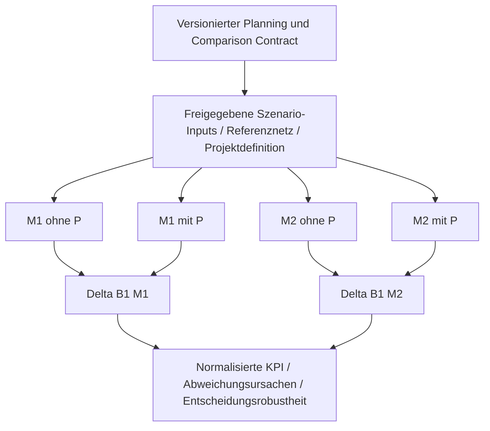
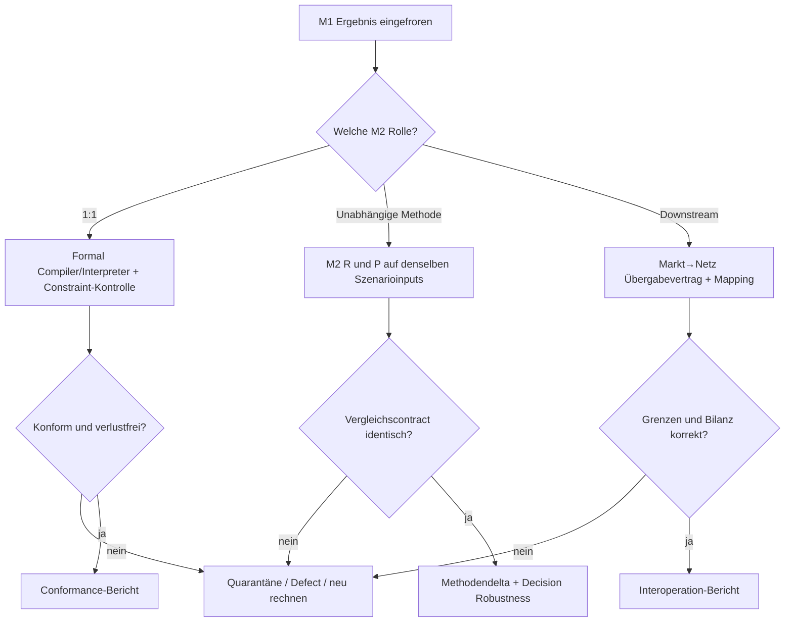

# CBA Scenario Interoperation — M1, M2, Modellfehler, Robustheit, Übersetzung

**Zweck:** fachlich durchführbarer Interoperationsvergleich mehrerer Energiesystemmodelle für eine **CBA-Planungsfrage**. Die IoSN-Algorithmen des Stammrepositories sind ausdrücklich **kein** Bestandteil dieser Szenariountersuchung.  
**Status:** prüfbare Use-Case- und Testdesigns, **nicht** experimentell durchgeführt. Normative Basis: ENTSO-E 4th CBA Guideline [S01], B1 `5.1, B6 `5.6. TYNDP-2026-spezifische Details aus **Konsultationsentwurf** [S02] sind keine bestätigten finalen Regeln.

## 1. Der zentrale CBA-Vertrag

Eine *vergleichbare Planungsfrage* ist beispielsweise: „Welchen Nutzen hat das **gleiche** Interkonnektorprojekt P gegenüber **dem gleichen** freigegebenen Referenzsystem R im Szenario S, Jahr Y und unter derselben KPI-Konvention?“

Für jedes Modell `m` und Szenario `s` sind **beide Fälle** zu rechnen:

- `W(m,s,R)` = wohlfahrtskonsistentes Referenzergebnis **ohne** Projekt.
- `W(m,s,P)` = wohlfahrtskonsistentes Ergebnis **mit** Projekt.
- `Delta_B1(m,s) = W(m,s,P) - W(m,s,R)`; bei einer *zulässigen und belegten* vereinfachten Kostenmethodik ist dies unter passenden Annahmen auch als `Cost(m,s,R) - Cost(m,s,P)` berechenbar.
- Aggregation erst nach Freigabe einer gleichen Szenario-/Wettergewichtung: `B1(m)=sum_s p(s)*Delta_B1(m,s)`, `sum_s p(s)=1`.
- *Nicht erlaubt:* `W(M2,s,P)-W(M1,s,R)`. Auch identische Preise, Kostenbegriffe oder Ergebnisnamen allein rechtfertigen keine Vermischung.

Die B1-Definition umfasst Verbraucherrente, Produzentenrente und Übertragungs-/Congestion-Rent bzw. bei Sektorkopplung das globale SEW. Eine reine Brennstoff-/Erzeugungskostendifferenz ist **nicht allgemein** identisch mit dem vollständigen SEW. [S01, `5.1; S02, `5.1 Entwurf]

Die Identität „gleiches Szenario“ umfasst nicht nur den Szenarionamen, sondern Input-Digest und räumlich/zeitlich referenzierte Werte, Einheiten, Behandlung von Nachfrage, Klimajahren, Wahrscheinlichkeit, Discounting und den gemeinsamen Projekt-Eingriff.

## 2. Was bedeutet „M1 ist fertig — was machen wir mit M2“?

**Zuerst muss die Rolle von M2 feststehen**, sonst ist der Vergleich logisch unbestimmt:

| Variante | M2 erhält | M2 soll tun | Welche Aussage ist zulässig? | Was bleibt offen? |
|---|---|---|---|---|
| **M2-R1: 1:1-Reimplementierung** | formale Variablen, Gleichungen, Ziel, Zeit-/Szenariodaten (ggf. über DSL) | **genau dieselbe** mathematische Aufgabe unabhängig implementieren und lösen | mathematische/Implementierungs-Konformität (bei unabhängigen Modellgeneratoren) | Modellstrukturfehler der gemeinsamen Gleichung, Entscheidung unter alternativen Methoden |
| **M2-R2: unabhängiges Gegenmodell** | **freigegebene gemeinsame CBA-Inputs und Methodenspielräume**, **nicht** M1s bereits kalibrierte Gleichungen | eigenes R/P-Paar berechnen; dokumentierte alternative Netzdarstellung/Speichermethode etc. | Sensitivität gegenüber **zulässiger** Methodendiversität; mögliche Robustheitsprüfung | exakte 1:1-Äquivalenz darf nicht behauptet werden |
| **M2-R3: nachgelagerte Engine** | explizit definierte M1-Outputs (z.B. zonale Dispatch-/Exchanges) mit Mapping in Netzmodell | zusätzliche Netz-/Redispatch-/AC-/N-1-Rechnung und Rückmeldung | **Prozessinteroperation**, eventuelle Plausibilität des übertragenen Zustands | **keine** unabhängige Markt- oder B1-Bestätigung |
| **M2-R4: alternativer Solver** | **dasselbe bereits generierte** LP/MILP von M1 | lösen | numerische Stabilitätsprüfung / Solverdiversität | keine unabhängige Implementierung der Algebra oder Methode |

**Aufbau nach Abschluss von M1:**
1. M1-Baseline und Projektfall **einfrieren**, inklusive Version/Hashes, Tool, Solver, Modelllogik, Seeds, Inputdaten, Gewichte, Parametrierung, Ergebnisqualitätsmetriken.
2. Planning Contract/Szenarioinventar und **M1-Methodenbeschreibung** gegen den fachlichen Auftrag prüfen. Bei Fehlerfund **nicht** als unfehlbare Referenz veröffentlichen.
3. Für **R1** gemeinsamen formalen Problemcontract exportieren, M2 separat implementieren, Constraint-/Objective- und Lösungsmatching prüfen; Converter-Loss-Report zwingend. Für **R2** M2 unabhängig aus denselben freigegebenen Szenariodaten rekonstruieren, zulässige Methoden vorab registrieren und **beide** R/P-Fälle lösen. Für **R3** nur wohldefinierte Schnittstellengrößen übertragen, Netzphysik und Mapping getrennt validieren.
4. Differenzen zunächst in **Daten → Semantik → Methode → Lösung/Optimalität → KPI-Berechnung → Szenariogewicht** zerlegen. Kein erzwungenes „Fitten“ von M2 an M1 ohne Kennzeichnung.
5. Nur **innerhalb desselben Plans/Methoden-/Szenarioprofils** CBA-Δ berechnen; Abweichungen zwischen M1/M2 gesondert als Modellrisiko berichten.

### Warum zwei Läufe von M1 nicht automatisch „M2“ ersetzen

Ein Fehler in der gemeinsamen Szenariodatei, ein zu niedrig gesetzter VOLL, ein nicht berücksichtigtes Netzlimit oder ein falscher Speicher-Endzustand kann auch von allen Interpretern **identisch** übernommen werden. Unabhängigkeit braucht zusätzlich **Datenprüfung, unabhängige Referenzbenchmarks und zugelassene methodische Alternativen**.

## 3. Fehlerklassen und Detektionswirkung

| Fehlerart | Beispiel | Wird von M2-R1 gefunden? | Wird von M2-R2 gefunden? | Pflichtreaktion |
|---|---|---|---|---|
| F-DATA | gleiche Lastzeitreihe falsch skaliert, MW statt GW | typischerweise **nein**, weil identische Inputs | nicht sicher, falls gleicher Datenursprung | unabhängiger Einheiten-/Bilanz-/Plausibilitätscheck, Quarantäne aller betroffenen Runs |
| F-ALG | Speicher-Bilanzgleichung oder Zielfunktion in gemeinsamer DSL falsch | **nein**, wenn identisch interpretiert | **möglicherweise**, nur bei strukturell unabhängiger Methode | analytischer Mini-Benchmark, physikalische Invarianten |
| F-IMPL | M1-Interpreter ignoriert Nebenbedingung | **ja**, bei unabhängiger M2-Implementierung und Constraints-Checks | oft sichtbar, aber Methode könnte Unterschied erklären | reproduzierbarer Defect, Fix, R/P-Neurechnung |
| F-TRAN | Link-Port, Gewicht oder Speichergrenze beim Transfer verworfen | **ja**, sofern symbolisches Matching die Funktion abdeckt | eventuell, aber nicht automatisch lokalisierbar | fail-closed Conversion; Diff und Feature-Coverage |
| F-METHOD | M1 zyklischer Speicher, M2 ohne terminale Bedingung | im Conformance-Modus **unzulässig** | als explizit zulässige Alternative **auswertbar** | Method-ID, Szenario-/KPI-Parität und Robustheitsbericht |
| F-KPI | M1 beinhaltet Emissionskosten zweimal; M2 nicht | nur wenn KPI-Formel normiert/validiert ist | ggf. Differenz, Ursache unklar | eigenständiger KPI-Rechner, Double-counting-Check |
| F-NET | nodale Einspeisungen verloren beim Zonen-Mapping | nein, falls derselbe Fehler als „Input“ genutzt wird | ggfs. durch andere Granularität | Erhaltungs- und Boundary-Tests, Rückübertragung |

**Governance-Regel:** Wird ein Fehler gefunden, wird eine `defect_id` eröffnet, alle betroffenen Ergebnispaare auf `QUARANTINED` gesetzt, der Fehlerumfang bis zum Contract/Transformation-Herkunftspunkt verfolgt und **jeder betroffene Referenz- *und* Projektfall** reproduzierbar neu gerechnet. Alte CBA-KPIs erhalten einen Superseded-Verweis, statt still überschrieben zu werden.

## 4. Verpflichtende CBA-Use-Cases

### UC-CBA-01 — B1/SEW: Interkonnektor, M1 versus M2

- **Planungsfrage:** Verändert P den europaweit konsistent definierten SEW, und bleibt der Nutzen unter zwei zulässigen Marktmodellformulierungen positiv?
- **Gemeinsam:** R/P-Projektdefinition, Studienjahr, Klimazeitprofile und Gewichte, Last-/Erzeugungsannahmen, Emissions-/Brennstoffpreise, Währungsbasis, räumliche Betrachtungsgrenze, KPI-Konvention.
- **Variationen:** alternative zulässige Unit-Commitment-/Speicher-/Netzformulierungen, **nur** wenn Method Profile deren Gleichwertigkeitsgrenzen benennt.
- **Transformationen:** Szenariodaten→M1/M2; räumliches Mapping; standardisierter Welfare-/Kosten-KPI-Export.
- **Tests:** Inputs/Zeitschritte/Einheiten, Dualität/Optimalitätsgap, R/P-Pairing, doppelte Wohlfahrts-/CO₂-Erfassung, Delta-Vergleich; Ergebnis: `MATCH`, `METHOD_DIFFERENCE`, `NON_COMPARABLE` oder `ERROR`.
- **Architektur:** A+ für vergleichbare Methodenvielfalt; B/B+ Conformance bei gleicher Referenzmathematik. Normanker [S01] `5.1, 2026-Detail [S02] `5.1 **Entwurf**.

**Explizit illustratives Gedankenexperiment, kein TYNDP-Ergebnis (Mio. €/Jahr):**

| Modell (jeweils eigenes R/P-Paar) | Cost R | Cost P | Δ B1 (vereinfachter Kostenansatz, nur unter dessen Voraussetzungen) | illustrative jährliche Projektkosten | Indikatives Nettosignal |
|---|---:|---:|---:|---:|---:|
| M1 (Methode A) | 1 000 | 920 | +80 | 50 | +30 |
| M2 (Methode B) | 1 030 | 1 000 | +30 | 50 | -20 |

**Konsequenz:** Das Projektsignal kehrt sich um. *Ohne Method Profile, Fehleranalyse und zulässige Unsicherheitsregeln* ist dies **weder** ein bewiesener M1-Fehler **noch** ein Beweis, dass das Projekt „nicht robust“ ist. Zunächst müssen Wohlfahrtsdefinition, Bilanz, R/P-Baselines und Modellansatz abgeglichen werden. Projektkosten werden hier nur illustrativ vereinfacht; vollständige CBA benötigt freigegebene Wirtschaftlichkeitsrechnung, Zeitprofil und Abzinsung.

### UC-CBA-02 — B6/Adequacy: seltene Ereignisse, M1/M2

- **Planungsfrage:** Wie stark senkt P das `Expected Energy Not Supplied` (EENS) unter adequacyrelevanten Klima-/Ausfallszenarien?
- **Gemeinsam:** Modellperimeter, Nachfragereferenz, Klimasatz, zufällige Kraftwerks-/Netzausfälle, Stichprobenkonvention, VOLL, LOLE/EENS-Rechenregeln, R/P-Paarung, Sampling-Unsicherheiten.
- **Variationen:** nach Genehmigung alternative Adequacy-Algorithmen/Monte-Carlo-Mapping; keine substituierte reine Drei-Wetterjahre-B1-Näherung.
- **KPI:** `EENS_avoided = EENS(R)-EENS(P)`, Monetisierung mit freigegebenem VOLL, sofern normativ zulässig und Doppelzählung ausgeschlossen.
- **Tests:** Seed-/Common-Random-Numbers, Konvergenz-/Konfidenzintervall, Extremwertdeckung, B6-Methodenversion, Projekt-gegen-Referenz-Paarung.
- **Architektur:** A+ oder B+ für verschiedene Adequacy-Methoden; B für explizit gleiche MC-/Adequacy-Referenzformulierung. Die genehmigte 4th CBA Guideline fordert MC-basierte Adequacy [S01, `5.6]. Angaben des 2026er Entwurfs zu 35 Klima-Jahren/hunderten Proben **nicht automatisch als finale Vorgabe** verwenden [S02, `5.6].

### UC-CBA-03 — Modellfehler: Speicher-Endzustand / impliziter Default

- **Fehler:** M1 fixiert `SOC(T)=SOC(0)`, M2 setzt terminalen SOC frei; alle übrigen Komponentenparameter sind gleich. Die Endenergie ist im ersten Fall nicht kostenlos verfügbar, im zweiten potentiell.
- **Beobachtung:** Gleiche YAML/CSV-Eingaben, andere Optimierung/SEW. Ein Schema kann auf beiden Seiten gültig sein.
- **1:1-Translation:** **FAIL** ohne expliziten Zyklus/Terminalconstraint in Ziel-Engine; kein stilles Ersetzen des Defaults.
- **Independent Method Comparison:** Zulässig *nur* wenn beide Speicherformulierungen als sachgerechte Alternativen **vorab** genehmigt sind; Ergebnis als Methodenunsicherheit, nicht als 1:1-Reproduktion kennzeichnen.
- **Regression:** Vergleich auf synthetischem Zwei-Zeitschritt-LP mit Start-SOC, Lade-/Entladeeffizienz, Kosten, Abschlussbedingung; zwei M1/M2-KPI-Paare.

### UC-CBA-04 — Netzübertragung: Transport, DC/PTDF, lineare Verluste, CGMES

- **Frage:** Ist dieselbe Interkonnektor-CBA unter unterschiedlichen Netzabbildungen vergleichbar, und wo endet 1:1?
- **Gemeinsam:** Physikalische Netzknoten-IDs, Bilanzgrenzen, Projekttopologie, Basisgrößen, Netzausfallkatalog/Annahmen, Mess-/Zeitreferenz.
- **Methoden:** Transportmodell (keine Kirchhoff-Loop-Flows), DC/PTDF mit Reaktanzen/Slack/Referenzeinspeisungen, AC/CGMES mit Blindleistung/Verlusten. **Diese sind nicht im Allgemeinen algebraisch 1:1 übersetzbar.**
- **Übergabe:** zonale Einspeisungen/Exchanges→nodale Zuordnung→AC/Netzprüfung; erforderliche Netzdaten müssen als externe Profile referenziert werden. Eine Markt→Netz-Kette ist **R3-Prozessinteroperation**, nicht M2-R2-independenter B1-Gegenlauf.
- **Tests:** `sum(nodes mapped injections)`-Erhaltung, `sum(balances)`/Richtung, PTDF-Projektion, Grenzwert-/Ausfallkonsistenz, Verlustverteilung, explizite Informationsverlustklassifikation.
- **Architektur:** A+ plus CGMES-/Netzprofil für Prozesshandoff; B-Profil nur für mathematisch kompatible Teilklasse.

### UC-CBA-05 — Übersetzungsfehler: PyPSA→GEMS/INES

- **Input:** PyPSA-Modell mit `Link bus2`/Wirkungsgrad für Sektorkopplung, z.T. nicht unterstütztem `Process` oder Snapshotgewichten ≠1.
- **Primärbelege:** PyPSA→GEMS [S05] weist explizit „not enforced/silently ignored“ bei mehreren Funktionen aus, während z.B. Snapshotgewichte ≠1 abgelehnt werden; ines-pypsa [S08] dokumentiert einseitigen Konverter und nicht übernommene Parameter.
- **Tests:** negative Conversion-Cases: Multiport→**REJECTED** statt stiller Zweipunkt-Approximation; bei fachlich irrelevanter Metadatenreduktion → **DECLARED_NON_SEMANTIC_LOSS**; bei fachlich freigegebenem näherungsweisen Mapping → **APPROVED_BOUNDED_LOSS** mit Schranken/Impactanalyse.
- **Kein Bestätigungsbeweis:** Dass ein Converter eine Datei erzeugt, sagt nichts über die Gleichheit der CBA-Kosten/Constraints.

### UC-CBA-06 — M1 abgeschlossen, M2 unabhängig, widersprüchliche Entscheidung

- **Setup:** M1 hat ein freigegebenes R/P-Paar samt B1 berechnet. M2 erhält denselben versionierten **Szenario- und Planungscontract**, führt ein unabhängiges R/P-Paar aus und liefert abweichendes ΔB1.
- **Entscheidungsbaum:** (a) Daten-/KPI-/Gewichtsinkonsistenz? → **INVALID/repair**; (b) nicht deklarierte abweichende Mathematik? → **NON_COMPARABLE**; (c) gleiche Mathematik, abweichendes Ergebnis? → **CONFORMANCE_DEFECT**/Numerik-Analyse; (d) deklarierte zugelassene Methode mit signifikant abweichendem ΔB1? → **ROBUSTNESS_FINDING** mit Entscheidungssensitivität, ggf. Ranking nicht freigeben.
- **Unabhängigkeitsnachweis:** `model_origin`, `independent_implementation`, `method_id`, gemeinsam genutzte Code-Module, genutzte Standardbibliothek und Konverter-Baum erfassen. Zwei Solver derselben modellgenerierten Instanz sind **nicht** zwei unabhängige Methoden.
- **Architektur:** A+ oder B+ bei offenen zugelassenen Varianten, B bei verordnetem Reference-Profil.

## 5. Robustheitsanforderungen für eine CBA-Entscheidung

Ein robustes CBA-Ergebnis braucht *mindestens* diese getrennt dokumentierten Dimensionen:

1. **Szenario-/Zukunftsrobustheit:** alternative Wetter, Nachfrage, Ausbaupfade, Preise, Ausfälle; gemeinsamer Szenarioindex und freigegebene Gewichte (nicht willkürlich Wetter- und Wahrscheinlichkeitsgewichte vermischen).
2. **Methodenrobustheit:** zugelassene Unterschiede in Formulierung/Granularität/Speicher/UC/Verlusten; **ex-ante** Method Registry, Gültigkeitsgrenzen und Methoden-Unabhängigkeitsklassifikation.
3. **Numerische Robustheit:** Optimalitätslücken, MIP-Gaps, Solver-/Preprocessing-/Toleranzvariation, zufällige Seeds.
4. **Entscheidungsrobustheit:** Vorzeichen, Rangfolge, Schwellenübertritt, bedingter Regret und Veränderung gegenüber R; nicht bloß RMSE von Dispatch-Outputs.
5. **Fehlerrobustheit:** Gegenprüfungen von Bilanzen, Dimensions- und Referenzintegrität, physikalisch/ökonomischen Bounds sowie Fehler-Injection.

**Vorgeschlagene Metriken (Normsetzung steht aus):**
- `sign_consistency = n(Delta_NetBenefit > 0) / n(valid comparable runs)` (un-/gewichteter Anteil explizit unterscheiden).
- `decision_flip_count` je zulässiger Methoden-/Szenariokombination.
- `maximum_regret` der unter einer genehmigten Entscheidungsregel getroffenen Projektwahl.
- methodische Varianz/Intervall je **identischer** Szenariozelle, danach kontrollierte Aggregation.
- B6 `EENS`-Konfidenzintervalle bei gepaarten Monte-Carlo-Replikationen.

**Nicht** vorab numerisch festgelegt: Mindest-Sign-Consistency, Regret-Schwelle, KPI-Toleranz, MC-Konfidenzniveau; das ist Aufgabe des zuständigen Method-/Regulatory Owners. Eine aggregierte mittlere ΔB1-Zahl kann einen Vorzeichenwechsel verbergen.

## 6. Prozessregeln bei Defects und Varianten

**Ergebnisregeln:**
- Ein Methodenunterschied ist kein Defect, **solange** er genehmigt, dokumentiert und der Contract fachlich vergleichbar ist.
- Eine fehlende oder silently-ignored Modellfunktion ist **immer** mindestens ein Gate-Failure, selbst wenn der KPI zufällig gleich bleibt.
- Verschiedene numerische Lösungen können gleichwertig sein (Degeneracy): für 1:1 daher auch Optimalitätsziel, Residuen, Schattenpreise nur unter definierten Bedingungen und alternative Optima prüfen.
- Signifikante methodische Differenz führt **nicht automatisch** zum Ausschluss eines Modells; sie kann eine fehlende robuste Entscheidungsgrundlage anzeigen.

Nächste Validierung und konkrete Tests: [cba_contracts_and_tests.md](cba_contracts_and_tests.md), [cba_pilot_plan.md](cba_pilot_plan.md).
