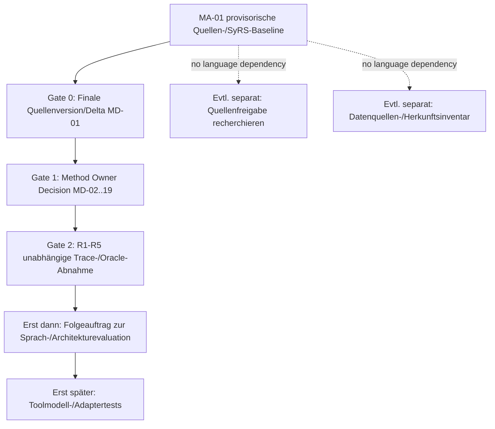

# MA-01 — Handoff to Language Architecture (No Architecture Decision)

**Revision 0.1.0 / 2026-11-05.** **PROVISIONAL DOCUMENTARY BASELINE – NOT RELEASED FOR A FINAL CONTRACT.** Dieser Handoff ist eine Schnittstellenübergabe aus dem Requirements Engineering, **kein** Auftrag zur Sprachauswahl, Architekturentwicklung, Implementierung oder Parallelisierung.

## Verwendbare Ergebnisse und Grenzen

|MA-01-Artifact|Zulässige Verwendung|Nicht zulässige Verwendung|
|---|---|---|
|methodology_source_baseline.md|O26-Fundstellen mit O/D-Scope-Klassifikation, 50 Items|Als amtlich freigegebene oder garantiert vollständige Methodik betrachten|
|iosn_process_specification.md, iosn_process_matrix.csv|18 Prozessschritte, Quellen/Inputs/Transformationen/Ausgänge, bedingte Studien|Als verpflichtende Software-Pipeline-Architektur behandeln|
|iosn_system_requirements.md, iosn_requirements_catalogue.csv|48 vorläufige L2-Anforderungen, Vorgaben, Freiheitsgrade und L3/L4-Bedarf|Als amtlich unterschriebenen Requirements-Contract verwenden|
|iosn_methodology_traceability.csv|50 L1→48 L2→L3/L4 plus 2 ausgeschlossene externe Aussagen prüfen|Trace als Beweis für tatsächliche Modell-/Solver-Konformität interpretieren|
|methodology_ambiguity_register.md|20 vorläufige MD-Fragen und Prioritäten an Fachowner zur Klärung|Parameter oder Akzeptanzschwellen selbst autorisieren|
|requirements_review.md|R1–R5 Risiken, Abweichungen und Restgaps|Als durchgeführten numerischen Modellreview oder Owner-Sign-off interpretieren|
|scope_and_change_impact.md|Legacy-Wetterauswahl dauerhaft aus IoSN-Vertrag herausnehmen|Alte UC-01, SR-005 oder PCA-Gate als aktive Anforderungen wiederbeleben|
|handoff_to_language_architecture.md|Abhängigkeiten und Reifegrade prüfen|Folge-Makroauftrag ohne separate Nutzerentscheidung starten|

## Fachlich bestätigt auf Ebene der **Konsultationsquelle**, nicht als finale genehmigte Umsetzung

In der konsultierten O26-Fassung ausdrücklich oder kontextuell enthalten: Zieljahre 2035/2040/2050; veröffentlichte ausgewählte Wetter-ID-/Gewichtstupel je Zieljahr; gemeinsame Investitionsentscheidung über Wetterfälle; wetterszenariogewichteter Betriebs-/ENS-Kostenanteil; DC-Lastfluss in der vermaschten Bestandsnetznachbildung; in §4.5.2 steuerbare **DC-Marktlinks** für Übertragungs-Investitionskandidaten auch bei physischer AC-Technologie; zweistufige LP-Investitionen plus jahresbeschränkten Speicherausbau; getrennte LF- und ggf. OPF-Studien; netz-, H2-, Hydro-, Nachfrage-/DSR- und Offshore-Bausteine. Diese Feststellungen sind **Methodikinterpretationen der O26-Draft-Fassung**, nicht bereits erbrachte Systemnachweise.

## Offen und nachweisblockierend

**MD-01** offizielle genehmigte Quellenversion. **MD-02** ökonomische Blockdiskontierung. **MD-03** Reduktionsgüte/N-1-Oracle. **MD-04** Ergebnis-/KPI-Formeln. Weitere **MD-05–19** betreffen Offshore-Faktor, Speicher, Stufensequenz, LF/OPF, Marktlink-NTC, H2, Datenvintages, Zeitachsen, Clustering, Startnetz, LP-Toleranzen, Hydro/DSR, Mehrfachoptima und Weather-Input-Metadaten. **MD-20** Governance/Legacy-Konflikt ist dokumentiert und bleibt bis zum Repository-Abgleich formal offen.

Gegenwärtig: **48/48 MA01-SR Implementierungsprüfungen NOT_EXECUTED**, keine bestätigte Solver-/Modell-/Postprocessing-Konformität; Quellstatus UNCONFIRMED_FINAL. Ergebnisse dürfen als **provisorisches Anforderungsinventar** verwendet werden, aber nicht als fertiger offizieller Tool-Contract.

## L1 bis L4: notwendige Übergabegranularität

- **L1 Methodik / MA01-MR**: Regel, Quellensektion und Druckseite, Normativitätstyp O-explicit/O-descriptive/O-open; 2 externe Aussagen ohne L2.
- **L2 SyRS / MA01-SR**: gewünschtes fachliches Verhalten, vorgeschriebene Formulierungsklasse und Modellannahmen, Implementierungsfreiheit, Inputs/Outputs und Applicability.
- **L3 Required Formalisation / MA01-FR**: Datenachsen, Einheiten, Herkunft; Abhängigkeits- und Zustandsübergänge; Constraints; physikalische/marktliche Assetsemantik; Fehler; KPI; Varianten. **Kein Metamodell oder Syntaxentscheid.**
- **L4 Verification Needs / MA01-VN**: maschinenprüfbare Struktur, mathematische Gleichungen, generierte Modellrestriktionen, LP-Output, unabhängige numerische Referenz und KPI-Rechnung. Testdefinition ist kein ausgeführter Test.

Wesentliche technische Regel: **Toolneutralität schließt methodische Spezifizität nicht aus**. Die vorgegebenen mathematischen Eigenschaften (z.B. gemeinsames x, LP-Stufen, erwartungswertgewichtete Kosten, Netz- und Marktlinkdifferenz) sind auch in einer zukünftigen formalen Beschreibung zwingend darstellbar. Sie schreiben aber keine spezielle PyPSA-, Antares- oder Sienna-Klasse und keinen Solver vor.

## Abhängigkeitsdiagramm und Gate-Ordnung

Eine Source-Authority- oder exogene Datenquellenrecherche ist fachlich relativ unabhängig von der späteren Sprachwahl. Die verantwortliche Prozess- oder Methodikinstanz muss entscheiden, was parallel tatsächlich beauftragt wird.

## Potenziell unabhängig startfähige **spätere** Makroaufträge (nicht gestartet)

|Kandidat|Unabhängigkeit|Output und harte Abhängigkeit|Freigabe|
|---|---|---|---|
|MA-FUT-SOURCE – maßgeblichen Methodik-Release identifizieren|Unabhängig von Modellierungs- und Softwarearchitektur|Autoritatives Dokument, Versionsdiff, Gültigkeitsdatum und Status, löst MD-01|NOT_AUTHORIZED|
|MA-FUT-DATA – reale PEMMDB/PECD/DFT/Netzreferenzen inkl. Wetter-**Input**-Manifest belegen|Unabhängig von Sprachwahl; abhängig von Datenzugriff|Datensatz-IDs, Metadaten, Zeit-/Raumkonvention, Checksummen, Provenienz; **keine** Wetterjahrauswahl|NOT_AUTHORIZED|
|MA-FUT-CLARIFY – offene mathematische und Outputmethodik mit Ownern klären|Sachlich separat von Architektur, aber finale Entscheidungen referenzieren Gate 0|Freigegebene Gleichungen, Datenprofile, Nachweisschwellen, MD-02–19|NOT_AUTHORIZED|
|MA-FUT-FORMAL – formale Repräsentationen vergleichen|**Nicht freigabefähig vor G0–G2**|Bewertung nur auf genehmigter SyRS mit L3/L4, keine neue DSL ohne Anforderungsgate|NOT_AUTHORIZED|

## Bedingungen für eine echte finale MA-01-Übergabe

1. Offizielle Methodikrevision inklusive Veröffentlichungs-/Genehmigungsstatus kontrolliert bestätigen.
2. Clause Audit von allen relevanten Kapiteln und Anhängen mit Method Owner durchführen.
3. Unklare algorithmische/mathematische und numerische Verpflichtungen durch genehmigte Entscheidungen und Testorakel schließen oder als explizite nicht freigabefähige Teilbereiche ausweisen.
4. Aktive Requirements und Testbedarfe auf semantische Konsistenz prüfen; alte MR/SR/UC/PoC-Spezifikationen ausschließlich historisch.
5. Ein Freigabeprotokoll mit 4 Ebenen, Versionsidentität, getesteten/ungestesteten Nachweisen, reviewer/verantwortlicher Stelle und Scope erstellen.

**Handoff-Entscheid:** Die Dokumentenbaseline kann zur methodischen Quellen-/Requirements-Prüfung dienen. Eine normative IoSN-Spezifikationssprache, Adapter, neue PoCs oder CBA-Interoperation werden **nicht** begonnen; die Entscheidung über die nächste Parallelisierung bleibt beim Auftraggeber.
