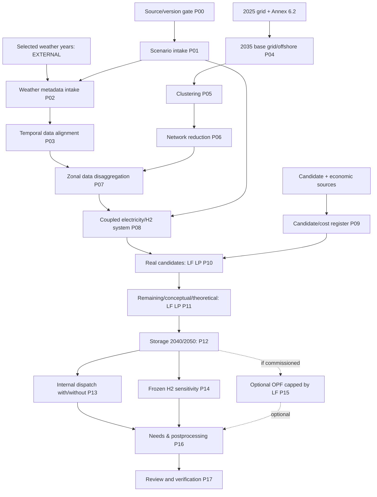

# MA-01 — IoSN Process Specification

**Version 0.1.0 (2026-11-05)**; **status PROVISIONAL**. Derived from O26 consultation 25 February 2026. The authoritative machine-readable companion is `iosn_process_matrix.csv`. Each row includes purpose, source, input and precondition, method rule, implementation freedom, output semantics, invalidity, verification and open issue. O = evidenced method; D = engineering-derived behavior. No workflow is inferred merely from a legacy PoC.

## Fundamental scope boundary

**EXTERNAL WEATHER SELECTION → IO SN DATA INTAKE ONLY**: upstream process has already selected calendar/scenario IDs and probabilities. Input consists of (i) number and IDs, (ii) target-year mapping, (iii) normalized/approved weights, (iv) time-axis/calendar, (v) required RES, demand and hydro data reference/units and (vi) provenance. P02 and P03 **validate and align provided inputs** but do **not** run PCA, k-means, sampling or statistical selection verification. O26 Annex 6.3 exists solely as context of the upstream responsibility.

## Flow and dependencies

**Read diagram as obligations + data dependencies, not a prescribed software orchestration stack.** Separate target-year invocations have no implied endogenous intertemporal investment coupling. Stage 3 storage expansion is restricted by horizon. The source does not fully specify whether every sensitivity output must contribute to every published KPI.

## Summary process matrix

|ID|Domain transformation|Source|Implementation freedom (representative)|Main output|Open issue|
|---|---|---|---|---|---|
| P00 | Source/profile release gate | O26 cover; D governance | Document-management platform free | source_manifest | B-01 |
| P01 | Study horizon/scenario intake | §§3.2,4.1 | Import/storage free | study_manifest | DATA-VERSION |
| P02 | Previously selected weather-scenario intake | §3.7 p.20 | Serializer free; no selection algorithm | selected_weather_manifest | WEATHER-BOUNDARY |
| P03 | Temporal/market input preparation | §§3.7,4.1–4.4 | ETL/time-container free | aligned_timeseries | TIME-AXIS |
| P04 | 2035 starting grid and fixed offshore reference | §§3.4–3.5; Annex 6.2 | Network serialization free | reference_grid | GRID-ELIG;OFFSHORE-TARGET |
| P05 | Zonal clustering | §3.8.1; Annex 6.1 | Clustering algorithm implementation free within method class | zonal_clusters | ZONAL-QUALITY |
| P06 | Equivalent network reduction | §§3.8.2–3.8.3; Annex 6.1 | Numerical implementation free if behavior compliant | reduced_grid | ZONAL-ORACLE;CAP-ORACLE |
| P07 | Zonal data disaggregation | §3.8.4 | Data transformation technology free | zonal_market_data | ALLOC-TOLERANCE |
| P08 | Coupled model construction | §§3.3,3.6,4.1,4.3,4.4 | Native component decomposition free | model_semantics | H2-DETAIL;DSR-SEMANTICS |
| P09 | Candidate and economic preparation | §§3.10–3.11,4.5–4.6 | Internal representation free subject to link semantics | candidate_cost_register | CAND-MAPPING;ECON-DISCOUNT |
| P10 | Real-candidate LP expansion | §§3.1.1,3.9–3.10 | LP solver/modeling language free | stage1_portfolio | CAND-STAGES;LF-SEMANTICS |
| P11 | Remaining/conceptual/theoretical LP expansion | §3.10 | Solver free within LP and carry-forward semantics | stage2_portfolio | CAND-STAGES |
| P12 | Storage expansion for 2040/2050 | §§3.10,4.5.1 | Representation and LP implementation free | storage_portfolio | STORAGE-DETAIL |
| P13 | Internal grid dispatch comparison | §§3.9,4.1 | UC/ED engine and numerical solution free | dispatch_comparison | KPI-REPORT |
| P14 | Frozen-H2 sensitivity | §3.6 | Native H2 representation free | h2_frozen_sensitivity | H2-SENS |
| P15 | Optional OPF investment study | §3.9 | OPF solver/model platform free | optional_opf_result | OPF-CAP |
| P16 | Postprocessing and needs reporting | §§2.2,3.1.2,3.10–3.11 | Reporting tool free; KPI semantics not arbitrary | needs_register | FILTER-THRESHOLD;OUTPUT-KPI |
| P17 | Independent verification and acceptance | §5.1; D | Review automation free | review_evidence | VERIF-ORACLE;B-01 |

## Source-constrained semantics and common errors

1. **Weather**: P02 accepts externally selected tuples **2035** {WS032,WS037,WS059} weights {.24,.43,.33}; **2040** {WS065,WS071,WS077} {.20,.40,.40}; **2050** {WS091,WS092,WS106} {.23,.57,.20} in O26 §3.7 p.20. It can reject missing/duplicate/invalid or out-of-version input. It must never claim to reproduce the Annex 6.3 decision.
2. **Network reduction**: P05 is the clustering decision; P06 derives physical equivalents. An arbitrary 102-node NTC network is not necessarily method-conformant. P06 includes impedance/zero-flow corrections, Kirchhoff mesh constraints, four seasonal/directional N-1 ratings, HVDC/PST contributions. Quality has to be compared with detailed-grid behavior; existence of a busmap is insufficient.
3. **Two distinct DC notions**: in P06/P08 the *existing electrical grid* follows DC-load-flow/Kirchhoff; in P09–P11 all *transmission investments* are modelled as controllable DC **market** links with directional NTC effects, even when their physical technology is AC (O26 §4.5.2 p.37). Never impose a physical AC meshed-branch model on those candidates by accident.
4. **LF baseline vs internal constraints**: primary P10–P12 LF optimisation preserves mesh law yet sets internal interzonal capacity bounds to infinity; P13 applies actual internal restrictions to dispatch comparison. An optional P15 OPF expansion must remain distinct and have its eligible portfolio limited by LF outcome (O26 §3.9 p.29).
5. **Mathematics**: O26 §3.1.1 p.12–14 requires expected-cost/nonanticipative investment decisions. Weather weights enter operational expectation; investments are shared across weather cases within each horizon. A minimax formulation is **not** implied by O26's use of the word 'robust'.
6. **Stage semantics**: P10 real candidates only; P11 residual real plus conceptual onshore and theoretical offshore candidates incorporating P10; P12 storage 2040/2050. Exact stage carry-forward and filtering requires method owner clarification. Do not silently merge stages.
7. **Hydrogen and storage**: H2 infrastructure is a scenario input in O26; electric investment expansion must not create unapproved H2 network expansion options. Battery technology is a generic modelling proxy, and need outputs must not be relabelled as exclusively battery project recommendations.
8. **Outputs**: method describes needs, not actual selected construction projects. KPI/aggregation and tiny-expansion threshold are not unambiguously fixed in the consultation text. Mark method-owned acceptance **BLOCKED** rather than filling with tool defaults.

## Stage-specific verification design (not executed)

P02: exact scenario manifest and sum; P03: aligned timestamps and units; P04: project eligibility and fixed RES; P05: zone graph connectivity and overloaded-line coverage; P06: detailed-vs-reduced flow residuals, N-1 limits and equivalence classes; P07: source-zone reconciliation; P08: commodity balances and hydro/DSR semantics; P09: market-link vs mesh-branch semantics; P10–P12: LP structure, non-anticipativity, objective decomposition, candidate sets and horizon caps; P13/P14/P15: paired runs, frozen profile and LF cap; P16: needs lineage and approved KPI oracle; P17: independent R1–R5 acceptance with failed/blocked recorded explicitly.

## Release condition

A passing process file is **not** a passing implementation. The comprehensive checks require source finalisation, owner decisions and native generated-model/run evidence. No new validators/PoC/adapters are built under MA-01.
