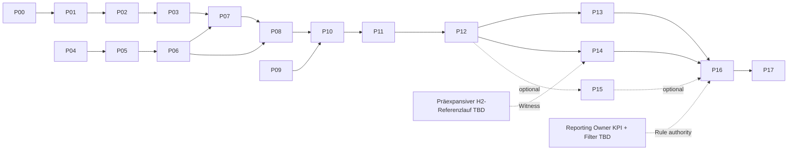

# ML-C03 — Data Lineage and Process DAG

**Baseline:** ML-R00 `9162def25d22c37b1fbc38f7d80fe929425cc8d2`; R01 P00–P17/M01–M18, R03 38 proposals, R04 V1–V6. **NON_NORMATIVE; NOT_EXECUTED; G1 BLOCKED.**

## 1. Graphtrennung

**(1) Fachlicher R01-Prozess-DAG:** P00–P17 mit mehreren Intake-Ästen und Kontrollabhängigkeiten; Kanten sind fachliche Reihenfolge, nicht zeitliche Orchestrierung. **(2) R03-Daten- und Transformations-DAG:** 38 Vorschlagsknoten `MLR03-T...`; gerichtete Kante wenn ein deklarierter Producer-Output zugleich Consumer-Input ist; 47 eindeutige Kanten, keine Zyklen. **(3) Externe Freigabe-/Modell-Oracles:** Methodikreleases, Quellfreezes, H2-Präexpansions-Run, P11-Carry, Filter-/KPI-Owner und unabhängiger Reviewer. Diese dritten Abhängigkeiten sind nicht automatisch im T→T-Graph enthalten.

### Fachlicher Überblick (Illustration, keine normierte Pipeline)

P04 und P09 haben eigenständige Quellen. Der P14-Eingang B01-D072 ist **vor** der Netzexpansion zu bestimmen und darf nicht aus dem endgültigen P12-Ergebnis abgeleitet werden. P15 darf nicht automatisch durchlaufen.

## 2. Vollständige 47 R03-Transformationskanten

Ableitungsalgorithmus: Für jeden Transform `T_j` und jeden Input-Ref `r` finde alle `T_i`, bei denen `r∈outputs(T_i)`; eine Kante `T_i→T_j` entsteht genau dann, wenn `i≠j`; mehrere Trägerreferenzen ergeben nur eine Kante. Diese Konstruktion reproduziert die R03-Review-Kennzahl und ist **nicht** gleichbedeutend mit 47 Owner-abgenommenen Regeln.

| Producer-ID | Consumer-ID | Tragendes Objekt | P-zu-P |
|---|---|---|---|
| `MLR03-T00-01` | `MLR03-T01-02` | `MLR03-I-P00-source_manifest` | P00 → P01 |
| `MLR03-T02-01` | `MLR03-T03-02` | `MLR03-I-P02-weather_manifest` | P02 → P03 |
| `MLR03-T03-01` | `MLR03-T03-02` | `MLR03-I-P03-utc_time_axis` | P03 → P03 |
| `MLR03-T04-01` | `MLR03-T04-02` | `MLR03-I-P04-start_grid` | P04 → P04 |
| `MLR03-T04-01` | `MLR03-T05-01` | `MLR03-I-P04-start_grid` | P04 → P05 |
| `MLR03-T05-01` | `MLR03-T05-02` | `B01-D021` | P05 → P05 |
| `MLR03-T05-01` | `MLR03-T06-01` | `B01-D021` | P05 → P06 |
| `MLR03-T06-01` | `MLR03-T06-02` | `B01-D026;B01-D027;B01-D028` | P06 → P06 |
| `MLR03-T06-01` | `MLR03-T06-03` | `B01-D026;B01-D027` | P06 → P06 |
| `MLR03-T06-02` | `MLR03-T06-03` | `B01-D029` | P06 → P06 |
| `MLR03-T05-01` | `MLR03-T07-01` | `B01-D021` | P05 → P07 |
| `MLR03-T07-01` | `MLR03-T07-02` | `B01-D033` | P07 → P07 |
| `MLR03-T03-02` | `MLR03-T07-02` | `MLR03-I-P03-aligned_timeseries` | P03 → P07 |
| `MLR03-T07-02` | `MLR03-T08-01` | `MLR03-I-P07-zonal_market_bundle` | P07 → P08 |
| `MLR03-T08-01` | `MLR03-T08-02` | `B01-D057` | P08 → P08 |
| `MLR03-T08-01` | `MLR03-T10-01` | `B01-D057` | P08 → P10 |
| `MLR03-T06-01` | `MLR03-T10-01` | `B01-D028` | P06 → P10 |
| `MLR03-T09-01` | `MLR03-T10-01` | `B01-D059` | P09 → P10 |
| `MLR03-T09-03` | `MLR03-T10-01` | `MLR03-I-P09-economic_bundle` | P09 → P10 |
| `MLR03-T02-01` | `MLR03-T10-01` | `MLR03-I-P02-weather_manifest` | P02 → P10 |
| `MLR03-T10-01` | `MLR03-T10-02` | `MLR03-I-P10-stage1_model_input` | P10 → P10 |
| `MLR03-T10-02` | `MLR03-T11-01` | `B01-D060` | P10 → P11 |
| `MLR03-T09-01` | `MLR03-T11-01` | `B01-D061` | P09 → P11 |
| `MLR03-T11-01` | `MLR03-T11-02` | `MLR03-I-P11-stage2_model_input;B01-D063` | P11 → P11 |
| `MLR03-T08-02` | `MLR03-T12-01` | `B01-D067` | P08 → P12 |
| `MLR03-T11-02` | `MLR03-T12-01` | `B01-D062` | P11 → P12 |
| `MLR03-T12-01` | `MLR03-T12-02` | `MLR03-I-P12-storage_model_input` | P12 → P12 |
| `MLR03-T11-02` | `MLR03-T13-01` | `B01-D068` | P11 → P13 |
| `MLR03-T06-02` | `MLR03-T13-01` | `B01-D029` | P06 → P13 |
| `MLR03-T13-01` | `MLR03-T13-02` | `MLR03-I-P13-paired_dispatch_inputs` | P13 → P13 |
| `MLR03-T08-01` | `MLR03-T14-00` | `B01-D057` | P08 → P14 |
| `MLR03-T14-00` | `MLR03-T14-01` | `B01-D072` | P14 → P14 |
| `MLR03-T14-01` | `MLR03-T14-02` | `B01-D073` | P14 → P14 |
| `MLR03-T08-01` | `MLR03-T14-02` | `B01-D057` | P08 → P14 |
| `MLR03-T11-02` | `MLR03-T15-01` | `B01-D068` | P11 → P15 |
| `MLR03-T15-01` | `MLR03-T15-02` | `MLR03-I-P15-opf_model_input` | P15 → P15 |
| `MLR03-T10-02` | `MLR03-T16-01` | `B01-D060` | P10 → P16 |
| `MLR03-T11-02` | `MLR03-T16-01` | `B01-D062` | P11 → P16 |
| `MLR03-T12-02` | `MLR03-T16-01` | `B01-D066` | P12 → P16 |
| `MLR03-T13-02` | `MLR03-T16-01` | `B01-D071` | P13 → P16 |
| `MLR03-T14-02` | `MLR03-T16-01` | `B01-D074` | P14 → P16 |
| `MLR03-T15-02` | `MLR03-T16-01` | `B01-D077` | P15 → P16 |
| `MLR03-T16-01` | `MLR03-T16-02` | `MLR03-I-P16-raw_result_index` | P16 → P16 |
| `MLR03-T16-00` | `MLR03-T16-02` | `B01-D081` | P16 → P16 |
| `MLR03-T16-01` | `MLR03-T16-03` | `MLR03-I-P16-raw_result_index` | P16 → P16 |
| `MLR03-T16-01` | `MLR03-T17-01` | `B01-D082` | P16 → P17 |
| `MLR03-T16-02` | `MLR03-T17-01` | `B01-D078` | P16 → P17 |

**Konsistenzprüfung:** 38/38 Knoten, 47/47 eindeutige Kanten, topologisch sortierbar, keine Zyklen. Beispielhafte T-Reihenfolge: `MLR03-T00-01` → `MLR03-T01-01` → `MLR03-T02-01` → `MLR03-T03-01` → `MLR03-T04-01` → `MLR03-T09-01` → `MLR03-T09-02` → `MLR03-T09-03` → `MLR03-T16-00` → `MLR03-T01-02` → `MLR03-T03-02` → `MLR03-T04-02` → `MLR03-T05-01` → `MLR03-T05-02` → `MLR03-T06-01` → `MLR03-T07-01` → `MLR03-T06-02` → `MLR03-T07-02` → `MLR03-T06-03` → `MLR03-T08-01` → `MLR03-T08-02` → `MLR03-T10-01` → `MLR03-T14-00` → `MLR03-T10-02` → `MLR03-T14-01` → `MLR03-T11-01` → `MLR03-T14-02` → `MLR03-T11-02` → `MLR03-T12-01` → `MLR03-T13-01` → `MLR03-T15-01` → `MLR03-T12-02` → `MLR03-T13-02` → `MLR03-T15-02` → `MLR03-T16-01` → `MLR03-T16-02` → `MLR03-T16-03` → `MLR03-T17-01`. Innerhalb eines P existieren teilweise mehrere T-Knoten; ein P→P-Verweis wäre keine Selbstzyklusanweisung.

## 3. Minimaler prüfbarer Lineage-Vertrag

| Kette | Identität / Nachweis | Prüfung | Status |
|---|---|---|---|
| Source → DataInstance | `source_id;source_release;native_version;content_sha256_if_real;scenario;study_year;CY;UTC_interval;zone;unit` | Release, Input-Grain, Dimension, Referenzen, Originaldatenvalidierung | Kein qualifizierter Originalpayload |
| DataInstance → Preprocessing | `input_instance_hashes;transform_id+version;parameter_ref;output_instance_hashes;run_id` | deterministische oder explizit stochastische Transformationssemantik; Quellen-/Zeitscheibenverlust transparent | Nur Vertrag vorgeschlagen |
| Network → Equivalent | `reference_grid;bus_zone_map;detailed_flows;PTDF;LODF;N1;PST;HVDC;metrics` | symbolische DC-Physik plus Owner-Quality Oracle | Vergleichsorakel TBD |
| Parameter → Model | `model_ref;carrier;units;indices;candidate_type;exogenous_or_variable;constraint_ref` | Bilanzen und LF/OPF/Stage-Konformität | Native Zeugnisse NOT_EXECUTED |
| Model → RawResult | `solver_run_id;stage_id;model_version;decision/operation;witness;solver_status;unit` | Feasibility/optimality/instance identity; multiple optima zulassen | Native Zeugnisse NOT_EXECUTED |
| RawResult → Derived KPI | `formula_ref+version;source_raw_ids;aggregation;comparator;weight_ref;filter_ref` | fachlich genehmigte Kennzahlformel, explizite Raum/Zeit/CY-Basis | Owner-Oracles TBD |
| KPI → SystemNeed → Review | `need_id;status_not_project;review_id;evidence_class;owner_signature` | kein Projektapproval, V1–V6 getrennt, G1 kontrolliert | G1 BLOCKED |

## 4. Unbelegte Kanten und die jeweilige Sperre

| Fehlt | Betrifft | Diagnose / niemals automatisch tun | Owner-Abhängigkeit |
|---|---|---|---|
| Präexpansiver H2-Solve → T14-00 | B01-D072 | T14-00 behauptet eine Extraktion aus einem nicht bezeichneten, nicht verifizierten Ausgangslauf; nicht auf P12 oder Postexpansion zurückführen | MD-10, H2/Model Owner |
| Autorisierte Report-Filterregel → T16-00 | B01-D081 | technisch als vorgeschlagener Erzeuger klassifiziert, fachlich aber eine externe Definition | MD-04/17, Reporting Owner |
| Stage-1→Stage-2 Carry-Funktion | B01-D063/T11-01 | Datenverweis ersetzt nicht fachlich gültige Investitions- und Kostenübernahme | MD-07 |
| Genehmigtes Netzreferenz-Orakel | B01-D024,D026–30,D086–87 | PTDF/LODF/N−1-Qualität und Akzeptanz nicht durch Schema beweisen | MD-03/13/15 |
| KPI-, ONDP- und Kosten-/Filter-Definition | B01-D078–81 | Rohsolver-Objective ist kein freigegebener Nutzen/KPI; keine heimliche Grenzwertnutzung | MD-02/04/05/17 |
| Source-Release, originale Daten, unabhängiger Review | B01-D001,002,083–85 | syntaktischer Vollständigkeitscheck ≠ Methodikfreigabe | MD-01/11/15/20 |

**Erläuterung:** In den 47 Kanten sind keine fehlenden Owner-Oracles „eingebaut“. Ein künftiger ausführbarer vollständiger Prozess-DAG benötigt diese als eigenständige, versionierte Eingangs- und Kontrollbeziehungen. Der vorliegende DAG ist vollständig **in Bezug auf die R03-Referenztabelle**, nicht als produktive End-to-End-Freigabe.
