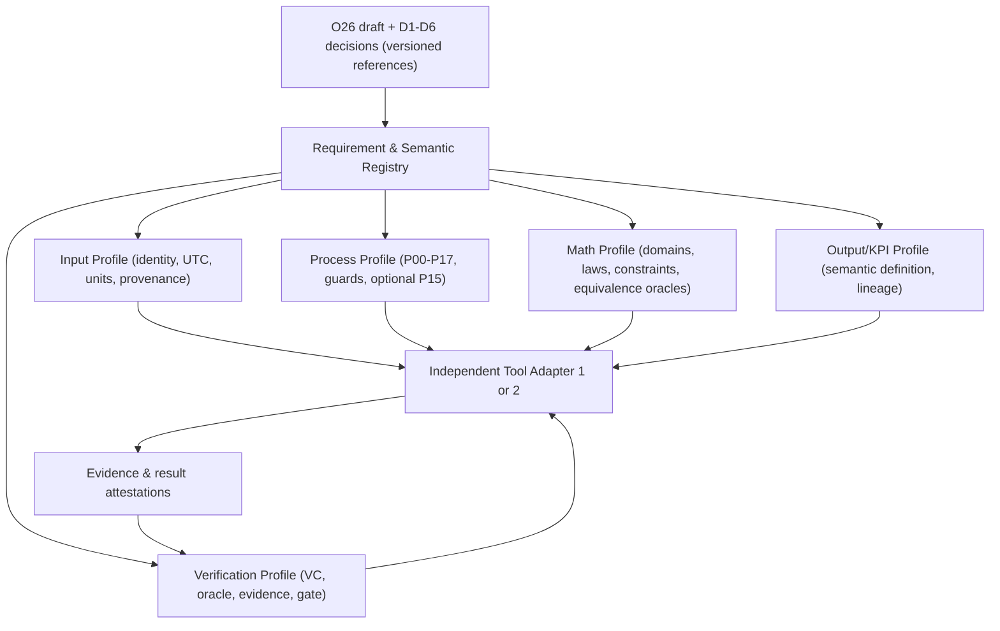
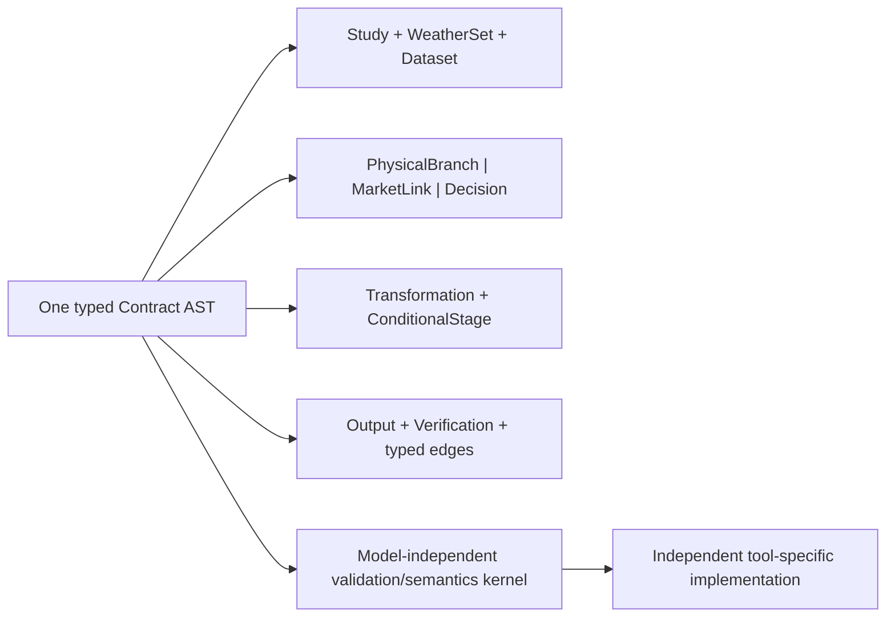

# ML-R02 — Contract Architecture Alternatives
**Stand:** 2026-11-11 · **Status:** Forschungshypothesen, keine akzeptierte ADR.

## Gemeinsame Contract-Invarianten
Die Architektur darf die 48 MA01-SR nicht überschreiben. Requirements sind normative Kandidaten **nur innerhalb MA-01-Provisional**, gekoppelt an Quellclauses, aktive Gültigkeit und explizite Statusunterscheidung. Ein Tool erzeugt **seine eigene** Implementierung: kein genereller Model-to-Model-Translator, keine gleichlautende algebraische Implementierung, keine implizite Freigabe durch Syntaxprüfung. Ist Pflichtdaten-Provenienz oder kritische Semantik nicht auflösbar, ist `BLOCKED/FAIL_CLOSED` auszugeben.

## Architektur A — Modulare Requirements-/Semantic Registry

**Minimal registry:** `sourceClause(id,revision,status)`, `requirement(id,obligation,applicability)`, `semanticConcept(id,unit,dimension,roles)`, `profile(id,version,digest)`, `verificationCase(id,oracle,expected)`, `evidence(id,hash,execution,review)`, all linked via typed edges. Cross-profile resolver validates unique references, acceptable version tuples, strong obligation closure, and divergent meanings. **Pro:** independent lifecycle for schema/math/reporting; JSON Schema/LinkML/SHACL, ReqIF export or GEMS/mathspec integration possible. **Con:** difficult version-tuple and cross-module consistency; registry alone can't execute constraints. **Experiment:** `prototype_A/`, registry + five JSON profiles; 14 synthetic cases and six-class placeholder for P06 (not source-derived labels).

## Architektur B — integriertes getyptes Metamodell

**Minimal AST:** `Study`, `WeatherSet`, `Dataset`, `PhysicalBranch`, `MarketLink`, `Decision`, `Transformation`, `ConditionalStage`, `Output`, `Verification` plus cross-references. A SysML-v2/KerML-derived library or a LinkML-backed typed metamodel are potential future realizations, **not** proven alternatives here. **Pro:** cohesive semantics and graph navigation; fewer cross-file version mismatches. **Con:** single schema upgrade couples method, math and output evolution; porting to formal MBSE constructs/engines remains unproven. **Experiment:** `prototype_B/` is deliberately custom `IoSN-TinyMeta`, not a conformant SysML implementation.

## Architektur C — Föderierte Contract-Views (keine dritte Implementierung)
Immutable core IDs + separately governed views in MBSE/ReqIF, LinkML, mathspec/GEMS, and JSON Schema, connected by a typed mapping/evidence graph. Avoid a second semantic owner: view provenance and transformation-loss certificates are required. **Pros:** standard reuse and familiar specialist workflows. **Cons:** mapping gaps and dual-source ambiguity; highest synchronization burden without a governed canonical semantics layer. C bleibt **Designoption**, nicht getesteter Prototyp.

## Idempotenz, Versionierung und Konsistenz
Der Inhalt ist nur mit (source_version, requirements_baseline_sha, registry_version, input_profile, process_profile, math_profile, output_profile, verification_profile, semantic-vocabulary-version, fixture_hash) eindeutig referenzierbar. Ein neuer `major` mit inkompatiblen Operatoren/Domänenrollen erfordert Ablehnung bis kontrollierte Migration freigegeben ist; `minor` ist nur kompatibel, falls Pflichtfelder und formale Semantik bestehender Begriffe unverändert bleiben. Versionen/Kontenthash werden getrennt von Eigentümerzustimmung geführt. Beispiel A fixiert Profile 0.1.0; B fixiert AST 0.1.0. Ein Versionswechsel wurde negativ getestet, **kein** echter Migrationsprozess.

## Zustandsmaschine der Verifikation
`DECLARED` → `SCHEMA_CHECKED` → `SEMANTICALLY_CHECKED` → `MODEL_ORACLE_CHECKED` → `RESULT_REPLAYED` → `INDEPENDENTLY_REVIEWED` → `APPROVED`. Jeder Übergang benötigt externen Nachweis; kein automatisches Advance durch syntaktische Tests. Unauflösbare Requirement-Daten- oder Semantikverletzung führt zu `BLOCKED`. `NOT_APPLICABLE` ist nur bei **dokumentiert deaktiviertem optionalem Profil** zulässig, nicht für Pflichtobligationen.

## Unabhängige Toolimplikationen
PyPSA, Antares, Sienna oder andere Tools erhalten denselben prüfbaren Contract, sind aber nicht verpflichtet, dasselbe Datenbank-, Math-DSL- oder Gleichungsobjekt intern zu benutzen. Ein Adapter muss semantische Realisierung und Abweichung offenlegen: `SUPPORTED`, `EQUIVALENT_WITH_EVIDENCE`, `LOSSY_BLOCKED`, `UNSUPPORTED`. Eine GEMS↔PyPSA-Konvertierung allein genügt nicht für Methodikabnahme. Zu testen sind Trace-ID-Erhaltung, Vorverarbeitungsnachweise, dimensionskonforme Variablen, Modell-Micro-oracles, KPI-Replay und unzulässige Pipeline-Skips.
