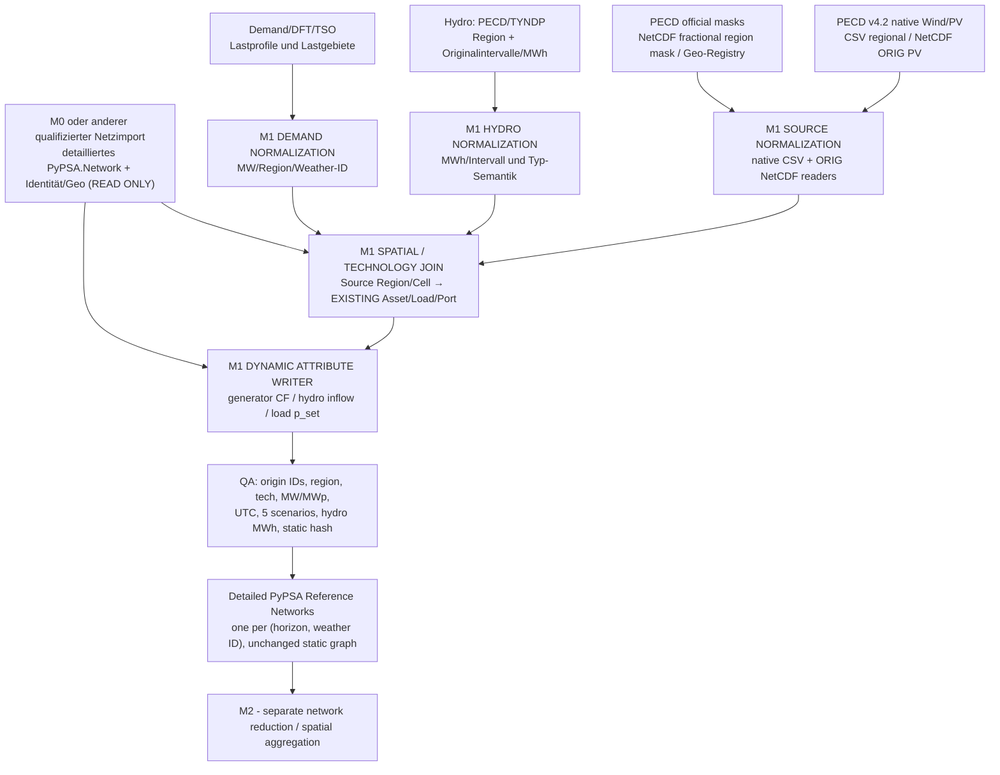

# IoSN Modul 1 — Kanonische Softwarearchitektur V2: PECD-native Zeitreihen auf unverändertem PyPSA-Detailnetz

**Datum:** 2026-11-01  
**Entscheidung:** `M1_ARCH_V2_SOURCE_ADAPTER_AND_NATIVE_SPATIAL_JOIN`  
**Status:** `ARCHITECTURE_SPECIFIED / EXISTING_CSV_HYDRO_COMPOSER_FIXTURE_QUALIFIED / NATIVE_GRID_AND_REAL_SOURCE_NOT_YET_QUALIFIED`  
**Scope:** **Modul 1** ist der unabhängige Datenaufbereitungs- und Zeitreihen-Zuordnungsdienst für ein bereits existierendes PyPSA-Netz. Die Analyse ersetzt die ältere [Architektur vom 30.10.2026](../IOSN_M1_PECD_PYPSA_REFERENCE_TIMESERIES_ARCHITECTURE_2026_10_30.md) **als aktueller Sollvertrag**, nicht als rückwirkende Änderung ihrer historischen Evidenz.

**Weitere verbindliche Teile:** [10 Upstream/Reuse](10_UPSTREAM_REUSE_LEDGER_V2.md) · [20 Source/Spatial Contracts](20_SOURCE_SPATIAL_COMPONENT_CONTRACT_V2.md) · [30 Workflow/QA](30_WORKFLOW_AND_QUALIFICATION_V2.md) · [40 Next Macros/Handoffs](40_NEXT_MACROS_AND_HANDOFFS_V2.md). [Index/Versionspolitik](README.md).

## 1. Executive architecture decision

**PyPSA-Core wird NICHT modifiziert.** Die elektrischen Netzwerkobjekte, gespeicherten Komponentenzeitreihen, PyPSA-NetCDF und die Rechen-/Solveralgorithmen sind bereits vorhanden.

**PyPSA-Eur wird nicht als komplett neuer Workflow implementiert oder upstream geforkt.** Die Snakemake-Bausteine und der konzeptionelle Pfad `source data → normalized capacity factors/inflows/demand → PyPSA time-series attributes` bleiben maßgeblich. Ein **projektlokaler alternativer Source-Adapter** ersetzt nur die Wetter-/Profilaufbereitung, wenn autoritative vorgefertigte PECD-Energieindikatoren verwendet werden. Unnötige Atlite-ERA5-/SARAH-Cutout-Neuberechnung fällt in diesem Modus weg.

**M0 und PECD/Hydro/DFT sind unabhängige Datenquellen.** M0 liest ausschließlich ein Netzformat (hier CGMES), stellt ein elektrisches detailliertes PyPSA-Netz mit bestehenden Komponenten und Identitäts-/Geografieprovenienz bereit. Es berechnet **keine** PECD-Profile, maskiert **keine** PECD-Zonen und weist **keine** Hydro-Basinanteile zu. Ein vorgefertigtes, qualifiziertes PyPSA-Netz anderer Herkunft ist ebenfalls ein gültiger M1-Eingang.

**M1 führt Source→Profile→bereits existierende Anlage/Last/Hydroport separat zusammen**. Nur die **zulässigen dynamischen** PyPSA-Attribute werden geschrieben; keine neue Generator- oder Lastanlage und keine Änderung von Bussen, Leitungen, Transformatoren, Links, Speichern, `bus`, `p_nom` oder anderen statischen Werten. **M2 aggregiert das danach vollständig mit Zeitreihen versehene elektrische Netz.**

### 1.1 Was an „hochaufgelösten PECD-Daten“ tatsächlich existiert

Die räumliche Auflösung des meteorologischen Modells (0,25° × 0,25°) **ist nicht gleich** der gelieferten Energieprofilauflösung. Offizielle [PECD-v4.2-Produktdokumentation](https://confluence.ecmwf.int/spaces/CKB/pages/540941752/Climate+and+energy+related+variables+from+the+Pan-European+Climate+Database+derived+from+reanalysis+and+climate+projections+v4.2+Product+user+guide+PUG), Tabellen 2.12 und **3.6** (Projektionen), Stand 05.08.2026:

| PECD-Produkt | Native modellierte/gegebene Energiezeitreihe | M1-Verarbeitung |
|---|---|---|
| Wind Onshore WON | **Stündlicher CF auf `PEON/P2ON`**, je Wind-Technologie / Resource-Grade (nicht als ORIG-CF-Pixel) | PECD-Regionsmasken-/IDs auf vorhandene Wind-Anlagen abbilden; regionalen CF unverfälscht übernehmen |
| Wind Offshore WOF | **Stündlicher CF auf `PEOF/P2OF`**, Technologietyp/Resource-Grade | echtes Offshore-Parkgebiet oder gesicherte ID nutzen; Landfall-Bus nicht mit Turbinenposition verwechseln |
| PV SPV | **Stündlicher CF als griddiertes `ORIG`-NetCDF mit 0,25°** **und** regionale Profile u.a. NUT0/NUT2/SZON/PEON/P2ON; vier PV-Typologien; **MW/MWp** | bevorzugt echtes ORIG-Pixel (wenn geliefert und zur Anlage passend); regional nur ausdrücklich definiert, keine verdeckte Vergröberung |
| Solarstrahlung, Windgeschwindigkeit, Temperatur | Griddierte meteorologische `ORIG/BIAS`-Felder | **optionaler anderer Modus**: Atlite/PV-/Wind-Umwandlung mit neuem physikalischen Modell; **nicht** mit offiziell geliefertem WON/WOF-/SPV-CF gleichsetzen |
| Hydro HRI/HRR/HPI/HOL etc. | Hydrologische **`SZON`**-Energie, überwiegend wöchentlich in MWh, kein direktes Stunden-Kraftwerksprofil | eigenständiger Hydro-Adapter mit quelltreuer hydrologischer Allokation und Energieintegralprüfung |
| Nachfrage/DFT | Separate DFT-/TYNDP-/TSO-Lastquelle; gegebenenfalls meteorologisch konditioniert | eigenes Source→vorhandene `Load`-ID-Mapping; keine automatische Lastberechnung aus PECD-Wind/PV |

**Beweisgrenze:** Es ist nicht nachgewiesen, dass das im Projekt physisch zugängliche Datenpaket tatsächlich die ORIG-PV-NetCDF oder die erforderlichen offiziellen fraktionalen Regionsmasken enthält. Vor dem Real-Daten-PASS die Original-Header, Modell-/Horizon-/WS-Schlüssel, CRS, Masken-/CF-Variablen und SHA256 tatsächlich prüfen. Die bisherigen MA2-Fixtures mit `spatial_level=ORIG` ersetzen keinen nativen NetCDF-Reader.

## 2. Komponentenmodell und Verantwortung

**Wichtig:** Das M1-System ist auch nutzbar, wenn der Netzimport aus einem anderen Format statt CGMES stammt. Sein minimaler Netzvertrag ist `PyPSA.Network + eindeutige Komponenten-IDs + bus/carrier/p_nom + quellbelegte Geoposition beziehungsweise separate Anlagen-Geometrie + Revision/Source-Metadaten`. Das M0-DNR-Sidecar ist für die konkrete M0-Lieferung relevant, aber kein PECD-Mappinggenerator.

### 2.1 Fachliche Schichten

1. **Source Manager:** `weather_id`-/Horizon-Metadaten, Datenproduktfamilie, tatsächliche Dateien und Checksums, Version, Rechte, Zeitbasis und native Geometrie; Quellendaten haben **keine Kenntnis des Netzgraphen**.
2. **PECD Format Reader (REGIONAL/ORIG):** regionales PECD-CSV weiterhin über MA2-Reader; **neu** offizielles griddiertes ORIG-SPV-NetCDF via xarray, technische Auswahldimensionen, Speicher-/Chunkstrategie und gegebenenfalls Metadaten aus „Weights and masks“.
3. **Spatial Profile Mapper:** automatisch eine versionierte `asset_profile_map` erzeugen, nicht nur vorgegebene Tabellen plausibilisieren. Datenbasis: echte Anlagenposition bevorzugt, sonst nachweislich repräsentativer Bus-Proxy; rasterbasiertes Point→Grid-Cell; regionales Point→Mask/Region; komplexe anlagenweite Multi-Region-Zuordnung ausschließlich aus belegten MW-/MWp-Anteilen.
4. **Hydro Adapter:** bestehender MA3-Algorithmus, Quellregion→bestehendes Hydroasset über hydrologische TSO-/Basinanteile, native MWh, Modell-MWh und MW nach Intervallgrenzen separat; keine Umdeutung von Erzeugungsenergie als Zufluss.
5. **Demand/Load Adapter:** DFT/TYNDP/TSO→bestehende originale Last-IDs über eine belegte Regional-/Lastanteilsmatrix; `sum(Load MW)` muss die regionale Quelle erhalten. Bestehende Load-Profile dürfen nicht ohne ausdrücklich freigegebene Policy überschrieben werden.
6. **Time-Series Composer:** der **bereits ausgeführte** MA4F-Composer `scripts/iosn_m1/compose.py`; einzige autorisierte Schreibinstanz; NetCDF-Ausgabe, Konflikterkennung, Snapshot- und statische Invarianzprüfungen.
7. **Qualification & Provenance:** Source-Byte-/Geo-/Time-/Technik-/Asset-Witness, Erhaltung elektrischer und hydrologischer Größen, gesonderte `STATIC / FIXTURE / REAL_SOURCE / E2E / PF`-Gates. Kein automatischer Solver oder AC-PF zur Erzeugung von Verfügbarkeitszeitreihen.

## 3. Minimal erforderliche Änderung gegenüber PyPSA-Eur

Der Standard-PyPSA-Eur-Workflow [build_electricity.smk](https://github.com/PyPSA/pypsa-eur/blob/1526bb820e25a9faa61f32b00bfc77dd05db6b2e/rules/build_electricity.smk) unterscheidet zwei fachlich andere Aufgaben:

**A — Meteorologie → RES-Kapazitätsfaktoren:** `build_cutout` (ERA5/SARAH/Atlite) → `determine_availability_matrix` (Landflächeneignung) → `build_renewable_profiles` (stündliche CF und optional Potenziale). Mit offiziell **fertig gelieferten** PECD-WON/WOF/SPV-Kapazitätsfaktoren genügt eine alternative Source-Schiene; weder erneut Atlite-Wind-/PV-Leistungsmodelle noch Flächenpotenziale berechnen, wenn ausschließlich bestehende Kraftwerke profiliert werden.

**B — Netzmodell erzeugen/aggregieren:** PyPSA-Eur `compose_network` liest üblicherweise `networks/clustered.nc` und `add_electricity.py` legt neue Generatoren/Lasten an. **Für IoSN-M1 nicht ausführen**, weil das detaillierte Eingabenetz seine Komponenten bereits enthält. Hier nur den bereits vorhandenen MA4F-Dynamic-Composer anwenden. Das ist ein **kleiner projektlokaler Netz-Input-Modus**, keine Änderung der PyPSA-Core-/Solve-Schnittstellen.

**Source-Modus (neu, projektseitig):** `source=PECD_NATIVE_CF` für offizielle regionale Wind-/PV- und ORIG-PV-Indikatoren; `source=ATLITE_METEOROLOGICAL` nur falls ausdrücklich ein *neues* Energieumwandlungsmodell aus Wind-/Strahlungsrohdaten beauftragt wird. Nicht behaupten, dieses Modusflag existiere bereits upstream. Backend-M0 ist unabhängig.

**Native PV-ORIG Reader + official fractional mask Reader + automatischer original-asset Geo Join** sind die relevanten noch fehlenden Funktionen. Demand-Join ist zusätzlich nötig, **falls** M1 die Lastzeitreihen aus regionaler DFT/TSO-Quelle selbst verteilen soll. Der Hydro-Reader und MA4F-Composer sind bereits fixture-funktional; keine Neuimplementierung.

## 4. Verbindliche Modellsemantik

### 4.1 Generator-/CF-Zuordnung

Seien `g` die bereits existierenden Generatoren, `p` offizielle Quellprofile im passenden Produkt und `h,s,t` Zielhorizont, festes Wetterjahr und Stunde. `A[g,p,h]≥0` ist das durch Geografie/Region/Technologie und gegebenenfalls MW-Anteile belegte Mapping; bei eindeutiger Zuordnung 1, bei einer **tatsächlich bestehenden** regionsübergreifenden Sammelanlage `sum_p A=1`.

\[
CF_{g,h,s}(t) = \sum_{p} A_{g,p,h} \cdot CF_{p,h,s}(t).
\]

Schreibziel `n.generators_t.p_max_pu.loc[t,g]` = `CF_{g,h,s}(t)`. Unverändert bleiben `n.generators.loc[g,"p_nom"]` und `n.generators.loc[g,"bus"]`; `p_max_pu` ist **Verfügbarkeit, kein erzeugter Dispatch**. Mehrere original angeschlossene Windgeneratoren können dieselbe **regionale** PECD-Wind-CF nutzen; das bewahrt die elektrische Detailauflösung, **nicht** eine fiktive Wind-Meteorologieauflösung.

**ORIG-PV:** Zelle anhand eigener Quellkoordinaten/CRS und geeigneter Anlagenposition bestimmen; Technology = Industrial/Residential rooftop, Utility fixed, 1-axis tracking nach realem Source-Abruf. MW/MWp muss vor Schreiben konsistent auf das M0-`MW_AC`-Rating umgerechnet sein; eine Clippingregel darf nur mit belegter Wechselrichter-/Sourcebasis greifen. Area-fraction mask≠MW-Share.

### 4.2 Hydro

Pro Originalintervall `k=[t_0,t_1)` und Quellregion `z`: `E^{source}_{z,k}` in MWh. Hydrologische Verteilung `B_{az}` an vorhandenes Hydroasset `a` muss quellenbasiert nachgewiesen sein. Zuerst `sum_a B_{az}=1` im qualifizierten Coverage-Scope (oder explizite unzugeordnete Restenergie), danach **getrennte** Quell- und in das elektrische PyPSA-Speichermodell überführte Energieprüfung.

\[
E^{model}_{a,k}=c_{az}B_{az}E^{source}_{z,k},\qquad \sum_{t\in k} P^{inflow}_{a,t}\Delta t = E^{model}_{a,k}.
\]

`c` nur mit belegter Quell-/StorageUnit/Store-Port-/Wirkungsgradsemantik, nicht künstlich aus einer Null-/Missing-Regel. Native Wochen-Daten sind **keine** gemessenen Stundenleistungen; eine Stundenverteilung ist eine deklarierte Disaggregation. HCL closed-loop nur klassifizierte Abwesenheit natürlicher Quelle, niemals gefälschtes Nullprofil.

### 4.3 Nachfrage

Wenn die Quellen stündliche regionale Last `D_{z,s}(t)` liefern und ein qualifizierter Anteil `L_{lz}≥0` für bestehenden Load `l` vorliegt, gilt `sum_l L_{lz}=1` im vollständigen Netz und `p_set[l,t]=sum_z L_{lz} D_{z,s}(t)`. Die Herkunft von Lastanteilen (TSO-/Last-/Kapazitäts-/Geo-/Demand-Metrik) ist explizit. **PECD allein liefert keine Original-CGMES-Knotenlasten.**

### 4.4 Zeit, Szenarien, Export

- **Exakt fünf** vorab extern festgelegte `weather_id` (unverändert, noch nicht physisch verifiziert) mit tatsächlich benötigten Zielhorizonten; keine Neuauswahl, keine Ersatzjahre, keine zeitliche Reduktion.
- Native Source-Klima-/Modell-/Scenario-/Zeitbasis getrennt von elektrischem Planungsjahr; konsistente stündliche UTC-Achse, vor PyPSA `timezone-naive UTC` und UTC-Provenienz im Manifest; leap/DST/native Hydro-Intervallgrenzen exakt.
- Nur vom Composer gesteuerte Dynamic-Whitelist: `generators_t.p_max_pu`, `storage_units_t.inflow`, `loads_t.p_set` bei freigegebener Demandquelle. `Store/Link`-Spezialport nur über vorbestehende, explizit genehmigte Energieinjektion ohne Neuanlage.
- **Eine vollständig ausgegebene NetCDF-Datei je (horizon, weather_id)**, unveränderte M0-Statik/Original-IDs sowie Mapping-/Quellen-/Target-Ownership-/Hydro-Energie- und Qualitätsledger. Keine Voraussetzung, dass `PyPSA.set_scenarios` für AC-PF geeignet wäre.

## 5. Stand der vorhandenen Projektimplementierung (kein Neubau)

| Vorhandener Baustein | Verifizierter SHA/Datei | Nachweisgrenze |
|---|---|---|
| MA2 regionale PECD-CSV-Reader + GeoJSON-Assignment-Validator | [MA2 @ 11700baa](https://github.com/AlOussama/TYNDP_Products/blob/11700baa8df8cafc6bd71b96998f8b2bca647ca0/scripts/iosn_m1/res/adapter.py) | **20 lokale synthetische Tests** laut Report; liest `TYNDP_RAW10_DATE_HOUR / TYNDP_DATE_HOUR / ISO_CSV`, **kein** ORIG-Quell-NetCDF; nimmt `asset_profile_map` bereits als Input |
| MA3 Hydro-Quell-/Interval-/Anlagen-Energieadapter | [MA3 @ b3b9bf13](https://github.com/AlOussama/TYNDP_Products/blob/b3b9bf133d1b5c968323a31f8ac76090f1f2e182/scripts/iosn_m1/hydro/adapter.py) | **62 Gesamttests** in MA3 CI (inkl. Projektcore) – Fixture, keine realen Hydro-Bytes |
| MA4F integrierter PyPSA-Composer, Snakemake und Schemas | [MA4F @ 1ab3eb1](https://github.com/AlOussama/TYNDP_Products/blob/1ab3eb1aed54975e69586cc3d958a24d97a6288f/scripts/iosn_m1/compose.py), [Report](https://github.com/AlOussama/TYNDP_Products/blob/1ab3eb1aed54975e69586cc3d958a24d97a6288f/docs/current/IOSN_Modul1/MA4F/EXECUTION_REPORT.md) | **CI 41315496732**, 92/92 Tests, 16/16 Snakemake-Jobs, fünf SYNTHETISCHE Netze, 16/16 statische Tabellen; **nicht** reale Eingangsdaten |
| MD1 Source-/M0-Qualifikation | [MD1 @ 5c681989](https://github.com/AlOussama/TYNDP_Products/blob/5c68198984b6f2f430a49ff3e23d17c0b27320e1/docs/current/IOSN_Modul1/MD1/EXECUTION_REPORT.md) | `S-PECD-PHYSICAL`, `S-HYDRO-PHYSICAL`, `N-M0-PHYSICAL` und `J-M1` **BLOCKED**; fünf reale IDs noch nicht zugänglich |
| M0 CAN/2.0.0/DNR/1.0.0 | [M0 S-GOV @ b1e2849](https://github.com/AlOussama/TYNDP_Products/blob/b1e284996fa69f81651daf9150b829e6a42e4ce3/docs/current/IOSN_Modul0_CGMES/90_S_GOV_M3_REPAIR_CLOSURE_AND_FREEZE.md) | Architektur für Netzimport eingefroren, **kein** echter fertig qualifizierter M0-Netzimport. M1 überschreibt nicht M0-Verantwortung |

**Verbesserungspotenzial ist eng begrenzt:** Nicht die vorhandenen Leser/Composer ersetzen, sondern native NetCDF-/Maskenleser und automatische Spatial-Joins **in dieselbe Workflowkette integrieren**. Realdatenbeschaffung läuft unabhängig davon.

## 6. Abnahme und nächste Entscheidungsstufe

[30 Workflow/QA](30_WORKFLOW_AND_QUALIFICATION_V2.md) spezifiziert Source-Gates je PECD/Hydro/DFT unabhängig vom Netz, formatunabhängiges Fixture-Gate, qualifizierten Real-Netz-Join, NetCDF-/Energieinvarianz, negative Grenz-/Offshore-/PV-/Hydro-Datenszenarien, Reviewer und M2-Release.

**Aktuelle Statuskombination:** `M1_MA4F_FIXTURE_INTEGRATION_QUALIFIED`, `MD1_REAL_SOURCE_BLOCKED`, `NATIVE_ORIG_MASK_READERS_NOT_IMPLEMENTED`, `AUTO_ASSET_PROFILE_MAPPING_NOT_IMPLEMENTED`, `DEMAND_MAPPING_NOT_QUALIFIED`. **Daher kein MA4R-Real-Release und kein M2-Handoff.**

**Nächste konsolidierte Makros** [40](40_NEXT_MACROS_AND_HANDOFFS_V2.md): Native-PECD+Auto-Spatial-Upgrade auf dem getesteten MA4F-Composer (sofort), eigenständiger Demand/Load-Adapter nach Scope (parallel), beschaffungsorientierter echter PECD-/Hydro-/M0-Source-Witness (parallel), danach **ein** realer fünf-Szenario-Integrationslauf und unabhängige Endqualifikation. Keine Mikro-Iterationsrunde und kein zusätzlicher neuer Solver-/Modellierungsworkflow.
