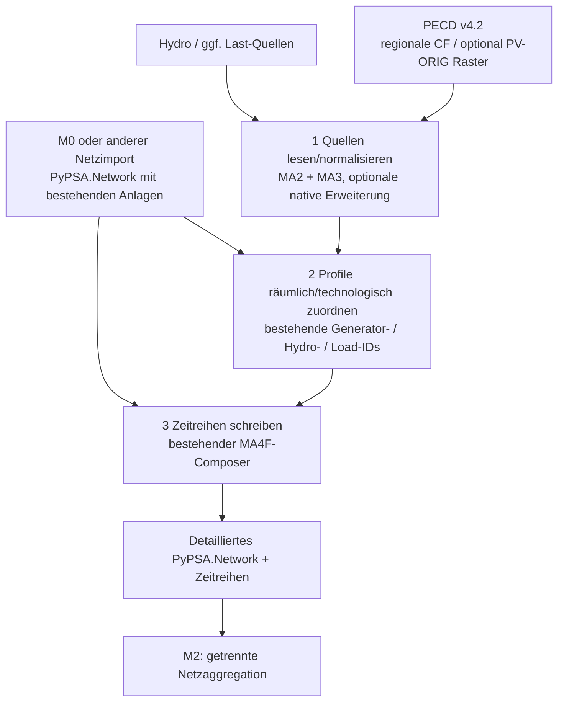

# IoSN Modul 1 — Reduzierte Softwarearchitektur V3

**Datum:** 2026-11-01  
**Entscheidungsvorschlag:** `M1_V3_REUSE_MA2_MA3_MA4F__MINIMAL_PECD_SOURCE_AND_SPATIAL_DELTA`  
**Status:** `ARCHITECTURE_SIMPLIFIED / EXISTING_FIXTURE_EVIDENCE_RETAINED / REAL_SOURCE_BLOCKED`  
**Projekt:** `AlOussama/TYNDP_Products`  
**Grundlage:** [V2-Architektur](00_CANONICAL_ARCHITECTURE_V2.md), [Reuse-Ledger](10_UPSTREAM_REUSE_LEDGER_V2.md), [MD1 Source-Witness](https://github.com/AlOussama/TYNDP_Products/blob/5c68198984b6f2f430a49ff3e23d17c0b27320e1/docs/current/IOSN_Modul1/MD1/EXECUTION_REPORT.md), [MA4F getesteter Composer](https://github.com/AlOussama/TYNDP_Products/blob/1ab3eb1aed54975e69586cc3d958a24d97a6288f/docs/current/IOSN_Modul1/MA4F/EXECUTION_REPORT.md).  

**Vorrang als Sollarchitektur:** V3 vereinfacht die vorgeschlagene V2-Implementierungsstruktur. Die älteren Makroberichte, Commits und ihre tatsächliche Fixture-Evidenz bleiben unverändert. Die zusätzlichen V2-Handoffs `MA5N`, `MA5D`, `MD2`, `MA6` sind **nicht** automatisch auszuführen; deren fachlich erforderlicher Restumfang ist in Abschnitt 7 dieses Dokuments konsolidiert. Keine Rücknahme von schon bestandenem Code- oder Testnachweis.

## 1. Ein Ziel, drei Funktionen — keine zweite Modellierungsplattform

**Ziel:** Vorhandenes detailliertes PyPSA-Netz mit quellgetreuen PECD-/Hydro-/bei Bedarf Last-Zeitreihen befüllen. **M0 importiert ausschließlich das Netz; M1 verbindet externe Profile mit existierenden Netzkomponenten; M2 aggregiert erst danach.**



**Diese drei Boxen sind drei logische Funktionen, nicht drei neu zu entwickelnde Services, Pakete, Projekte oder eigenständige Makros.** PyPSA-Core, PyPSA-Eur-Ausführungskonzepte und bereits erstellte MA2/MA3/MA4F-Komponenten werden genutzt. Keine Änderung an PyPSA-Core oder Solvern; keine autonome neue Netzdaten-Schicht.

## 2. Einzige Minimal-Schnittstelle

```text
Eingabe A — Netzwerk (unabhängig von PECD)
  network: PyPSA.Network / exportiertes .nc
  benötigt: bestehende Generator/Load/Hydro-IDs, bus, carrier, p_nom,
             Bus-Koordinaten sofern als Anlagenproxy qualifiziert
  optional: eigenständige reale Anlagenstandorte, Netz-/Source-Provenienz,
            M0-DNR/Sidecar (falls aus M0 geliefert)

Eingabe B — Profile (unabhängig vom elektrischen Netz)
  weather_id + horizon + tech + product/resolution + source_file
  Zeitachse + Profil-ID/Region/Pixel + Einheiten + CRS/Geometrie
  Version/Revisionsstand + echte Datei-SHA256 + Berechtigung
  bei Hydro: native Intervallgrenzen, MWh, hydro_area/type
  bei Last: nachgewiesene MW-Profile und Lastgebiet

M1-Zwischenprodukt
  asset_profile_map: existing_component_id, profile_id,
                     weight, technology, method, evidence
  values:             [time, existing_component_id]
  source_provenance:   [source_file, sha256, version, weather_id]

Ausgabe
  detailliertes PyPSA-NetCDF mit unveränderter statischer Netzstruktur;
  dynamische Generator-/Speicher-/Load-Zeitreihen + QA/Source-Ledger
```

Es werden **keine PECD-Regionen, Hydro-Basinanteile, meteorologischen Geodaten oder Wetter-IDs als M0-Pflichtausgabe** verlangt. Ein M0-DNR-Sidecar kann im konkreten IoSN-Projekt zusätzliche Identitäts-/Geoqualität nachweisen, ist aber **nicht** die Voraussetzung, dass M1 prinzipiell mit einem anderen bereits vorhandenen PyPSA-Netz arbeitet.

**Spezifischer MA4F-Altstand:** `scripts/iosn_m1/compose.py` verlangt derzeit verpflichtend `m0_sidecar`, `m0_reference_manifest`, `bridge`, Hydro- und RES-Fixture-Manifeste und gibt ausschließlich `SYNTHETIC_FIXTURE` zurück. Für den generischen Realnetzmodus ist **eine kleine Eingabe-/Evidenzklassen-Entkopplung nötig**, nicht ein Neuschreiben des getesteten Schreib-/Roundtrip-Kerns. Rückfall auf einen bloßen unvalidierten Writer ist verboten.

## 3. Was tatsächlich vorhanden ist — was bleibt neu?

| Funktion | Ist-Baustein | V3-Entscheidung |
|---|---|---|
| Regionale PECD-Wind-/PV-CF lesen | [MA2 CSV-/ISO-Reader](https://github.com/AlOussama/TYNDP_Products/blob/11700baa8df8cafc6bd71b96998f8b2bca647ca0/scripts/iosn_m1/res/adapter.py), Open-TYNDP-2026-Reader | **Wiederverwenden** |
| Hydrologische regionale MWh und native Intervalle | [MA3 Hydro-Adapter](https://github.com/AlOussama/TYNDP_Products/blob/b3b9bf133d1b5c968323a31f8ac76090f1f2e182/scripts/iosn_m1/hydro/adapter.py) | **Wiederverwenden**, reale Basin/Plant-Anteile extern belegen |
| Geografische Funktionen | `GeoPandas`/Shapely/`xarray` und punktuell Atlite-`indicatormatrix`/Maskenoperationen | **Wiederverwenden**, keine GIS-Engine neu schreiben |
| Vorhandene `asset_profile_map` validieren | MA2 `validate_assignment()`, GeoJSON-Punkt-in-Polygon | **Wiederverwenden** |
| **Zuordnung automatisch erzeugen**, falls kein direkter Profile-ID-Crosswalk existiert | bislang **nicht** vollständig implementiert | **Kleine neue Funktion innerhalb MA2**, auf qualifizierter Geometrie |
| **Native SPV-ORIG NetCDF-Quellwerte** lesen | MA2 nur `TYNDP_RAW10_DATE_HOUR / TYNDP_DATE_HOUR / ISO_CSV`; NetCDF bisher **nur als Ausgabe** | **Nur ergänzen, wenn echtes PECD-SPV-ORIG-Produkt Eingang ist**, via xarray |
| Native PECD fraktionale Regionsmasken | MA2 validiert GeoJSON, kein originaler NetCDF-Maskenparser | **Nur ergänzen, wenn tatsächliches PECD-Produkt diese Maske für den Join benötigt** |
| PyPSA-Zeitreihen binden, Source-Kollisionen, statische Netz-Identität, NetCDF-Roundtrip | [MA4F-Composer](https://github.com/AlOussama/TYNDP_Products/blob/1ab3eb1aed54975e69586cc3d958a24d97a6288f/scripts/iosn_m1/compose.py) | **Wiederverwenden**; dünne generische Input-/Realmodus-Adaptierung statt neuem Composer |
| Regionale Lasten → vorhandene `Load`-IDs | PyPSA-Eur-Lastdisaggregation existiert, M1 kein echter DFT-Adapter | **Nur bei nachgewiesenem Bedarf** ergänzen; bestehendes `loads_t.p_set` nicht überschreiben |
| Solver, AC-/DC-PF, Anlagenneuanlage, Netzcluster | PyPSA-Core beziehungsweise M2 / andere Module | **Keine neue M1-Funktion** |

**Produktauflösungen:** Offiziell modellierte PECD-Wind-CF liegen in regionalen PEON/P2ON-/PEOF/P2OF-Produkten vor; aus 0,25°-meteorologischen Rasterwinddaten ergibt sich **kein automatisch vorhandenes originales 0,25°-Wind-CF-Produkt**. Ein griddiertes `ORIG`-PV-Kapazitätsfaktorprodukt (0,25°) existiert als Produktoption; ob es tatsächlich in den fünf Quell-Dateipaketen vorliegt, ist bislang nicht physisch geprüft. Hydro überwiegend SZON/Intervallenergie, kein automatischer griddierter CF.

## 4. Minimaler Datenfluss in bestehendem PyPSA-Eur-Konzept

```text
Standard PyPSA-Eur für Wetter→Energieprofil:
ERA5/SARAH → Atlite Cutout → eligibility/potentials → build_renewable_profiles

Projektseitiger PECD-CF-Modus für existierende Anlagen:
bereits modellierter PECD-CF → MA2 Reader → Mapping → MA4F Writer
Hydro-Source (unabhängig)   → MA3 Adapter ─────────────────┘

PyPSA-Eur-/Core-Modellierung und Solving danach unverändert
```

- `build_cutout`/`determine_availability_matrix` nicht erneut ausführen, **wenn fertige CF offizieller PECD-Quellen verwendet und keine neuen erneuerbaren Flächenpotenziale berechnet werden**.
- **Kein unveränderter Aufruf des Standard-`compose_network` für ein bereits vollständig mit Generatoren/Lasten bestücktes M0-Netz**, weil der Upstream-Composer Generatoren, Lasten und ggf. weitere Komponenten anlegt und von `clustered.nc` startet. Der vorhandene MA4F-Writer entspricht hier der kleinsten Anpassung.
- Source-Switch `regional_csv | native_pv_orig_netcdf` ist eine **projektseitige** Konfiguration/Parser-Dispatch; nicht als bereits existierende Upstream-Option ausgeben.
- Datenquelle ist austauschbar, solange die Ausgangs-CF-, Hydro- und Load-Typen **ihren physikalischen Sinn behalten**.

## 5. Räumliche Zuordnung: genau ein Mapping, keine künstliche Modellierung

**Methodenreihenfolge für Wind/PV:**
1. Vorhandener **offizieller profil-/anlagenbezogener Crosswalk**, soweit eindeutig und zu Technologie, Wetter-/Produktrevision passend.
2. Nachgewiesene **reale Anlagenposition** → PECD-Region oder ORIG-Pixel durch GIS-Index/Masken-Join.
3. Ein **repräsentativer elektrischer Bus** als Ersatzstandort **nur mit ausdrücklichem, qualifiziertem Nachweis**; für Offshore-Landfall und synthetische 3W-Sternbusse unzulässig.
4. Ohne gültige Quelle/Zuordnung: `BLOCKED`, **keine** unbekannte nächstgelegene Zone oder Nullprofil-Füllung.

Für eindeutige regionale Profile `CF_g(t)=CF_region(g)(t)`. Nur wenn ein vorhandener Sammelgenerator nachweisbar mehrere Quellregionen umfasst, gilt `CF_g(t)=Σ_r w_gr CF_r(t)`, `Σ_r w_gr=1` und `w` aus **nachgewiesenen MW/MWp-Kapazitätsanteilen**, nicht aus geometrischen Maskenflächen. Mehrere Generatoren an unterschiedlichen Originalbussen dürfen denselben **regionalen** Wind-CF verwenden, ohne die elektrische Topologie zu aggregieren.

Für PV sind Profilbasis `MW/MWp`, tatsächlich vorhandene PV-DC-MWp, AC-`p_nom`, und eventuell freigegebene Wechselrichter-Clipping-Policy getrennt zu prüfen. Für Hydro erfolgt die **nicht geometrisch triviale** hydrologische Source-zu-Anlagenverteilung aus belegten Basin-/TSO-Schlüsseln und Energieerhaltung; sie wird durch MA3 abgewickelt, nicht aus Bus-Entfernungen erraten. Nachfrage/DFT ist eine getrennte regionale Quellen-zu-Load-Id-Verteilung, **kein** PECD-Wind-/PV-CF-Feature.

## 6. Eine einfache, fail-closed Zeitreihen-Ausgabe

**Der einzige Writer ist weiterhin MA4F** (mit erforderlichem kleinen Real-/Generic-Input-Fix):

| Datenart | Bereits vorhandene PyPSA-Zieldaten | Pflichtprüfung |
|---|---|---|
| Wind/PV, qualifizierte RoR-Verfügbarkeit | `n.generators_t.p_max_pu` | vorhandene Generator-ID, Profil-/Kapazitätsnormierung, disjunkte Writer-Zuständigkeiten |
| Hydro mit passendem `StorageUnit`-Modell | `n.storage_units_t.inflow` | Source-MWh→Intervall-MW und hydrologische Zuordnung; Speicherport |
| Nachfrage (nur bei Bedarf) | `n.loads_t.p_set` | qualifizierte Quelle und Lastanteile; kein ungeprüftes Überschreiben |
| `Store/Link`-Spezialfall | kein allgemeiner Native-Inflow-Port | nur mit belegtem bereits vorhandenem Injektionsport und Freigabe; sonst blockieren |

Zeitachsen sind vollständig quellengeprüft, auf UTC-naive PyPSA-Snapshots abgebildet; native Klima-/Planungsjahre voneinander trennen. **Fünf bereits festgelegte Wetterdatensätze bleiben unverändert**; ihre exakten IDs und tatsächlichen Horizon-Bindungen aus der autoritativen Datenlieferung übernehmen, keine eigenen WS-Zuweisungen oder Re-Selektion.

Output je tatsächlich geforderter `(horizon,weather_id)`: ein neues `.nc` mit **allen statischen Komponenten und `bus`/`p_nom` unverändert**, bereits vorhandenen dynamischen Werten unverändert außer explizit genehmigten Zielspalten, plus minimalem `qa.json` (Source-Hashes, Mapping-Coverage, Zeit-Checks, statische Fingerprints, Hydroenergie, PyPSA-NetCDF-Roundtrip). `p_max_pu` ist Verfügbarkeitsgrenze, **kein tatsächlicher Dispatch**.

## 7. Nur zwei folgende Arbeitsphasen — keine neuen Pakethierarchien

### Phase R1: SOURCE-GAP-AND-CODE-DELTA — jetzt, ein konsolidierter kurzer Implementierungs-/Datenabgleich

1. **Tatsächliche Quelldateien zuerst lesen**: pro verbindlicher PECD-Produktart ein echter Header-/Dimension-/Format-/CRS-/Version-/Zeit-/Lizenz-Witness; klären, ob tatsächlich `ORIG`-PV, originale Masken und die fünf beschlossenen Wetter-IDs verfügbar sind. Reale PECD-/Hydro-Sourcebytes können **unabhängig vom M0-Netz** überprüft werden.
2. Bestehenden MA2-/MA3-/MA4F-Code **nicht neu bauen**. Erst nach konkreter Bedarfsermittlung ggf. `native_pv_reader()`, `native_mask_reader()`, `build_asset_profile_map()` **als kleine Funktionen im bestehenden RES-Adapter** implementieren; reine Source-ID-Tabellenjoins brauchen keine GIS-Rasterimplementierung. Der Hydro-Adapter bleibt unverändert bis ein echter Quellformatbefund anderes belegt.
3. MA4F-Composer **minimale Schnittstellen-/Evidenzklassen-Entkopplung**: für qualifiziertes generisches PyPSA-Netz optionaler Sidecar; für M0-spezifischen Realpfad tatsächlich vorgeschriebene M0-Provenienz weiter prüfen; `FIXTURE` und `REAL` ausdrücklich getrennt, reale Qualifikationsentscheidung **nie** per bloßem Laufzeitflag.
4. Ein Regressionstestpaket: bisherige MA2/MA3/MA4F-Tests erneut; optionale ORIG-/Mask-/Spatial-Negativtests; referenzierte fünf Fixture-Ausgaben und Roundtrip. **Keine weitere generelle Architektur- oder Branch-Review-Kampagne**.

**R1-Exit:** `MINIMAL_DELTA_FIXTURE_PASS` mit belegter Source-Produktmatrix oder `BLOCKED_REAL_BYTES`. Bei fehlenden physisch zugänglichen Originaldaten wird nicht spekulativ eine vermeintlich offizielle NetCDF-Struktur oder fünfte Weather-ID erfunden. Eine rein synthetische ORIG-Fixture darf nur als solche qualifiziert sein.

### Phase R2: REAL-DATA-COMPOSITION-AND-ACCEPTANCE — sobald tatsächliche Eingaben bereitliegen

1. Der **Netz-Owner** liefert ein qualifiziertes detailliertes PyPSA-Netz (CGMES über M0 oder anderer qualifizierter Import). Der **PECD-/Hydro-/Last-Data-Owner** liefert separat die tatsächlichen Profile, Raumzuordnungen, Versionen, Rechte und fünf Weather-ID-Bindungen. Keiner muss den anderen Inputtyp erzeugen.
2. Ein gemeinsamer Lauf auf allen **tatsächlich erforderlichen** `(horizon,weather_id)`: Source-Parse, Geo-/Technologiezuordnung, bestehender MA4F-Writer, statische Netzinvarianz, Stunden-/Quellenabdeckung, PV-Basis-/Hydroenergie-Bilanzen, NetCDF-Roundtrip.
3. Ein **unabhängiger Reviewer** am finalen Code/Source-/QA-Commit; erst bei echtem PASS Freigabe des detaillierten M1-Netzes an M2. Keine AC-PF- oder Dispatch-Behauptung aus bloßen Wetter-Verfügbarkeitsprofilen.

**Nicht als eigene Folgemakros auslösen:** erneutes MA1/MA1C/MD1-Review, separaten MD2-Katalogreview ohne reale Dateibytes, neue MA2-/MA3-/MA4F-Implementierungen oder vorrangig eine komplette Wetterjahres-/Zeitachsenplanung. Ein eigener Demand-Adapter ist **nur bei nachgewiesener regionaler Lastaufteilungspflicht** notwendig.

## 8. Beweisstand und Governance

- **Bestanden und beibehalten:** [MA4F Fixture-Integration](https://github.com/AlOussama/TYNDP_Products/blob/1ab3eb1aed54975e69586cc3d958a24d97a6288f/docs/current/IOSN_Modul1/MA4F/EXECUTION_REPORT.md), GitHub Actions [41315496732](https://github.com/AlOussama/TYNDP_Products/actions/runs/41315496732), `92/92 pytest`, `16/16 Snakemake` (synthetisch), fünf synthetische NetCDF, alle 16 statischen Komponententabellen unverändert.
- **Blockiert:** [MD1-Gate](https://github.com/AlOussama/TYNDP_Products/blob/5c68198984b6f2f430a49ff3e23d17c0b27320e1/docs/current/IOSN_Modul1/MD1/MA4R_RELEASE_DECISION.md) — keine echten fünf Projekt-Weather-ID-/PECD-/Hydro-/Netz-Datei-Witness im vorliegenden Paket, native `ORIG`-Quelle nicht belegt.
- **Noch nicht nachgewiesen:** native ORIG-/Masken-Reader in bestehendem Produktcode, automatische Zuordnung aus echten Masken/Assets, Real-Data-Komposition, DFT-Load-Mapping (falls erforderlich), unabhängige Real-Abnahme.

**S-GOV-Entscheidung:** `M1_REDUCED_ARCHITECTURE_V3_PROPOSED__NO_NEW_PLATFORM__TWO_PHASES_ONLY`. V3 ist eine vereinfachte Architektur-Festlegung, **keine nachträgliche neue Code- oder Real-Daten-Zertifizierung**. Für die konkrete Freigabe gilt weiterhin: Fixture-PASS ≠ Real-Data-PASS; M2-Referenzfreigabe erst nach geprüfter tatsächlicher Source→Asset-Verknüpfung.
