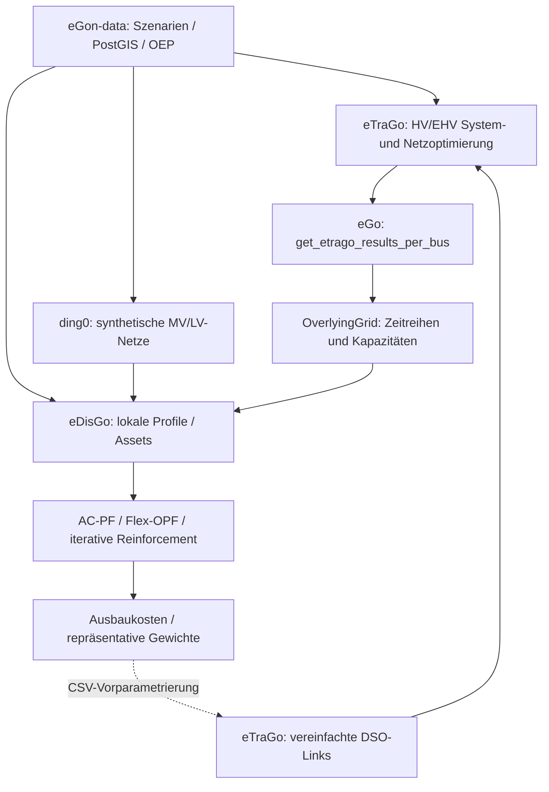
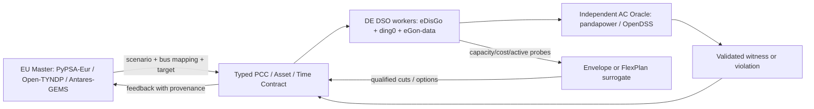

# ESM-D — Integrated Distribution Grid & Sector Coupling Review

**Stichtag:** 2026-11-28 (Europe/Berlin)  
**Status:** STATIC SOURCE REVIEW / HANDOFF READY / NUMERICAL QUALIFICATION OPEN  
**Rolle:** Independent Lead Scientific Power System Planning Architect  
**Mandat:** Read-only für alle untersuchten Systeme, keine Installation, Solver-Kampagne oder Modelländerung. Einzige durch den Folgeauftrag autorisierte Mutation: dieses Markdown-Handoff auf dem vorhandenen Branch `docs/esm-b-planning-requirements-20261127`, direkt unter `docs/handoffs/`. Kein neuer Branch, keine PR, kein Merge.  
**Adressaten:** ESM-A/B/C, übergreifende ESM-Architekturentscheidung, nationale/regionale TSO-DSO-Planung.  
**Vergleichskontext:** [ESM-A: Requirements](https://github.com/AlOussama/TYNDP_Products/blob/docs/esm-a-planning-requirements-20261127/docs/handoffs/ESM_A_20261127/ESM_A_PLANNING_PROCESS_REQUIREMENTS.md), [ESM-B: Antares/GEMS](./ESM_B_20261127/ESM_B_ANTARES_GEMS_CAPABILITY_REVIEW.md), [ESM-C: PyPSA/Open-TYNDP](./ESM_C_PYPSA_OPEN_TYNDP_CAPABILITY_REVIEW.md). ESM-C-Eingangsabschnitt gelesen, B-Pfad verifiziert; keine erneute vollständige A/B/C-Methodikprüfung, keine eigenmächtige Neudefinition der ESM-A-Anforderungen.

## 0. Executive decision record (Empfehlungen, keine Owner-Freigaben)

- **D-D01 — REUSE-FIRST:** eGon-data für räumliche Daten und Szenariomodellierung; ding0 für synthetische deutsche MV/LV-Topologien; eDisGo für Betriebsflexibilität und Ausbauanalyse; eGo als bestehender sequenzieller Referenzworkflow. Nicht durch eine neue allgemeine Verteilnetzbibliothek ersetzen.
- **D-D02 — eTraGo als Referenz für vereinfachte DSO-Rückwirkung:** Der aktuelle Code implementiert tatsächlich aus eDisGo/eGo-Ergebnissen parametrierte, erweiterbare Verteilnetz-Links mit unterschiedlichen Import-/Export-Bestandskapazitäten und gekoppeltem Zubau. Dies ist mehr als ein reiner Top-down-Workflow, aber noch kein dynamisches, bidirektionales Netzrestriktions-/Flexibilitätssignal. Übernahme dieser Formulierung hat Vorrang vor eigener Implementierung.
- **D-D03 — eDisGo ist eine substantielle AC-OPF-Implementierung, kein reiner Lastfluss-Wrapper.** Mehrperiodiger radialer Branch Flow mit exakter nichtkonvexer Stromgleichung oder SOC-Relaxation, flexible EV-Ladeparks, HP/TES, DSM und Batterien. Der Schwerpunkt liegt auf Betriebsplanung; Netzverstärkung ist eine gesonderte iterative Planung, nicht als gemeinsame globale Investitions-MILP nachgewiesen. Zielerreichung darf wegen Slacks und SOC-Lücke nicht mit physischer Zulässigkeit gleichgesetzt werden.
- **D-D04 — FlexPlan.jl zuerst für simultane Planung prüfen:** Native gekoppelte T&D-Investitionen, radial linearisierte Verteilnetzmodelle, zeit-/szenarioübergreifende Investitionen und DSO-Surrogate. Nicht automatisch geeignet für eDisGo-spezifische EV-Abfahrtsgarantien, Wärmespeicherphysik oder zertifizierte P/Q-Hüllen. Adapter und gegebenenfalls Modellergänzungen, nicht sofort Engine-Neuentwicklung.
- **D-D05 — Zwei Ebenen der europäischen Kopplung:** zunächst DE-Detaillayer mit eGon-data/ding0/eDisGo und übrigen Ländern über disaggregierte/typisierte Schnittstellen; anschließend FlexPlan oder Rückkopplung in PyPSA/Linopy für ausgewählte Engpassfälle. Open-TYNDP-Referenzfall nicht eigenmächtig durch deutsche DSO-Ausbauplanung verändern. Antares/GEMS nur über expliziten Daten-/Feasibility-Vertrag (ESM-B entscheidet über die konkrete Ziel-API).
- **D-D06 — Versionen entkoppeln:** eTraGo/eDisGo teilen PyPSA 0.26.2, eGon-data verlangt 0.20.1, ding0 höchstens 0.17.1. Aktueller pandapower-HEAD verlangt pandas 3.x, eTraGo pandas <2; FlexPlan und eDisGo-OPF benötigen verschiedene PowerModels-Versionen. Austausch über versionierte Artefakte statt gemeinsamer Python-/Julia-Umgebung.
- **D-D07 — Physikalisches Gate offen:** keine eigenständig ausgeführten Tests, Solverläufe, Datenbankimporte, Lizenzen für Dritt-Datensätze oder Betriebsvalidierungen. Entscheidung nur für Reuse und Architekturvorbereitung; keine Aussage über reproduzierte Einsparungen, Hosting Capacity, Rechenzeiten oder regulatorische Konformität.

## 1. Methodik und Evidenzvertrag

Klassifikation je **konkreter Fähigkeit** und Modellgrenze: **NATIVE** vorhandener Quellcode/API/Gleichung; **CONFIGURATION** vorhandenes Modell durch Schalter/Dateneingabe; **MODEL_EXTENSION** zusätzliche Parameter, Komponenten, Constraints oder Formulierungen innerhalb vorhandener generischer Engine; **ENGINE_EXTENSION** Änderung der generischen Engine, erst nach Falsifikation von Reuse-Optionen; **EXTERNAL_COUPLING** getrennte Rechen-/Datenkomponenten mit Vertrag; **NOT_SUPPORTED** im konkret geprüften Pfad nicht unterstützt; **UNVERIFIED** nicht hinreichend belegt. NATIVE impliziert weder installierbar noch gelöst noch physisch validiert.

Evidenz: **D** Dokumentation, **C** tatsächlich gelesener relevanter Quelltext/Konfiguration, **I** nur Dateibaum/Symbolinventar (keine Implementierungsqualifikation), **T** gelesener Test mit erkennbarem Orakel (nicht ausgeführt), **P** publizierte Dritt-Evidenz, **N** unabhängig numerisch reproduziert. N = keine in diesem Review. Metadaten via GitHub API; Default-Branch-HEAD und Push-Datum sind verschieden. Paketversion aus Manifest bedeutet nicht veröffentlichter Release oder CI-Pass. Dokumentationszweige können gegenüber HEAD abweichen; im Konfliktfall gilt gepinnter Quellcode. Wo D/I allein vorliegt, ist Detailfähigkeit ausdrücklich UNVERIFIED.

## 2. Quellen-/Versionsmatrix und Reproduktionsgrenzen

| Repository | Default | Paket/Release-Evidenz | HEAD-Datum UTC | Vollständiger geprüfter Commit | Code-Lizenz |
|---|---|---|---|---|---|
| eGo | dev | 0.3.4 setup.py | 2026-11-11 | [ec4537aaa5fbe6f2b3e1bbc7a8905859d18f6b4a](https://github.com/openego/eGo/commit/ec4537aaa5fbe6f2b3e1bbc7a8905859d18f6b4a) | AGPL-3.0 |
| eTraGo | dev | 0.11.0 setup.py; [Release 0.11.0, 13.08.2026 dokumentiert](https://etrago.readthedocs.io/en/latest/) | 2026-11-12 | [b18c6709ffb1498eaed1d49f313efb9733057331](https://github.com/openego/eTraGo/commit/b18c6709ffb1498eaed1d49f313efb9733057331) | AGPL-3.0 |
| eDisGo | dev | 0.3.0 setup.py; Veröffentlichung nicht bestätigt | 2026-11-24 | [fc451cb9cc9bd01c6284d28bf8d0b4f4252212af](https://github.com/openego/eDisGo/commit/fc451cb9cc9bd01c6284d28bf8d0b4f4252212af) | AGPL-3.0-or-later laut Dateiheader |
| eGon-data | dev | 2.0.0 pyproject; [v2.0.0 Release angezeigt](https://github.com/openego/eGon-data) | 2026-11-24 | [a15c63cb1054cf7647e0dd1954828619b927569e](https://github.com/openego/eGon-data/commit/a15c63cb1054cf7647e0dd1954828619b927569e) | AGPL-3.0-or-later |
| ding0 | dev | v0.2.1 setup.py | 2026-11-02 | [593440243e4d38aa9cf9e5410131d941a9b1165d](https://github.com/openego/ding0/commit/593440243e4d38aa9cf9e5410131d941a9b1165d) | AGPL-3.0 |
| pandapower | develop | Version dynamisch; [Release v3.5.6 angezeigt](https://github.com/e2nIEE/pandapower/releases), nicht mit HEAD gleichsetzen | 2026-11-27 | [aee10bd4df9ff64593ecec23c2f98c4828c92356](https://github.com/e2nIEE/pandapower/commit/aee10bd4df9ff64593ecec23c2f98c4828c92356) | [BSD-3-Clause](https://github.com/e2nIEE/pandapower/blob/develop/LICENSE) |
| SimBench | develop | 1.6.3 pyproject; [v1.6.3 Release](https://github.com/e2nIEE/simbench/releases) | 2026-09-22 | [876e7a7be470258cefa524a36eeb08293008b5dc](https://github.com/e2nIEE/simbench/commit/876e7a7be470258cefa524a36eeb08293008b5dc) | BSD-3-Clause Code; ODbL/DbCL Daten |
| FlexPlan.jl (Upstream Electa-Git) | master | 0.4.1 Project.toml | 2026-10-02 | [9c2e99030032bbabc3a8a69b54b6a8eb92ca62af](https://github.com/Electa-Git/FlexPlan.jl/commit/9c2e99030032bbabc3a8a69b54b6a8eb92ca62af) | BSD-3-Clause |

Alle acht Repository-HEADs per Connector gelesen. openego-Kernrepos nicht archiviert; letzte Push-Zeitpunkte 24.–27.11.2026. Tags-/Releases-API wurde für mehrere Repositories nicht zugelassen; daher keine behauptete vollständige Tagliste oder Release-Pin-Gleichheit. Reproduktionsbaseline sind die obigen vollständigen Commit-Hashes, nicht bewegliche dev-Refs. Für Ausführung Release/Tag plus Hash, Lockfile, Solver und Daten separat freigeben. Nicht geprüfte Nebenbranches: UNVERIFIED.

**Organisation:** Abfrage ergab 23 öffentliche openego-Repositories. Kern fünf oben. Weitere relevante Inventar-Kandidaten: data_processing (historischer Vorgänger), ego.io, ego.powerflow, osmTGmod (Netz-/Datenaufbereitung), disaggregator, eGo_app_demand, regon__electricity_new_hh_profiles (Nachfrage/Daten), eGon-validation (potentielle QA), egon-webapp, powerd-data, example_code, pypsa-eur-sec, PyPSA, tsam (Forks/Modelle/Reduktion). oemof.powerflow archiviert. platform_workshop, beamer_theme, egon-website: keine prioritäre Solver-/Modellreuse. Relevanzinventar, keine vollständige Detailprüfung aller 18 Nebenrepos; insbesondere eGon-validation noch nicht als unabhängiges numerisches Orakel qualifiziert. [Organisation](https://github.com/orgs/openego/repositories), [reGo(n) Toolchain](https://rego-n.org/tools_data/).

### 2.1 Paketkompatibilität (C, statisch)

| Umgebung | Manifestbefund | Konsequenz |
|---|---|---|
| eGo 0.3.4 | [setup.py](https://github.com/openego/eGo/blob/ec4537aaa5fbe6f2b3e1bbc7a8905859d18f6b4a/setup.py) referenziert eTraGo@dev und eDisGo@dev direkt | Unpinned upstream; bei späterem Lauf eigene SHAs + vollständiger Lock; keine Reproduzierbarkeit allein durch eGo-Version |
| eTraGo | [setup.py](https://github.com/openego/eTraGo/blob/b18c6709ffb1498eaed1d49f313efb9733057331/setup.py): pypsa==0.26.2, linopy==0.3.2, pandas<2.0, pyomo<6.6, sqlalchemy<1.4, xarray<2024.07.2 | Legacy-PyPSA-Stack, getrennt von ESM-C modernem Core |
| eDisGo | [setup.py](https://github.com/openego/eDisGo/blob/fc451cb9cc9bd01c6284d28bf8d0b4f4252212af/setup.py): pypsa==0.26.2, numpy==1.26.4, pandas>=1.4,<2.2, sqlalchemy<1.4, Python >=3.10,<3.13 | Statische Überschneidung mit eTraGo z.B. pandas 1.x; kein Beweis eines installierbaren transitive dependency lock |
| eGon-data | [pyproject.toml](https://github.com/openego/eGon-data/blob/a15c63cb1054cf7647e0dd1954828619b927569e/pyproject.toml): 2.0.0, Python >=3.10, pypsa==0.20.1, pandas==2.0.3, Airflow/Postgres | Nicht in derselben Umgebung wie eTraGo/eDisGo. Datenbank-/Exportvertrag |
| ding0 | [requirements.txt](https://github.com/openego/ding0/blob/593440243e4d38aa9cf9e5410131d941a9b1165d/requirements.txt): pypsa>=0.11,<=0.17.1, pandas<=1.2.4, numpy~=1.21.2, scipy~=1.7.1, osmnx~=1.1.1, egoio==0.4.8, ding0~=0.2.1 (Selbstabhängigkeit); [setup.py](https://github.com/openego/ding0/blob/593440243e4d38aa9cf9e5410131d941a9b1165d/setup.py) nennt Python 3.8-Klassifikation | Separater Alt-Stack; problematischer Selbstpin/alte Wheels, nicht modernisieren ohne Reproduktion der Topologien |
| eDisGo Julia | [edisgo/opf/eDisGo_OPF.jl/Project.toml](https://github.com/openego/eDisGo/blob/fc451cb9cc9bd01c6284d28bf8d0b4f4252212af/edisgo/opf/eDisGo_OPF.jl/Project.toml): Julia 1.12, PowerModels 0.19.6-Kompatibilität, JuMP, Ipopt, Gurobi; Manifest vorhanden | SOC-Pfad Gurobi, NC-Pfad Ipopt; keine automatische offene SOC-Alternative im Main.jl behaupten |
| FlexPlan Julia | [Project.toml](https://github.com/Electa-Git/FlexPlan.jl/blob/9c2e99030032bbabc3a8a69b54b6a8eb92ca62af/Project.toml): Julia 1.10-Kompatibilität, PowerModels 0.21, PowerModelsACDC 0.9.1/0.10, JuMP 1.15-Kompatibilität, HiGHS im Test-Target | Eigene Julia-Projektumgebung; PM 0.19 vs 0.21 nicht ein gemeinsamer Resolver |
| pandapower / SimBench | [pyproject.toml](https://github.com/e2nIEE/pandapower/blob/aee10bd4df9ff64593ecec23c2f98c4828c92356/pyproject.toml): Python >=3.11, pandas~=3.0.5; [pyproject.toml](https://github.com/e2nIEE/simbench/blob/876e7a7be470258cefa524a36eeb08293008b5dc/pyproject.toml): Python>=3.11, pandapower>=3.4.0 | Separate Oracle-Umgebung; SimBench-Paket nicht blind in eDisGo importieren |

Pin der bestehenden PyPSA-Eur-Integration in eGon-data: [download()](https://github.com/openego/eGon-data/blob/a15c63cb1054cf7647e0dd1954828619b927569e/src/egon/data/datasets/pypsaeur/__init__.py#L159-L218) checkt 2119f4cee05c256509f48d4e9fe0d8fd9e9e3632 aus und überschreibt Konfiguration/Extra-Funktionalität. Das ist direkter Vorläufer-Reuse, **kein Nachweis** der Kompatibilität zum heutigen PyPSA-Eur/Open-TYNDP. Separate Adapter und Schema-Migration.

### 2.2 Datenverfügbarkeit und Lizenz-Gates

- [eGon-data Datenbeschreibung](https://egon-data.readthedocs.io/en/latest/data.html) und [Repository](https://github.com/openego/eGon-data): Postgres/PostGIS-Datenpipeline über Airflow; OEP und Zenodo-Datenbundle. Deutschland-georeferenziert; Ausland gröber aggregiert. Dokumentation nennt ca. 350 GB temporären Platz für Vollpipeline, Testgebiet Schleswig-Holstein. Diese Review hat keinen DB-Zugang oder Vollständigkeit des Bundles geprüft.
- [eTraGo Input Data](https://github.com/openego/eTraGo) dokumentiert OEP sowie Zenodo-DB-Backups. [eDisGo Data sources](https://edisgo.readthedocs.io/en/dev/userguide/data_sources.html) dokumentiert CSV-Ding0-Topologien, OEP/eGon-data und EV-Verzeichnisse. ding0-CSV enthält buses, lines, loads, generators, transformers, transformers_hvmv, storage_units, switches, network; neue vs alte Importpfade explizit unterscheiden. Keine Datenverfügbarkeit einzelner Grid-IDs als gegeben annehmen. SimBEV-/TracBEV-Import dokumentiert versionsabhängige Formate (3083c5a, 14d864c).
- Neue Datenmodule reGo(n) enthalten status2024, reGon2037 und reGon2045; ältere eGon2035/eGon100RE sind eigene Szenarien. Szenarioversion, Wetterjahr und Energie-/Kapazitätssummen abgleichen, nicht einfach umbenennen. TYNDP-/NEP-Szenarien sind nicht ohne Mapping identisch.
- AGPL-Code: Rechte-/Hinweispflichten und bei einschlägiger modifizierter Netzwerkbereitstellung Quellcodepflicht prüfen; Prozessgrenzen allein garantieren keine lizenzrechtliche Ausnahme. Juristische Bewertung vor Distribution/Hosted Service. Keine pauschale Lizenzübertragung von Code auf Daten. [SimBench Lizenz](https://github.com/e2nIEE/simbench/blob/develop/LICENSE): DB ODbL 1.0, Inhalte DbCL 1.0, Code BSD-3-Clause. eGon-Tabellen-Metadaten, OSM (ODbL), MaStR, Wetter-/Zensus-/Mobilitätsdaten sowie TSO/DSO-Daten einzeln lizenzieren. Keine Weiterveröffentlichung realer DSO-Anschlussdaten ohne Freigabe.
- Minimaler DataManifest: dataset_id/version, Quelle/Download-URL, Lizenz/Attribution, SHA256, schema_version, CRS, Szenario, Modell-/Wetterjahr, snapshot_index und Zeitzone, Auflösung, Einheiten, räumlicher Geltungsbereich, bekannte Lücken. Zugangsnachweis pro benötigter Tabelle/Datei. Quelldaten, abgeleitete synthetische Netze und Betriebsresultate getrennt.

## 3. Wissenschaftliche Komponenten- und Netzmodellmatrix

| Fähigkeit / Modellgrenze | Primärer Reuse-Baustein | Klasse | Evidenz / Beschränkung |
|---|---|---|---|
| EHV/HV Netzdispatch, lineare Netz-/Marktoptimierung | eTraGo/PyPSA | NATIVE | D/I; grid_optimization, market_optimization, sclopf; Detailmethodik nicht vollständig auditiert |
| HV/MV-Umspannwerke, MV/LV-Leitungen und Transformatoren | ding0 + eDisGo | NATIVE | C/I: Topologieimport, stations reinforcement; synthetische Modelle |
| Deutschlandweite synthetische MV/LV-Topologien | ding0 | NATIVE | D/C: eGon-Datenabfragen; OSM-Wege/Clustering/Routing im Inventar; keine Realnetzidentität |
| Repräsentative Netze / Netzbezirke | eGo KMeans; SimBench | CONFIGURATION / EXTERNAL_COUPLING | C/D; Clusterrepräsentanten, Gewichte; SimBench Referenzfälle, nicht reale DSO-Assets |
| Reale DSO-Netze / GIS-Anlagen | externer DSO-Datenadapter | EXTERNAL_COUPLING | reale Daten nicht vorhanden; Mapping und Assetprovenienz nötig |
| AC-PF (symmetrischer stationärer Betrieb) | eDisGo.analyze / PyPSA PF; pandapower | NATIVE | C, D; tatsächlicher konvergenter Fall nicht reproduziert |
| DC/lineare PF-Initialisierung | eDisGo.analyze lpf seed | CONFIGURATION | C; nicht gleich LV-Spannungsmodell oder lineare Flex-OPF |
| Radiale mehrperiodige AC-OPF | eDisGo Julia NCBF | NATIVE | C/T; nichtkonvex, lokal gelöst, radial/balanciert |
| SOC-relaxierte Branch-Flow-OPF | eDisGo Julia SOCBF | CONFIGURATION | C/T; Gurobi-Standardpfad, Gleichheitsrest und AC-Replay Pflicht |
| Lineare DistFlow/MILP-Ausbauplanung | FlexPlan.jl | EXTERNAL_COUPLING | C/I/D; anderer Modell-/Datenvertrag, keine elektrische exakte AC-Garantie |
| P/Q-Bilanzen, I²R-/I²X-Verluste, Spannungsabfall | eDisGo BFM | NATIVE | C/T; Tap- und Einheitenvertrag prüfen |
| P/Q-freie Inverterfähigkeit, V/Q-Regelung | eDisGo q_control / externer OPF | CONFIGURATION / MODEL_EXTENSION | I/C: cosphi-basierte Kopplung im BFM, kein frei zertifizierter P/Q-Satz |
| Thermische Leitung-/Stationsgrenzen und V-Bänder | eDisGo | CONFIGURATION | C; OPF 1/3 ohne harte Strom-/Spannungsbounds; 2/4 mit Bounds/Slacks; Reinforce prüft gesondert |
| Iterativer Leitungs-/Trafoausbau, LV-Netzteilung | eDisGo.reinforce | NATIVE | C; technische Heuristik und Kostenauswertung, keine globale Optimalitätsgarantie |
| Flexibilität als Ausbaualternative | eDisGo Szenariovergleich | CONFIGURATION | C/D; vergleichbare Basis/Servicequalität notwendig |
| Gemeinsame diskrete T&D-Investition und Betrieb | FlexPlan.jl | EXTERNAL_COUPLING | C/D/I; keine Behauptung, eGo selbst löst monolithisches T&D-MILP |
| Asymmetrischer mehrphasiger PF/OPF, Neutralleiter | OpenDSS, pandapower 3ph, PowerModelsDistribution | EXTERNAL_COUPLING | D; eDisGo geprüfter BFM kein Mehrleitermodell |
| Schutzkoordination, Kurzschluss, Power Quality, Dynamik | externe spezialisierte Engines | EXTERNAL_COUPLING | nicht durch eDisGo-OPF validiert; kein Scope für EMT hier |
| Zeitreihen / Worst case / räumliche Reduktion | eDisGo; eTraGo | CONFIGURATION | C/I; Auswahl- und Resamplingpfade; Chronologie und Energieerhalt testen |
| Probabilistische hosting capacity / N-1 gesamtes DSO-Netz | externer Studienworkflow | MODEL_EXTENSION / EXTERNAL_COUPLING | kein umfassendes natives Orakel qualifiziert |
| Umspannwerks-P/Q-FOR mit zeitgekoppelter Realisierbarkeit | eDisGo + FlexPlan-Probing als Reuse | MODEL_EXTENSION / EXTERNAL_COUPLING | aktive Leistungsprobes vorhanden; keine zertifizierte mehrperiodige P/Q-Hülle im geprüften Stack |
| Europäische flächendeckende MV/LV-Netzgenerierung | ding0-Methodik, nationale Datenadapter | MODEL_EXTENSION | Deutschland-Pipeline; Übertragbarkeit nicht belegt |

**Codeanker:** [EDisGo: Import, to_pypsa, to_powermodels, analyze, reinforce](https://github.com/openego/eDisGo/blob/fc451cb9cc9bd01c6284d28bf8d0b4f4252212af/edisgo/edisgo.py#L740-L1515); [Ausbaualgorithmus](https://github.com/openego/eDisGo/blob/fc451cb9cc9bd01c6284d28bf8d0b4f4252212af/edisgo/flex_opt/reinforce_grid.py#L228-L321); [Trafo-, Leitungs- und Netzteilungsmaßnahmen](https://github.com/openego/eDisGo/blob/fc451cb9cc9bd01c6284d28bf8d0b4f4252212af/edisgo/flex_opt/reinforce_measures.py); [KMeans und Gewichte](https://github.com/openego/eGo/blob/ec4537aaa5fbe6f2b3e1bbc7a8905859d18f6b4a/ego/mv_clustering/mv_clustering.py#L235-L348); [Bezirk/Anschluss/Gebäude](https://github.com/openego/ding0/blob/593440243e4d38aa9cf9e5410131d941a9b1165d/ding0/tools/egon_data_integration.py#L14-L142); [SimBench](https://github.com/e2nIEE/simbench).

Ding0 ist der Bottom-up-Generator, nicht der Datenlieferant tatsächlich vorhandener Kabel-/Transformatorasset-IDs. eGon-data liefert MV-Bezirke, Stations-/Gebäudeinformationen und Kapazitäten; ding0 konstruiert MV/LV mit Geometrien und Standardbetriebsmitteln. Für nationale Kostenabschätzung repräsentative Typologie vertretbar nach Kalibrierung, für verbindliche Einzelanschlussplanung reale Netzparameter/Schaltzustände/Schutzdaten erforderlich.

## 4. Sektorkopplung — Input, Modellaufbau, Entscheidung, Validierung

| Sektor | Daten/Regionalisierung | Modellbildung und Entscheidungen | Physischer Scope / Klasse |
|---|---|---|---|
| Haushalte, Gebäude | Zensuszelle, OSM/synthetische Gebäude, Haushaltsprofile, räumliche Zuordnung | eGon-data aggregiert/disaggregiert Strom- und Wärmezeitreihen; eDisGo verknüpft Gebäude-IDs/Lasten; konventionelle Last vorgegeben | NATIVE Datenpipeline (C); Anschluss innerhalb synthetischer Topologie, keine reale Messpunktidentität |
| Gewerbe/Handel/Dienstleistungen (CTS) | Gebäudebezug, Lastprofile und Spitzenlast | eGon-data CTS-Buildings; eDisGo Last/gegebenenfalls DSM | NATIVE Daten (C/I), genaue Endnutzung und Gebäude-RC UNVERIFIED |
| Industrie | demandregio, OSM-Industrieflächen/Standorte; Spannungslevel nach Peaks | Zuordnung zu MV/HV/EHV, aggregierte Lastgänge; DSM-Bänder statt Produktionsprozessmodell | NATIVE Regionalisierung (C); detaillierte industrielle Prozesswärme/Produktionsrestriktionen MODEL_EXTENSION/UNVERIFIED |
| Pkw-EV | SimBEV/TracBEV, Lade-/Stand-/Fahrzeiten, Ladeparks, Belegung | eGon-data HV-aggregiert charger Link/EV Store/Fahrlast; eDisGo V1G Ladeleistungs-/Energiebänder, Parkzuordnung, Diversitätsfaktor | NATIVE V1G (C/D); V2G NOT_SUPPORTED im geprüften Standardpfad; Session-Realisierbarkeit testen |
| ÖPNV/Schwerlast | eGon-data bus charging, HGV charging, heavy-duty H2, rail demand | ÖPNV externe statische Ladeprofile laut D, Szenarien abhängig; HGV/H2/Rail-Pipeline inventarisiert | NATIVE Eingangsdaten bzw. I/D; flexible Depotoptimierung/V2G UNVERIFIED |
| Gebäude-Wärmepumpen | Gebäudekapazität, Wärmebedarf (Raumwärme/WW), temperatur-/wetterabhängiger COP | eGon-data Kapazitätszuweisung; eTraGo Link; eDisGo OPF P_HP und TES | NATIVE (C/T); keine Gebäudekomfort-/RC-Dynamik im geprüften TES-Modell |
| Fernwärme/PtH | Gebiete, Heizlast, CHP und weitere Wärmeerzeugung, zentrale HP | eGon-data zentrale Wärmebusse/Links; eGo/eDisGo übergibt andere Wärmeeinspeisung und zentrale HP/TES-Vorgaben | NATIVE (C); hydraulischer/thermischer Fernwärmenetzfluss nicht nachgewiesen, EXTERNAL_COUPLING |
| Kühlung | Wetter/Kältebedarf nicht durch auditierte eGon-DSO-Module belegt | Chiller, EER/COP, Kältespeicher und Komfort als Modellergänzung | UNVERIFIED Standardpfad; MODEL_EXTENSION in Systemmodell (siehe ESM-C), elektrische Anschlussprüfung EXTERNAL_COUPLING |
| PV, Wind, dezentrale Erzeuger | MaStR, Geodaten, PV-Dach/Freifläche, Wetterprofile | eGon-data Zuordnung/Kapazitäten; eDisGo Feed-in, Curtailment, q_control; eTraGo optimiert aggregierten Dispatch | NATIVE Daten und Dispatch (C/I); realistische Inverter-S/Q-Kennlinien/FOR zusätzlich qualifizieren |
| Heimspeicher | Kapazitätszuweisung eGon-data, Import eDisGo | eDisGo p, SOC und virtuelle Verlustzweige; eTraGo aggregierte Kapazität/Dispatch | NATIVE (C/T); Effizienz-/SOC-Grenztest erforderlich |
| DSM | CTS/Industrie Potenziale und Grenzen | eDisGo P-/E-Bänder mit Rebound über Endenergie | NATIVE (C/T); keine explizite Anlagen-MILP oder Produktqualität |
| Methan und H2 | eGon-data Gas-/H2-Busse, Pipelines, Kavernen, Elektrolyse, Methanisierung, Nachbarländer | PyPSA/eTraGo energiebilanzielle sektorübergreifende Links/Stores; Szenarioabhängige Kapazitäten | NATIVE Systemmodell (D/C/I), keine Druck-/Kompressor-/Hydraulikvalidierung, lokale Gasnetze UNVERIFIED |

**Primäre Codebelege für Datenvertrag:**  
[EgonMapZensusMvgdBuildings](https://github.com/openego/eGon-data/blob/a15c63cb1054cf7647e0dd1954828619b927569e/src/egon/data/datasets/electricity_demand_timeseries/mapping.py#L10-L100) enthält zusammengesetzten building_id/sector-Schlüssel, Census-ID, bus_id und OSM-/Strom-/Wärmeflags. [identify_voltage_level/identify_bus](https://github.com/openego/eGon-data/blob/a15c63cb1054cf7647e0dd1954828619b927569e/src/egon/data/datasets/industry/temporal.py#L19-L149) ordnet Industrien nach Spitzenleistung und Geometrie zu. [Gebäude-HP-Kapazität](https://github.com/openego/eGon-data/blob/a15c63cb1054cf7647e0dd1954828619b927569e/src/egon/data/datasets/heat_supply/individual_heating.py#L85-L157); [Abfrage nach building_id](https://github.com/openego/eDisGo/blob/fc451cb9cc9bd01c6284d28bf8d0b4f4252212af/edisgo/io/heat_pump_import.py#L34-L99); [rural/central HP + COP](https://github.com/openego/eGon-data/blob/a15c63cb1054cf7647e0dd1954828619b927569e/src/egon/data/datasets/heat_etrago/power_to_heat.py); [Heat-demand-Busse](https://github.com/openego/eGon-data/blob/a15c63cb1054cf7647e0dd1954828619b927569e/src/egon/data/datasets/heat_etrago/hts_etrago.py); [H2-Pipelineaufbau](https://github.com/openego/eGon-data/blob/a15c63cb1054cf7647e0dd1954828619b927569e/src/egon/data/datasets/hydrogen_etrago/h2_grid.py#L193-L259). Weitere gelesene Baumstruktur: electricity_demand_timeseries/{hh_buildings,hh_profiles,cts_buildings}, DSM_cts_ind.py, power_plants/{pv_rooftop_buildings,pv_ground_mounted,mastr}, storages/home_batteries.py, heat_demand_timeseries, district_heating_areas, gas_grid.py, industrial_gas_demand.py, hydrogen_etrago/{power_to_h2,h2_to_ch4,storage}. Für diese letztgenannten Module keine vollständige Gleichungsprüfung (I). [Daten-Methodik](https://egon-data.readthedocs.io/en/latest/data.html).

Wichtige Trennung: räumliche Zuordnung zur MV-District-ID bedeutet nicht schon elektrischen LV-Anschluss. Kette building_id → grid district / station → ding0 Load / Bus → eDisGo-Komponente muss inkl. Summenerhalt, Geometrie/CRS, fehlender IDs, Spannungslevel und Aggregation nachgewiesen werden. Sektormodellierung von Gas/H2 ist kein Nachweis druckphysikalischer Netze; Gebäudekapazität ist kein optimierter Investitionsentscheid; ein OPF-Resultat mit Slacks ist kein serviceerfüllender Betriebspunkt.

## 5. Mathematische Detailprüfung eDisGo

### 5.1 Radialer Branch Flow und Zielfunktionen

Bezeichne gerichtete radiale Leitung i→j, P,Q am sendenden Ende (p.u.), v_i=|V_i|², l_ij=|I_ij|², r,x und Tap-Verhältnis a. Der im Quellcode gelesene Spannungsabfall lautet (Vorzeichen wie Quellgleichung):

    v_i/a² - v_j = 2(r P_ij + x Q_ij) - (r² + x²) l_ij.

Wirk-/Blindleistungsbilanz je Bus enthält ohmsche und reaktive Verluste r l bzw. x l und lokale Last/Erzeugung/Flexibilität. SOC-Modell: P²+Q² ≤ (v_i/a²) l; NC-Modell: Gleichheit. Für zulässige Betriebspunkte sind Strom-/Spannungsgrenzen, Leistungsgleichgewicht, Tap, Shunt- und Basisgrößen konsistent zu prüfen. Die SOC-Gleichheitslücke ist kein Konvergenzkriterium der AC-PF; bei positiver Lücke folgt keine physische Realisierbarkeit. NCBF mit Ipopt liefert im Allgemeinen lokal stationäre Lösungen, kein globales Optimum.

| opf_version | Modellabsicht | Verbindliches Post-Gate |
|---|---|---|
| 1 | Verlust-/Maximalbelastungsobjective, ohne harte V-/I-Grenzen | V/I separat prüfen, keine automatische Hosting-Capacity-Freigabe |
| 2 | Verluste und penalisiertes Curtailment/Shedding unter V-/I-Bounds | Slacks, Service, V/I und AC-Replay |
| 3 | Variante 1 + übergeordnetes Flexibilitätsziel, strafbewehrt | wie 1 + HV-Residual |
| 4 | Variante 2 + übergeordnetes Flexibilitätsziel, strafbewehrt | wie 2 + HV-Residual |

Code: [voltage, current, balance](https://github.com/openego/eDisGo/blob/fc451cb9cc9bd01c6284d28bf8d0b4f4252212af/edisgo/opf/eDisGo_OPF.jl/src/form/bf.jl#L71-L280); [OPF-Aufbau und Versionswahl](https://github.com/openego/eDisGo/blob/fc451cb9cc9bd01c6284d28bf8d0b4f4252212af/edisgo/opf/eDisGo_OPF.jl/src/prob/opf_bf.jl#L8-L105); [Objectives und Slacks](https://github.com/openego/eDisGo/blob/fc451cb9cc9bd01c6284d28bf8d0b4f4252212af/edisgo/opf/eDisGo_OPF.jl/src/core/objective.jl#L1-L176); [Gurobi/SOC, Ipopt/NC, SOC-tightness](https://github.com/openego/eDisGo/blob/fc451cb9cc9bd01c6284d28bf8d0b4f4252212af/edisgo/opf/eDisGo_OPF.jl/Main.jl#L46-L151). Die Gewichte im Code (z.B. factor_slacks=0.6 und skalierte HV-Penalties) sind keine automatisch kalibrierten ökonomischen Systemkosten in EUR. Energie-/Lastabwurf und Wärme-Slacks nicht als billige Flexibilität bewerten.

**Q-Vertrag:** Die Strom- und Spannungsphysik enthält Q; Teile der Flexibilitäts-Q-Bilanzen sind an cosphi/pf gekoppelt. Eine zweidimensionale unabhängig steuerbare Inverterfähigkeit mit P²+Q²≤S² und spannungsabhängigen Grenzen ist nicht automatisch aus dem Vorhandensein einer Q-Variable ableitbar. Geprüft: [Variablenbounds](https://github.com/openego/eDisGo/blob/fc451cb9cc9bd01c6284d28bf8d0b4f4252212af/edisgo/opf/eDisGo_OPF.jl/src/core/variables.jl), [P/Q-Balance](https://github.com/openego/eDisGo/blob/fc451cb9cc9bd01c6284d28bf8d0b4f4252212af/edisgo/opf/eDisGo_OPF.jl/src/form/bf.jl#L188-L280). Für freie FOR-Probes explizit P/Q-Fähigkeiten und Phasenmodell ergänzen oder PowerModelsDistribution nutzen.

### 5.2 Elektromobilität

**Systemebene:** [Modelldarstellung](https://github.com/openego/eGon-data/blob/a15c63cb1054cf7647e0dd1954828619b927569e/src/egon/data/datasets/emobility/motorized_individual_travel/model_timeseries.py#L18-L85) implementiert für flexible Zukunftsszenarien EV-Bus, BEV_charger-Link, battery_storage-Store und Fahrlast; Status quo als unflexible Last. Link p_min_pu=0 ([Charger- und SOC-Grenzen](https://github.com/openego/eGon-data/blob/a15c63cb1054cf7647e0dd1954828619b927569e/src/egon/data/datasets/emobility/motorized_individual_travel/model_timeseries.py#L644-L707)). Annahme flexible Ladung zuhause/Arbeit für alle entsprechenden Ereignisse; keine reale Ladebereitschaft garantieren. V2G nicht nachgewiesen.

**DSO-Ebene:** Ladeprozesse pro Fahrzeug, Zuordnung zu privaten/öffentlichen Ladepunkten/Parks, zeitliche Verfügbarkeit, Ladebedarf. [Elektromobilitätsmethodik](https://edisgo.readthedocs.io/en/stable/methodology/flexibility/electromobility.html) beschreibt Park-Gleichzeitigkeit (1 bis 0.45 zwischen 0.3 und 1 MW), nicht Ersatz zeitlicher Lastprofile. [get_flexibility_bands](https://github.com/openego/eDisGo/blob/fc451cb9cc9bd01c6284d28bf8d0b4f4252212af/edisgo/network/electromobility.py#L368-L640) konstruiert Ladeleistungs- und kumulative Energiehüllen aus frühester/spätester Ladung; MW/MWh-Umrechnung und Summation.

Für Park k:

    0 ≤ p_EV(k,t) ≤ P_upper(k,t)
    E_lower(k,t) ≤ e_EV(k,t) ≤ E_upper(k,t)
    e_EV(k,t) = e_EV(k,t-1) + η_cp Δt p_EV(k,t).

Code: [p_min=0, p_max, eta](https://github.com/openego/eDisGo/blob/fc451cb9cc9bd01c6284d28bf8d0b4f4252212af/edisgo/io/powermodels_io.py#L1324-L1352); [EV-State und Randwerte](https://github.com/openego/eDisGo/blob/fc451cb9cc9bd01c6284d28bf8d0b4f4252212af/edisgo/opf/eDisGo_OPF.jl/src/core/constraint.jl#L67-L115). Anfangszustand wird im Code aus Mitte der Anfangshülle plus erster Ladeleistung aufgebaut, Endzustand auf Mitte der letzten Hülle gesetzt. Bei Ein-Zeitschritt-Horizont sind beide Constraints aktiv: p_EV=0 für ηΔt>0, daher kein beliebiger Einzelstundentest für flexible EV. Prüfen, ob getroffene Zeitindex-Konvention bei Subhorizonten korrekt ist; bei Aggregation ggf. disaggregierbaren Session-Schedule als unabhängiges Orakel verlangen. Keine Behauptung, Summenhüllen seien für heterogene Ladeprozesse notwendigerweise exakt realisierbar.

V1G = NATIVE; V2G = NOT_SUPPORTED im geprüften Standard-Charger- und OPF-Pfad. Vorgeschlagene MODEL_EXTENSION: getrennte nichtnegative p_ch/p_dis, Fahrzeug-SOC mit Fahrlast und η_ch/η_dis, Anschlusszeit, SOC_min bei Abfahrt, Scheinleistungsgrenze, Lade-/Entladeausschluss wo erforderlich, Batterieverschleiß und opt-in. Nicht bloß p_min negativ setzen: die bestehende kumulative Ladehülle enthält keine bidirektionale Fahr-/SOC-Dynamik.

### 5.3 Wärmepumpen und thermische Speicher

Statisch p_HP = q_demand/COP. Optimiert mit thermischem Speicher: elektrische HP-Leistung und thermische Speicherleistung/Bestand. In Quellvariablen phs positiv bei Entladung:

    COP_t (php_t + phps2_t) = q_demand_t + phss_t - phs_t
    E_th,t = (1-p_loss)^(Δt/24) E_th,t-1 - Δt phs_t  (Folgezeitschritte)
    0 ≤ E_th,t ≤ E_th,max; 0 ≤ php_t ≤ P_HP,nom.

Initiale Gleichung ohne den obigen Verlustfaktor, feste Endenergie. phps2 und phss sind Strafvariablen, keine physisch zulässige Wärmeerzeugung. Export schreibt charge/discharge_efficiency, die gezeigten Speicher-State-Gleichungen verwenden diese Argumente jedoch nicht direkt. Export definiert p_loss je Fall (u.a. 0.04 pro Tag), nicht pauschal pro Stunde. phs-Grenzen werden aus capacity abgeleitet; Leistungs-/Energieeinheiten und implizite Dauer qualifizieren. Kein eigenständiger Nachweis von COP-Kennlinie, Temperatur-/Komfortzuständen, Mindestlaufzeiten, Abtauung oder Wärmenetztransport.

Quellen: [Heat state/HP balance](https://github.com/openego/eDisGo/blob/fc451cb9cc9bd01c6284d28bf8d0b4f4252212af/edisgo/opf/eDisGo_OPF.jl/src/core/constraint.jl#L10-L140); [Speicher-/HP-Bounds](https://github.com/openego/eDisGo/blob/fc451cb9cc9bd01c6284d28bf8d0b4f4252212af/edisgo/opf/eDisGo_OPF.jl/src/core/variables.jl#L281-L364); [HP/TES Export](https://github.com/openego/eDisGo/blob/fc451cb9cc9bd01c6284d28bf8d0b4f4252212af/edisgo/io/powermodels_io.py#L1381-L1519); [HP-Methodik](https://edisgo.readthedocs.io/en/stable/methodology/flexibility/heat_pumps.html). Fernwärme: [aggregate_district_heating](https://github.com/openego/eDisGo/blob/fc451cb9cc9bd01c6284d28bf8d0b4f4252212af/edisgo/run/tasks/flex.py#L433-L496) zieht andere Wärmeeinspeisung ab; Reihenfolge vor optimize wesentlich, sonst falsche Wärmebilanz. Gebäude-RC/Komfort als optionale MODEL_EXTENSION und externer EnergyPlus-oracle; keine Doppelzählung der thermischen Flexibilität mit TES.

### 5.4 Batteriespeicher, DSM, Verluste

Batterie: Quell-State se_t-se_(t-1)=-Δt ps_t (ps positiv bei Entladung), festgelegte Start-/Endenergie. Export deklariert 0.9 für charge/discharge_efficiency, verwendet virtuelle Zweige; die State-Gleichung enthält die Faktoren nicht direkt. Virtuelle Zweigleistung wird beim Rückimport verwendet. Deshalb nicht pauschal Wirkungsgrad=1 oder doppelte Verluste behaupten; Pflichtfall: AC-Anschlussenergie vs interne Energieänderung und Zweigverluste bei Lade-/Entladezyklen, einschließlich Rundreiseeffizienz. DSM: e_t-e_(t-1)=Δt p_DSM,t, P-/E-Grenzen, E_end=0; Shift darf Verbrauch nicht verschwinden lassen. Rebound über Horizontränder und Basislast prüfen.

Quellen: [battery/DSM/TES](https://github.com/openego/eDisGo/blob/fc451cb9cc9bd01c6284d28bf8d0b4f4252212af/edisgo/opf/eDisGo_OPF.jl/src/core/constraint.jl#L10-L63); [virtuelle Zweige, Wirkungsgrad und P/E-Export](https://github.com/openego/eDisGo/blob/fc451cb9cc9bd01c6284d28bf8d0b4f4252212af/edisgo/io/powermodels_io.py); [Betriebsstrategien (Dateibaum, Detailaudit offen)](https://github.com/openego/eDisGo/blob/fc451cb9cc9bd01c6284d28bf8d0b4f4252212af/edisgo/flex_opt/battery_storage_operation.py). Battery-/DSM-Betrieb NATIVE; Alterung, Reserve-Mehrfachnutzung und exakte industrielle Dienstleistungsbedingungen MODEL_EXTENSION.

### 5.5 Netzverstärkung, Zeitauflösung, Gleichzeitigkeit

Reinforce läuft mit AC-Analyse, Überlastidentifikation HV/MV, MV/LV, Leitungen, Spannungsproblemen und iterativen Maßnahmen: Trafoverstärkung, Leitungsersatz/-parallelisierung, LV-Netzteilung; Abbruch-/Iterationsgrenzen. Kosten aus Equipment- und Kostenparametern, kein Nachweis global kostengünstigster Maßnahmenkombination. EGo normalisiert und clustert MV-Netze; representative grid + n_grids_per_cluster nur für statistisch begründete Hochrechnung, niemals gleiche Flexibilität pro Einzelstation ungeprüft.

Vergleichsmatrix: baseline, Flex-off/unkoordiniert, koordinierte V1G/HP/DSM, Netzverstärkung ohne Flex, Flex+Verstärkung bei gleichem Service und Wetter-/Zeitindex. Peak demand, low-load/high-PV, Winterabend mit HP/EV-Koinzidenz, PV-Mittag, Reverse Flow, Rebound nach Sperrzeit, DSO-Trafo-/Feederengpass, Ausfall wo relevant. 15-min vs 1 h durch energieerhaltendes Resampling und Peak-Bounds verifizieren; repräsentative Tage nicht frei verketten bei EV/TES/SOC. Baseline-Netz und Szenarioausbau getrennt; EENS/Shedding nicht als Einsparung. Temperatur-/Ratingbasis und N-1-Prüfumfang explizit.

## 6. Tatsächlicher TSO-DSO-Datenfluss

### 6.1 Top-down und statische Bottom-up-Vorparametrierung sind bereits vorhanden

**Top-down realer Code:** [_build_run_edisgo_config und _run_one_grid_via_runner](https://github.com/openego/eGo/blob/ec4537aaa5fbe6f2b3e1bbc7a8905859d18f6b4a/ego/tools/edisgo_integration.py#L624-L756) delegiert per MV-Bezirk an edisgo.run.run_edisgo; OverlyingGrid kann aus eTraGo oder CSV geladen werden. [get_etrago_results_per_bus](https://github.com/openego/eGo/blob/ec4537aaa5fbe6f2b3e1bbc7a8905859d18f6b4a/ego/tools/interface.py#L190-L365) beschreibt/ermittelt dispatchable/renewable P/Q, Curtailment, Speicherleistung, SOC, optimierte Kapazität, DSM, zentrale/dezentrale HP/TES und EV; district heating mapping. Q bei fehlender post-LOPF-PF-Ausführung kann durch Ersatzwerte vertreten sein; nicht als AC-Referenz deklarieren. Speicheraggregation benutzt z.B. summiertes p_nom_opt und erstes max_hours: Heterogenität testen, sonst falsche E-Kapazität. [OverlyingGrid + distribute_overlying_grid_requirements](https://github.com/openego/eDisGo/blob/fc451cb9cc9bd01c6284d28bf8d0b4f4252212af/edisgo/network/overlying_grid.py#L39-L403): verteilte Zeitreihen nach Flexibilitätsband bzw. Komponentenparametern. Proportionale Verteilung ist ein Start-/Referenzprofil, kein Feasibility-Beweis.

**OPF-Rückbindung:** [constraint_HV_requirements](https://github.com/openego/eDisGo/blob/fc451cb9cc9bd01c6284d28bf8d0b4f4252212af/edisgo/opf/eDisGo_OPF.jl/src/core/constraint.jl#L150-L175): Summe der adressierten Flex-Leistungen + phvs = P_request für DSM/Curtailment/Storage/HP/CP. Nicht dieselbe Größe wie vollständiger gemessener P/Q-PCC-Austausch inkl. Verlusten. [HV-Requirement-Aufbau und Slack-Rückgabe](https://github.com/openego/eDisGo/blob/fc451cb9cc9bd01c6284d28bf8d0b4f4252212af/edisgo/io/powermodels_io.py#L1655-L1750) berücksichtigt nichtflexible Anteile. Kostenstrafen ersetzen keine harte Übereinstimmung. Entsprechend muss eine echte Rückkopplung Residuen an übergeordnetes Modell zurückgeben, statt sie zu verbergen.

**Bottom-up in eTraGo tatsächlich implementiert (wesentliche positive Reuse-Evidenz):** [distribution_grid_buses_and_links](https://github.com/openego/eTraGo/blob/b18c6709ffb1498eaed1d49f313efb9733057331/etrago/tools/distribution_grids.py#L48-L143) liest eDisGo/eGo-Vorparametrierung als CSV (bus_id, p_nom_load, p_nom_feedin, p_nom_worst_case, capital_cost_worst_case). Erzeugt separaten DSO-Bus je MV district, entweder einen bidirektionalen oder zwei gerichtete extendable Links. Unterschiedliche Ausgangskapazitäten Import/Export, CAPEX nur auf einer Richtung. [couple_distribution_links](https://github.com/openego/eTraGo/blob/b18c6709ffb1498eaed1d49f313efb9733057331/etrago/tools/constraints.py#L4420-L4510) koppelt die Erweiterungen, nicht die vorhandenen Kapazitäten; Code unterscheidet Pyomo/Linopy. Formulierungsidee:

    K_imp - K_imp,0 = K_exp - K_exp,0 = ΔK ≥ 0,
    0 ≤ p_imp,t ≤ K_imp, 0 ≤ p_exp,t ≤ K_exp,
    C_inv = c_DSO ΔK nur einmal.

Im eTraGo-Code sind Heuristik-Obergrenzen und marginal_cost=0.1 gesetzt; fachlich kalibrieren, keine naturgesetzlichen Grenzen. Gleichzeitiger Import/Export ist durch die obige Struktur nicht explizit ausgeschlossen; positive Kosten können ihn wirtschaftlich entmutigen, aber kein universelles mathematisches Verbot. Bestehende Kapazitäten, Mehrkosten und ggf. Binär-/Complementarity-Anforderung prüfen. Weiterer Code trennt Last, PV, CHP, HP und Speicher an DSO-Bussen. Das ist ein vorhandener reduzierter Kapazitäts-/Kosten-Rückwirkungspfad (CONFIGURATION, C), **kein Nachweis eines automatisierten iterativen Fixpunktes, vollständiger P/Q-FOR, AC-Network-Cuts oder simultaner disaggregierter Betriebs-/Netzinvestition**.

### 6.2 Empfohlener kanonischer Kopplungsvertrag (Entwurf, MODEL_EXTENSION)

PCC-ID ist physischer HV/MV-Boundary (bei mehreren Anschlüssen vektorwertig, nicht auf einen Skalar zwingen); positive P,Q definieren Bezug TSO→DSO. Unterschied zur PyPSA-Injektionskonvention ausdrücklich umrechnen. Asset ownership und Trafo-Boundary einmal wählen. Für DSO d,t:

    P_PCC = ΣP_load - ΣP_gen + P_losses
    Q_PCC = ΣQ_load - ΣQ_gen + Q_net_consumption

Lade-/Entladeanteile konsistent in Last/Erzeugung; Verluste niemals zusätzlich addieren, wenn sie im gemessenen PCC-P bereits enthalten sind. Bei komplexen Transformatoren/Shunts Q mit Vorzeichen aus tatsächlichem PF, nicht als stets positive Verlustgröße.

| Vertrag | Mindestfelder / Semantik |
|---|---|
| GridMap | stable system_bus_id, grid_district_id, physical_pcc_id, voltage_level, building/asset_id, CRS, Gewichte, topology_version, aggregation_map |
| ScenarioContract | scenario_id, weather_year, time zone, UTC timestamp, Δt_h, snapshot_weight, planning_year, baseMVA, P/Q Vorzeichen, Kapazitäts- und Demand-Hash |
| AssetLedger | asset_id, carrier, physical_bus, owner, capacity MW/MWh/MVA, baseline/upgrade ID, efficiency, service/state boundary, unique cost_id |
| BoundaryRequest | PCC-ID, t, P/Q-request oder Band, Spannung/Tap/short-circuit Annahme, requested services, Preis-/Investitionssignale |
| BoundaryResponse | tatsächliches P/Q/V, P_loss/Q, EV/TES/DSM/SOC-Endzustand, Slack je Ursache, violation ledger, solver status, confidence/quality flag, witness schedule, Kosten |
| FlexEnvelope | Gültigkeitsbereich (Netztopologie, V_PCC, state, time, weather), P/Q inequalities, zeitgekoppelte Energie/Ramp/State-Sets, inner/outer Flag, zulässige Witnesses, error bounds |
| InvestmentOption | asset_id, Upgrade-ID, option set, capacity gain, CAPEX/annualized cost OPEX, planning year, lifetime, annuity, base/reinforcement attribution |
| ValidationManifest | input/output SHA256, solver and package versions, tolerances, residuals, dropped/failed cases, independent engine, status |

Doppelzählungsregeln: (1) disaggregierte Last **ersetzt** aggregierte Last oder bildet äquivalente PCC-Bilanz; (2) dieselbe EV-/HP-/Batterie-Flexibilität darf nicht gleichzeitig frei auf beiden Ebenen disponiert werden; (3) Master-Envelope ist Projektion des DSO-Zustandsraums, kein zweiter physischer Speicher; (4) Kosten-ID genau einmal im Master oder Subproblem; (5) Gewichtete repräsentative Netze nur für Hochrechnung, keine künstliche zusätzliche Flexkapazität; (6) annuitisierte vs Overnight CAPEX, Netzverlustkosten, Flexvergütung und Curtailment konsistent; (7) HV/MV-Trafo-Besitzgrenze und P/Q-Bezug eindeutig.

### 6.3 P/Q Feasible Operating Regions (FOR)

Für feste Investition z, Netz-/Wetterkontext ω, Randspannung V und State initial s0 definiere mathematisch:

    F_d(z,ω,s0,V) = { (P_t,Q_t)_{t=1:T} | ∃ x_d:
         AC/BFM-Gleichungen, V/I/S-Grenzen, EV/HP/DSM/SOC-Dynamik,
         Servicequalität, Terminalbedingungen, Topologie z,
         P/Q am PCC aus x_d; physische Slacks = 0 }.

Eine reine stundenweise Hülle F_t mit min/max P und Q kann wegen Energie-/Rampkopplung falsche gemeinsame Trajektorien erlauben. Für zulässige Dispatchfreigaben konservative innere Hülle, die durch AC-geprüfte Witnesses oder einen belastbaren Konstruktion-/Disaggregationsbeweis abgesichert ist. Konvexhülle AC-feasibility ist im Allgemeinen nicht garantiert; selbst Punkte zwischen gültigen Samples können unzulässig sein. Outer hull nur zur Planungsschranke/Screening mit anschließender AC-Feasibility-Oracle.

Probing: max/min P und Q sowie Richtungen αP+βQ, mit sinnvoller P/Q-Gerätefähigkeit, festem Boundary-V, Service und Zustand. Mehrperiodige Probes oder ein zertifiziertes Zustands-/Energiebudget, nicht allein unabhängige Snapshot-Extrema. eDisGo BFM-Zielfunktion muss dafür erweitert/konfiguriert werden, Q nicht aus cosphi allein freigeben; Slack-null, SOC-gap und AC-PF-Replay obligatorisch. Infeasibility-Cuts nur mathematisch gültig für geprüfte Konvexität/Relaxation; bei nichtkonvexem AC-IPOPT kein unbedingter globaler Benders-Schnitt aus lokaler Lösung. Iterative Trust-Region-/Witness-Verfeinerung, report failed cases.

### 6.4 FlexPlan.jl — zentrale Reuse-Alternative

[Upstream Dokumentation](https://electa-git.github.io/FlexPlan.jl/) und [Repository](https://github.com/Electa-Git/FlexPlan.jl) beschreiben multistage/multiperiod stochastic MILP, Speicher, flexible Nachfrage, radiale linearisierte DistFlow-Modelle, Netzersatz und T&D-Kopplung. Der gepinnte Baum enthält konkrete src/prob/{flexible_tnep,stochastic_flexible_tnep,storage_tnep}, src/core/{line_replacement,storage,flexible_demand}, src/benders und test/data. **Direkter Codebefund**:
- [constraint_td_coupling_power_balance](https://github.com/Electa-Git/FlexPlan.jl/blob/9c2e99030032bbabc3a8a69b54b6a8eb92ca62af/src/core/td_coupling.jl#L307-L391) koppelt T- und D-seitige P-Variablen im gemeinsamen JuMP-Modell, in physikalisch gemeinsamer Basis: S_base,T p_T + S_base,D p_D = 0. Analoge Q-Gleichung, sofern T-Modell Q unterstützt; ActivePowerModel hat eigene Methode. Q-Bounds als Verhältnis zu Bemessung.
- [active import/export probes](https://github.com/Electa-Git/FlexPlan.jl/blob/9c2e99030032bbabc3a8a69b54b6a8eb92ca62af/src/td_decoupling/probe_flexibility.jl#L1-L45) ermittelt Baseline/up/down und schränkt Dispatch relativ zur Baseline ein. Die Build-Probes schalten intertemporal_constraints=false ([build_max_import/export](https://github.com/Electa-Git/FlexPlan.jl/blob/9c2e99030032bbabc3a8a69b54b6a8eb92ca62af/src/td_decoupling/probe_flexibility.jl#L164-L233)). Daher ausdrücklich keine mehrperiodige AC-zertifizierte P/Q-Hülle.
- [surrogate construction](https://github.com/Electa-Git/FlexPlan.jl/blob/9c2e99030032bbabc3a8a69b54b6a8eb92ca62af/src/td_decoupling/surrogate_model.jl#L1-L146) erstellt aggregierte Generator-/Load-/Storage-Modelle aus Probe-Lösungen; Speicherparameter z.B. summierte Kapazität, bestmögliche Effizienz/geringste Verlustrate. Physische Exaktheit der Surrogate nicht voraussetzen. Kombination mit eDisGo Oracle ist sinnvoll.
- Tests/Fixtures vorhanden (test/bfarad.jl, test/benders, case2/case6 etc. Baum I); keine Testausführung. Modell-/Datenadapter: DSO-Netze, Kostenkandidaten, T/D-PCC, EV/TES/DSM-Bänder, Zeit-/Szenariogewichte in FlexPlan-JSON/MultiNetwork; importierbare eDisGo-Zustände nicht mit FlexPlan-Storage-Semantik gleichsetzen. Bedarf an Zusatzconstraints für EV/TES-Service prüfen.

**Wichtig:** FlexPlan liefert auch einen Kandidaten für gemeinsame Investition statt nur ex-post Ausbau. Es ist aber keine fertige eGon-Datenpipeline oder TYNDP-/NEP-Methodik. Klassifikation EXTERNAL_COUPLING, bei spezifischen Flexmodellen MODEL_EXTENSION. Neue Engine erst, wenn FlexPlan/JuMP/PyPSA/Linopy und PowerModelsDistribution nachweislich unzureichend sind.

## 7. Architekturvarianten und Entscheidung

| Variante | Nutzen | Reuse / Delta | Status |
|---|---|---|---|
| A0 eGo native | DE-Referenzkette, top-down Betrieb & Ausbaukosten | eGo runner, eTraGo/eDisGo/CSV; eigene Szenariopins | Priorität 1, CONFIGURATION; statische Readiness |
| A1 eTraGo vereinfachte DSO-Links | Bottom-up Kapazitäts-/Kostenrückwirkung ohne neue Engine | vorhandene CSV-Parametrisierung und Ausbaukopplung; auf modernen Linopy als kleines Constraint-Modul übertragen | Priorität 1, MODEL_EXTENSION außerhalb Legacy; kein AC-FOR |
| B EU-Master + DSO ex-post | schnellste Anbindung PyPSA-Eur/Open-TYNDP/Antares; identische Referenzdispatches | Mapping, Export und DSO-Jobs; Feedback-Ledger | Priorität 1, EXTERNAL_COUPLING; erkennt, korrigiert nicht automatisch |
| C iterativer Master + Oracle/Envelope | Master berücksichtigt engpassbezogene Flex-/Netzkosten, kontrollierte Rückkopplung | A1 + FlexPlan probe/surrogate + eDisGo; mehrperiodige P/Q- und Serviceverträge | Priorität 2; MODEL_EXTENSION, Konvergenz/Validität offen |
| D simultanes T&D-MILP | gekoppelte Investitionsentscheidungen und Betrieb; Vergleichsbenchmark | FlexPlan native T&D, linearisiertes DSO, discrete reinforcement; AC oracle | Priorität 2 parallel kleinmaßstäblich, EXTERNAL_COUPLING |
| E monolithische AC-MINLP aller Länder | hohe physische Detailtiefe, aber Skalierungs-/Optimalitätsrisiken | vorhandene JuMP/PMD zunächst ausschöpfen; keine Eigenengine-Freigabe | zurückstellen; UNVERIFIED |

**PyPSA-Eur/PyPSA-DE:** master .nc/CSV pro eigenem Paketpin. eGon liefert DE-Gebäude, Anlagen und Zonenmapping; Add-on DSO-Links/Costs und Flex-Bands als Linopy-Constraints. Kein gemeinsamer Legacy-Import erforderlich. Bestehende eGon-data pypsa-eur Integration als Reuse-Vorlage mit Versionsmigration. Bei großen europäischen Szenarien zuerst ausgewählte Bezirke, Strata und station weights, Sensitivitäts-/Extremfallprüfung.

**Open-TYNDP:** zwei Produktprofile entsprechend ESM-C: offizieller TYNDP-Referenz-/CBA-Fall unverändert; separate Forschungsvariante mit DSO-Kosten/Flex. IoSN/NEP sind nicht automatisch identisch. DSO-Feedback nur in ausdrücklich autorisierter Methodik, matched reference/project arms und identischen Daten-/Servicegrenzen; übergeordnete Markt-/Netzinvestitionsentscheidungen nicht durch unkontrollierte zusätzliche deutsche Flex ersetzen. ENTSO-E/TSO-HV-Asset-Mapping und NUTS/Zonen plus MV-Bezirke als Crosswalk; keine Landesgrenzen- oder Cluster-Neudefinition aus ESM-D.

**Antares/GEMS:** minimal exporter/importer für demand, production, storage, flexible profile/constraints, PCC request/response; P/Q und V/I in separatem physikalischem Layer. ESM-B-API- und Modellfähigkeit maßgeblich; kein direkter nativer eGo-Connector belegt. Zunächst ex-post AC/DSO-Feasibility; erst danach kompatible Zeitkopplungs-/Kostenformulierung. Für beide Masters gleiches Benchmarkfixture und dieselbe DSO-Validierung.

## 8. Reuse-/Gap-Matrix einschließlich API/Lizenz

| ID | Fähigkeit | Reuse / Klasse | Gap, Risiko und Exit-Test |
|---|---|---|---|
| D-G01 | Regionalisierung | eGon-data NATIVE | DE-spezifische Daten und SQL-Schemas, Datenlizenz pro Tabelle; join coverage, Summenerhalt |
| D-G02 | Topologie | ding0 NATIVE | Legacy dependencies, synthetisch; CSV-Format/Asset-ID und Vergleich mit realen oder SimBench-Netzen |
| D-G03 | EV V1G | eDisGo NATIVE | End-/Startzeit, heterogene Session-Disaggregation, resampling, harte Servicegarantie |
| D-G04 | V2G | MODEL_EXTENSION | bidirektionale Fahrzeug-SOC, Fahrlast, S/η/Degradation; zwei Fahrzeugfälle |
| D-G05 | HP/TES | eDisGo NATIVE | Verlustdauer, Effizienzsemantik, Wärmeslack, Komfort; zwei Zeitintervalle, AC replay |
| D-G06 | Industrie/Kühlung | eGon/DSM teilweise; MODEL_EXTENSION/UNVERIFIED | fehlende Prozess-/Kälte-/Komfortdetails; erst Datenvertrag, nicht Engine |
| D-G07 | DG/Storage | eDisGo NATIVE | virtuelle branch losses und End-SOC; kein Double count |
| D-G08 | Lokaler PF/OPF | eDisGo NATIVE; pandapower EXTERNAL_COUPLING | radial/balanciert, SOC-gap, slack, solver licenses, unabhängige AC Prüfung |
| D-G09 | Mehrphasen/LV | OpenDSS/PMD EXTERNAL_COUPLING | Phase/Neutralleiter/Tap/Lastmodell-Daten fehlen; IEEE 13-node fixture |
| D-G10 | Ausbau | eDisGo NATIVE | heuristisch, Grenzwerte und CAPEX-Basis; FlexPlan Vergleich |
| D-G11 | Vereinfachte DSO-Links | eTraGo CONFIGURATION / Port MODEL_EXTENSION | cost/p_nom CSV, p_nom_min, bidirektionaler Zubau, Parallelfluss, Preisbasis |
| D-G12 | Iteration/FOR | FlexPlan Probes + eDisGo MODEL_EXTENSION | P/Q/zeitgekoppelt, Slack/AC-Feasibility, gültige Cuts, Konvergenz |
| D-G13 | Simultane T&D | FlexPlan EXTERNAL_COUPLING | PowerModels-Versionskonflikt, Approximation, Daten-/Kandidatenadapter |
| D-G14 | Europe scaling | eGon/SimBench + nationale Daten MODEL_EXTENSION | out-of-sample, Gewichtung, Länder-DSO-Typologie und NEP/TYNDP-Szenarioabgleich |
| D-G15 | Datenaustausch | PowerIO + Sidecar EXTERNAL_COUPLING | elektrische Konvertierung, Version, multi-energy/time/state/cost nicht blind über IR |
| D-G16 | Lizenz/Freigabe | AGPL, BSD, ODbL/DbCL; external | Code-/Daten-Lizenzregister und Nutzungsmodus; Legal/Owner-Gate |
| D-G17 | Paketkompatibilität | isolierte Runtimes CONFIGURATION | Locks/fixtures/CI/DB schema, keine getestete gemeinsame Installation |
| D-G18 | EU-/Antares-Vertrag | EXTERNAL_COUPLING | kein geprüfter direkter Adapter, ESM-A/B/C Anforderungs-/API-Mapping |

**Weitere Reuse-Kandidaten:** [PowerModelsDistribution.jl](https://github.com/lanl-ansi/PowerModelsDistribution.jl) dokumentiert mehrphasige AC-/SOC-/lineare Formulierungen, OpenDSS-Parser und publizierten Vergleich mit OpenDSS (D/P, nicht unabhängig reproduziert). [pandapower](https://github.com/e2nIEE/pandapower) für AC-PF/OPF/Contingency, Zeitreihen und 3ph; [SimBench](https://github.com/e2nIEE/simbench) liefert LV bis EHV mit Profilen. OpenDSS besonders für asymmetrische LV-Feeder, Tap/Regler/Schutz-Screening; PowerMCP-Snapshot-API geprüft, kein automatisches full hosting-capacity workflow vorausgesetzt. Für eigenständige europäische synthetische Topologien oder weitere FOR-Bibliotheken keine hinreichende Quellcode-/Versionsqualifikation in diesem Review; Kandidatensuche vor Eigenentwicklung. Keine Engine_EXTENSION zwingend identifiziert.

## 9. Power-Agent Reuse-Gate

Userseitige Power-Agent-Regeln aus verfügbaren Library-Ausschnitten (01_CHATGPT_PROJEKTHINWEISE_POWER_AGENT_V1.md, 04_MASTER_PROMPT_POWER_AGENT_REUSE_FUER_ALLE_PROJEKTE_V1.md sowie übergreifender Arbeitsauftrag) berücksichtigt. Vollständiges Neulesen aller internen Referenzdokumente nicht behauptet. Alle sechs aktuellen öffentlichen Organisations-Repos inventarisiert; HEADs gelesen. Aktualisierter PowerMCP-HEAD ist besonders relevant.

| Repo | Pin (main) | Reuse-Befund |
|---|---|---|
| PowerSkills | [636102954ff9522e7b161cbb2e3863746afa78cc](https://github.com/Power-Agent/PowerSkills/commit/636102954ff9522e7b161cbb2e3863746afa78cc) | relevante konkrete SKILL.md gelesen; operative Arbeitsreihenfolge |
| PowerMCP | [10dbd9a8ef81bbf0e1c790ba4faca25e7f1af336](https://github.com/Power-Agent/PowerMCP/commit/10dbd9a8ef81bbf0e1c790ba4faca25e7f1af336) | README, Tool-/Testinventar und PowerIO-Testdefinitionen inspiziert; Core pandapower, PyPSA, PowerIO; OpenDSS optional |
| PowerWF | [a3c437146e7263a45db940edc5e4c66a4cd170cf](https://github.com/Power-Agent/PowerWF/commit/a3c437146e7263a45db940edc5e4c66a4cd170cf) | cross_engine_validation orchestration code; B2G Oracle-Vertrag gelesen |
| PowerAgentBench | [77fe638482af94dd20ce28bfa4301658660d283d](https://github.com/Power-Agent/PowerAgentBench/commit/77fe638482af94dd20ce28bfa4301658660d283d) | RestoreBench README/physikbezogene Baumstruktur; unabhängige Orakel-/Provenienzidee |
| PowerFM | [4c6e9b3dd1e035d7abf8c526b2947380b6667fa3](https://github.com/Power-Agent/PowerFM/commit/4c6e9b3dd1e035d7abf8c526b2947380b6667fa3) | optionales ML-Screening, nicht erforderlich; keine modellbezogene Detailprüfung |
| power-agent.github.io | [9e47948d155278c5dc7ccb059ff8ac887b2ab7a8](https://github.com/Power-Agent/power-agent.github.io/commit/9e47948d155278c5dc7ccb059ff8ac887b2ab7a8) | Navigation, nicht normativer Rechenvertrag |

**PowerSkills:** [PyPSA](https://github.com/Power-Agent/PowerSkills/blob/636102954ff9522e7b161cbb2e3863746afa78cc/powerskills-tool/skills/pypsa/SKILL.md), [pandapower](https://github.com/Power-Agent/PowerSkills/blob/636102954ff9522e7b161cbb2e3863746afa78cc/powerskills-tool/skills/pandapower/SKILL.md), [OpenDSS](https://github.com/Power-Agent/PowerSkills/blob/636102954ff9522e7b161cbb2e3863746afa78cc/powerskills-tool/skills/opendss/SKILL.md); [DER hosting capacity](https://github.com/Power-Agent/PowerSkills/blob/636102954ff9522e7b161cbb2e3863746afa78cc/powerskills-engineering/skills/der-hosting-capacity-mitigation/SKILL.md), [Voltage violation](https://github.com/Power-Agent/PowerSkills/blob/636102954ff9522e7b161cbb2e3863746afa78cc/powerskills-engineering/skills/voltage-violation-mitigation/SKILL.md), [Thermal overload](https://github.com/Power-Agent/PowerSkills/blob/636102954ff9522e7b161cbb2e3863746afa78cc/powerskills-engineering/skills/thermal-overload-mitigation/SKILL.md), [Operations planning](https://github.com/Power-Agent/PowerSkills/blob/636102954ff9522e7b161cbb2e3863746afa78cc/powerskills-engineering/skills/operations-planning-mitigation/SKILL.md), [Convergence](https://github.com/Power-Agent/PowerSkills/blob/636102954ff9522e7b161cbb2e3863746afa78cc/powerskills-engineering/skills/convergence-failure-mitigation/SKILL.md), [Interconnection](https://github.com/Power-Agent/PowerSkills/blob/636102954ff9522e7b161cbb2e3863746afa78cc/powerskills-engineering/skills/interconnection-impact-mitigation/SKILL.md). Vorgehen: Daten/Topologie/Einheiten → Baseline-PF → bindende Grenze (low-load/high-PV UND peak-load) → bestehende Inverter-/Regler-/Flexmaßnahmen → Re-Solve über Zeitreihe → Verstärkung erst bei verbleibendem Problem; separate Schutzprüfung. Kein Skill ersetzt wissenschaftliches Modell oder Solver. Dynamik, RoCoF, EMT hier nicht primär, separate Eskalation bei Interconnection-Stabilität.

**PowerMCP/PowerIO:** [PowerIO Case compilation](https://github.com/Power-Agent/PowerMCP/blob/10dbd9a8ef81bbf0e1c790ba4faca25e7f1af336/README.md#L185-L263): aktueller Server über PowerIO 0.12, IR schema pio-ir mit version z.B. 0.12.1; ältere 0.11-Dokumente Version 2. Nicht hardcoded auf IR-2 festlegen. Adapters PyPSA/pandapower/ANDES/Egret verwenden PowerIO-Writer, Diagnostik/Fidelity/Selection explizit; [Roundtrip/Interchange/Modern optimizer tests](https://github.com/Power-Agent/PowerMCP/blob/10dbd9a8ef81bbf0e1c790ba4faca25e7f1af336/tests/test_powerio_server.py#L76-L315) enthält konkrete tests für Roundtrip, IDs, Matrix- und Importverträge; nicht ausgeführt. [compile_opendss_file, solve_snapshot, results](https://github.com/Power-Agent/PowerMCP/blob/10dbd9a8ef81bbf0e1c790ba4faca25e7f1af336/OpenDSS/README.md#L34-L116) verlangt validen Circuit, Re-solve nach Edit, liefert V/P/Q records. Kein Nachweis eines eDisGo-/FlexPlan-/Sienna-Adapters; moderne PyPSA-API nicht mit eTraGo 0.26.2 gleichsetzen. PowerIO elektrischer IR + eigener sektorspezifischer Sidecar, nicht ungeprüfter Verlust von EV/TES, Link-carrier, Kosten oder Zeitindex. Keine Installation oder MCP-Berechnung in dieser Review.

**PowerWF:** [transient workflow](https://github.com/Power-Agent/PowerWF/blob/a3c437146e7263a45db940edc5e4c66a4cd170cf/cross_engine_validation/README.md), [orchestration / failure status](https://github.com/Power-Agent/PowerWF/blob/a3c437146e7263a45db940edc5e4c66a4cd170cf/cross_engine_validation/workflow.py#L22-L151): getrennte unabhängige EngineEndpoints und Comparator, failures bleiben eigenständig. Der konkrete Workflow ist transient; Reuse als Architekturpattern, keine behauptete fertige DSO-PF-Ausführung. Besonders passend: [B2G IEEE33 / 10 BEM / 15 min Oracle-Vertrag](https://github.com/Power-Agent/PowerWF/blob/a3c437146e7263a45db940edc5e4c66a4cd170cf/B2G-Agent/B2G-Agent/cases/ieee33_10bem_15min/groundtruth/numeric_oracles/README.md): EnergyPlus baseline, RC-Kalibrierung, joint RC/OPF, EnergyPlus replay inkl. comfort/rebound, 15-min Aggregation, pandapower. Verzeichnis erklärt physics_truth_status pending; kein behaupteter fertiger numerischer Ground Truth. Für HP-Benchmark als Vertrag übernehmen.

**PowerAgentBench:** [RestoreBench](https://github.com/Power-Agent/PowerAgentBench/blob/77fe638482af94dd20ce28bfa4301658660d283d/benchmarks/steady/level_3/README.md): eingefrorene Daten, Witness-Replay, Solver/Constraint-Prüfung, Budget, versionierte Ergebnisse. Geltungsbereich reactive convergence, **bus voltage limits explizit nicht Teil des dortigen Success verdict**; für Hosting Capacity eigene V/I/Q/PCC-Service-Grenzen zwingend hinzufügen. Dynamikbenchmark nicht als DSO-Netzausbauoracle verwenden. Agenten-/Solverorakel getrennte Rollen, kein Agent bewertet eigene Lösung als wahr.

## 10. Benchmark-Spezifikation (Design; keine Ergebnisse)

Alle Zahlen unten sind vorgeschlagene **synthetische** Fixtureparameter oder projektunabhängige Testtoleranzen, keine realen DSO-Daten oder beobachteten Resultate. Owner/Methodik legt vor Ausführung feste Grenzwerte fest. Für Vergleich gleiche Topologie, State, Wetter, Verbraucher-Service, Zeitgewichte, Kostenbasis und Toleranzen. Negativfälle müssen absichtlich scheitern, Status nicht in PASS umdeuten. Jede Variante mit unabhängiger AC-PF für tatsächlich zurückimportierte P/Q-/Tap-Dispatches und unabhängigen algebraischen Energieorakeln.

| ID | Fixture / Testarme | Referenz und Falsifikator |
|---|---|---|
| D-B01 | Zwei EV-Sessions, Δt=0.25h, 7 kW je CP, η=0.9, gewünschte Energie 3.15 kWh je Session über zwei Stunden; disjunkte/überlappende Fenster; V1G dumb/optimized | explizites Session-LP / Enumeration; kWh bis Abfahrt, max P, Verfügbarkeit, Park-Gleichzeitigkeit; absichtlich unzulässiger Abfahrtsbedarf; Endband-/Off-by-one und Einzelschrittfall |
| D-B02 | V2G Erweiterung (separater Arm): zwei EV, start/end SOC, Fahrtentnahme, Anschlussfenster, asymmetrische η | eigenständige Energiegleichung, kein Export bei Abwesenheit, keine künstliche Energie, Opt-in; native V1G bleibt p≥0 |
| D-B03 | HP+TES, Δt=0.25h, COP [2,3], zweiperiodig, p_loss täglich 0/0.04, feste Anfangs-/Endenergie; unflex vs flexible | algebraische Wärmebilanz, Effizienz und Standverlust, absichtlich zu geringe HP/TES-Kapazität; phps2/phss≠0 bedeutet nicht service-feasible |
| D-B04 | DSM + Batterie, zwei/four step, Ladung/Entladung und Rückkehr | unabhängige E-Bilanz plus AC-seitige virtuelle Zweigverluste; terminal SOC/DSM=0, η≠1; negative Effizienz-/Energy-Creation-Tests |
| D-B05 | Radialer 2/3-bus analytischer feeder, r,x ungleich 0, Trafo-Tap, hoher R/X, unterschiedliche P/Q | analytischer BFM vs pandapower PF; NC/SOC, SOC-gap, thermische/Spannungsgrenzen, p.u./MW, Verlustzeichen; absichtlich loose SOC |
| D-B06 | IEEE 33-bus, gekoppelte EV/HP/TES/DSM, 15min, winter peak & PV low-load | eDisGo OPF + unabhängiger pandapower; PowerWF B2G Design, RC-/EnergyPlus separat falls komfortrelevant; kein Ground-Truth-Historienersatz |
| D-B07 | SimBench ländliches/urbanes MV/LV (Codes erst aus gepinnter Datenbank verifizieren), base + PV/EV/HP Penetration sweep | pandapower AC-PF, eDisGo-Reinforce vs FlexPlan ausgewählte Kandidaten; thermische/Spannungsengpässe, Upgrade-ID, annuitisierte Kosten, gleiche Servicequalität |
| D-B08 | IEEE 13-node unbalanced, einphasiges EV/PV, Regler/Taps, Reverse Power | OpenDSS vs PMD/pandapower3ph; Phasenspannungen, Neutralleiter falls vorhanden, Inverter/Schutz-Grenzen; positive-sequence eDisGo keine Autorität für Unbalance |
| D-B09 | Ein TSO-Bus, zwei DSO-Bezirke, asymmetrische Import-/Exportkapazität und gleiche Ausbauoption | eTraGo native Link coupling, moderne Linopy-Port; ΔK_imp=ΔK_exp, CAPEX genau einmal, keine unerwünschten Gegenflüsse; explizit infeasible target |
| D-B10 | DSO-P/Q-FOR, 2–4 Zeitpunkte, fixe Investition, EV/TES state, Q capability | P/Q direction probes, AC feasible witness/replay, counterexample unabhängig stündlicher Box; keine falsche innere Hülle, no-slack target |
| D-B11 | Kleines T&D-MILP, 2 Investitionsjahre, 2 Szenarien, Flex-vs-Kabel/Trafo | FlexPlan joint vs decoupled vs eDisGo heuristic; kleine vollständige Enumeration als Orakel, objective gap nur bei gleicher Modellformulierung; AC replay |
| D-B12 | Regionaler real-data pilot: mehrere typisierte MV-Bezirke, real verfügbarer Datenausschnitt | Mapping/Provenienz, ungewichtete + gewichtete KPIs, hold-out; fehlende Daten => NOT_EVALUABLE, kein synthetischer Ersatz als Realität |
| D-B13 | PyPSA-Eur/Open-TYNDP und optional Antares/GEMS matched-arm handoff | identische BoundaryRequest/response/AssetLedger, P/Q signs, no double count, 8760/8760+ leap/timezone, versioned data; keine stillschweigende Veränderung offizieller Referenzfälle |

Vorgeschlagene Orakel-Gates (vor Run freigeben, nicht aus Normen abgeleitet): statische Joins 100 % für modellierte Assets oder explizit ausgeschlossene IDs mit Summen; per-unit P/Q residual ≤1e-6 oder solver-skaliert dokumentiert; zeitdiskrete E-Bilanz ≤ max(1e-6 MWh, 1e-5×case energy); AC V-Magnitude Cross-Engine ≤1e-4 p.u. bei identischem Modell; PCC-P/Q und Verluste nach Basisumrechnung ≤1e-4 p.u. oder begründet; thermische/Spannungsgrenzen je Betreiber-/Normvertrag, kein pauschaler 0.95–1.05-p.u.-Standard für alle Studien. Physische Slacks ≤ Toleranz, keine verlorene Energie, keine unbediente Wärme/Abfahrt. Bei SOC tightness residual und AC replay separat. Testquote allein kein wissenschaftlicher Acceptance-Nachweis.

**KPIs:** MW/MWh Flex, EV unmet charging, heat unmet, terminal SOC, DSM rebound, violation count/duration/severity, I/S max, min/max V, reverse flow, loss MWh, curtailment/EENS, total reinforced km/count, added MVA, CAPEX und annuity, annual OPEX, hosting capacity MW unter explizitem Service-/Schutz-/Wettervertrag, residuals, cost gap, runtime/memory (erst gemessen), false feasible rate, false infeasible rate, representative vs hold-out error. Sensitivität: Flex-Penalty, COP, weather, charger access, cost lifetime, simultaneity, spatial and temporal reduction, V_PCC.

**Evidenzstand bestehender Tests:** [kleines MultiNetwork, NC/SOC und Energie-/P/Q-Orakel](https://github.com/openego/eDisGo/blob/fc451cb9cc9bd01c6284d28bf8d0b4f4252212af/edisgo/opf/eDisGo_OPF.jl/test/prob/test_opf_bf.jl#L161-L331) tatsächlich inspiziert: Slack-Bus-V=1, Spannungsbereich, SOC/NC-Strombeziehung, Verlustbilanz, HP-Slacks, Endzustände, Versionen 1–4, SOC-vs-NC objective Vergleich, heat storage off und Curtailment. Testdefinition T; kein Ergebnis. Python-Dateibaum umfasst tests/network/test_electromobility.py, tests/io/test_heat_pump_import.py, tests/network/test_overlying_grid.py, tests/flex_opt/test_reinforce_grid.py, tests/opf/test_powermodels_opf.py; I, nicht vollständiges Testorakel-Audit. CI-Konfigurationen im Baum, keine geprüften grünen Runs für alle Pins. Ein unabhängig reproduzierter N-Nachweis fehlt.

## 11. Empfohlene nächste Gates / Handoff an ESM-Synthese

| Gate | Inhalt | Output |
|---|---|---|
| D0 Evidence freeze | vollständige Source-/Tag-/CI-Pins, Datenzugang/Metadaten, Recht und Package Locks; ESM-A-Anforderungs-ID-Zuordnung | Manifest, Lizenzledger, offene Fälle |
| D1 Baseline | D-B01–05 + eine MV/LV-Topologie und analytischer unabhängiger Oracle, ohne großes Szenario | Pfadqualifikation V1G/HP/Storage/PF |
| D2 Native chain | eGo referenzieren und eTraGo Link-CSV/Investitionskopplung testen; GridMap + AssetLedger + BoundaryContract | minimal wiederverwendbarer Legacy-Referenzadapter |
| D3 Cross-engine | SimBench/IEEE/OpenDSS, D-B06–08 und D-B09; getrennte Umgebungen | physische Fehlergrenzen, Cost-/Mapping-Audit |
| D4 Master coupling | PyPSA-Eur/Open-TYNDP ex-post matched arms; optional Antares/GEMS gemäß ESM-B | kein Verlust von Daten/Service, eindeutige Rückmeldung |
| D5 Joint planning | kleine FlexPlan-Referenz D-B10/11, Probe-/Surrogate-vs-AC-Oracle, ggf. P/Q-/State-Modellergänzung | Entscheidung iterativ vs simultan nach Evidenz |
| D6 Real pilot | ausgewählte DE-Bezirke/regionale Daten, hold-out, repräsentative Hochrechnung, methodische TYNDP/NEP-Abnahme | reproduzierte, scope-begrenzte Ergebnisse |

**Owner-Entscheidungen offen:** verbindliches Planungsszenario und Zeithorizont; zulässige Daten/Lizenz-Nutzung; welche Spannungsebenen/Phasen/N-1/Schutz erforderlich; offizielle Referenzreproduktion vs zusätzliche Forschung; Service-/Kostengrenzen und Toleranzen; Priorität A1/B gegenüber C/D. Keine solver campaign durch dieses Dokument autorisiert.

**Explizite Review-Limitationen:** selektive statische Codeinspektion, nicht lückenlose Zeilenprüfung aller Repos; unvollständige Tags/Nebenbranches/CI-Status; keine reale DB-/Zenodo-Checksumme; keine Installations-/Resolver- oder Solverprobe; keine Messvalidierung; Rechtsbewertung nur technisch-informativ; R001ff. Mapping gegen ESM-A nicht abschließend; vollständige Power-Agent-Referenzdokumente nicht erneut gelesen, relevante Original-Skills/Quellen geprüft; weitere FOR-Bibliotheken und Nebenrepos noch Screening. Aus diesen Grenzen folgen die UNVERIFIED-Einträge. Architekturvarianten/Benchmarkparameter sind Empfehlungen dieses Reviews, keine Owner-Akzeptanz.

**Gesamturteil:** ESM-D ist für Reuse-/Architekturentscheidungen bereit. Die Stärke des Ökosystems ist die tatsächlich vorhandene integrierte georeferenzierte DE-Datenkette plus lokale AC-Flex-OPF und Ausbauanalyse. Die relevante Lücke ist nicht ein neuer universeller Verteilnetzsolver, sondern der geprüfte, mehrperiodige, netzphysikalisch konsistente und kosten-eindeutige Kopplungsvertrag zwischen EU/nationalem Master und DSO-Submodellen. Bestehende eTraGo-Verteilnetz-Links und FlexPlan T&D-Probing/JuMP-Formulierungen sind dafür erste Reuse-Pfade. Numerische/operative Freigabe: **HOLD** bis D0–D3 mindestens für den jeweiligen Einsatzbereich erfüllt sind.
